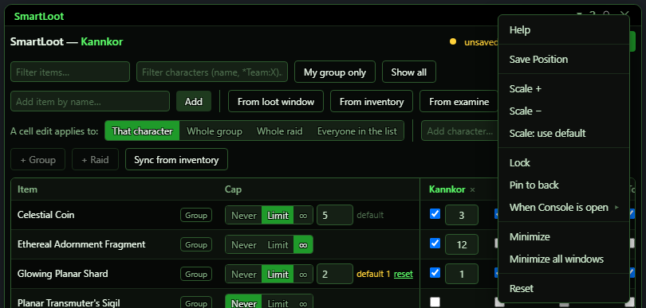
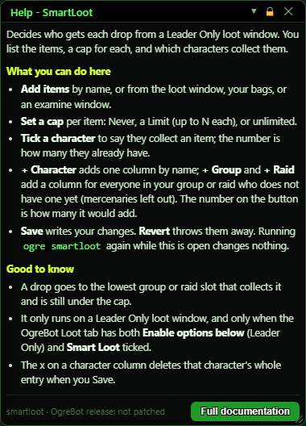

# The basics

**OgreBot is in beta testing.** Looking for OgreBot Classic? [Click here](../index.md).

Every OgreBot window works the same way. This page covers what they all share.

## The title bar

| Part | What it does |
|---|---|
| **Title** | The window's name. Drag it to move the window. Double-click it to minimize or restore the window. |
| **▼ / ▲** | Minimizes the window: it rolls up to its title bar where it is, so you can get to the game or another window quickly. Click **▲** to restore it to exactly the size it had. Some windows keep a line showing while minimized - the Instance Controller keeps its run status and a Pause button. A window always opens at its normal size; being minimized is not remembered. A few windows do not have it: OgreBot's small toolbar, and the Effect Tracker, which has its own Shrink button. |
| **?** | Opens a short help box for this window. Its **Full documentation** button opens this guide. |
| **Lock** | Click it to lock the window, and again to unlock it. A locked window cannot be moved or resized, and the padlock is lit while it is locked. Locking remembers the window's place, so it opens there, still locked, next time. |
| **X** | Closes the window. |

Some windows put extra buttons in the title bar too, for example a gear for settings.

## The right-click menu

Right-click a window's title bar for this menu:

| Item | What it does |
|---|---|
| **Help** | The same as the **?** button. |
| **Save Position** | Remembers where the window is and how big it is. It opens there next time. |
| **Scale + / Scale -** | Makes this window bigger or smaller. |
| **Scale: use default** | Goes back to the size set in Ogre Options. |
| **Lock / Unlock** | Stops the window from being moved or resized, or allows it again. Like the padlock, it is remembered for next time. |
| **Pin to back / Unpin from back** | A pinned window always stays behind every window that is not pinned, even when you click it. Remembered for next time. |
| **When Console is open** | A sub-menu: what this window does when the InnerSpace console opens over it - **Use default**, **Slide below**, **Hide** or **Leave in place**. **Use default** follows the choice in Ogre Options (named in brackets); the other three are this window's own, whatever Ogre Options says. The ticked one is in force. Remembered for next time. |
| **Minimize / Restore** | The same as the **▼ / ▲** button. |
| **Minimize all windows / Restore all windows** | Minimizes every Ogre window that is open, or - once they all are - restores them all. |
| **Reset** | Puts the window back where it first opened, at its first size, turns off Lock and Pin to back, sets Console back to use default, and restores it if it was minimized. |

## The help box

The help box sits next to the window it explains. You can move it and close it like any other window.

## Resizing

Drag the right edge, the bottom edge, or the bottom-right corner of a window to resize it.
