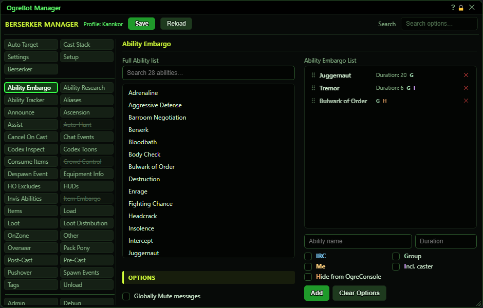
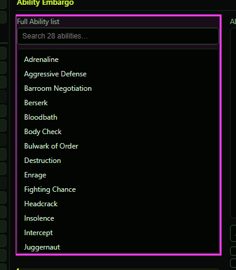
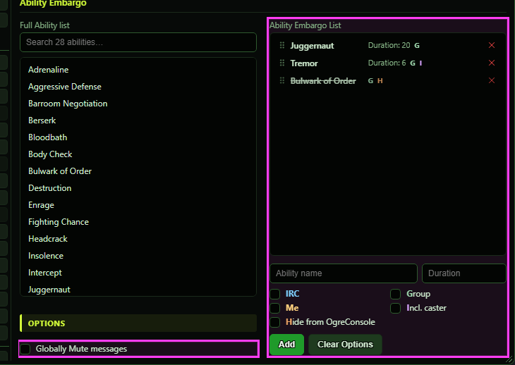

# Ability Embargo

**OgreBot is in beta testing.** Looking for OgreBot Classic? [Click here](../../index.md).

Not active yet in the new bot. You can build and save the list, but nothing acts on it. The tab is for abilities that only one of your characters should use at a time. When this character casts an ability on the list, the bot will tell your other characters not to cast that same ability for a set time (the Duration, or the ability's own duration if left blank). To build the list, click an ability on the left, set the options in the form under the Ability Embargo List, then press Add. Click a row on the right to change it, double-click a row to switch it off, drag a row to move it, and use the X to remove it.

## Ability Embargo

| Option | What it does | Default |
|---|---|---|
| **Full Ability list** | **Not active yet.** All of this character's abilities. Click one to put it in the form under the Ability Embargo List, or double-click it to add it straight to the list with no options. The search box above filters it. *The tab is not active yet, so nothing on the list is used.* | your abilities |

## Options

| Option | What it does | Default |
|---|---|---|
| **Globally Mute messages** | **Not active yet.** It will send every embargo message from this tab without showing it in OgreConsole, as if every row had Hide from OgreConsole ticked. *Some Instance Controller setups tick it for you.* | off |
| **Ability Embargo List** | **Not active yet.** Your saved embargo rows, each with its duration and option letters (IRC, G, Me, I, H). Click a row to load it into the form below and change it, double-click to switch it off, drag to reorder, X to remove. | empty |

## Add form (under the list)

| Control | What it does | Default |
|---|---|---|
| **Ability name** | The ability for the new row. Clicking an ability on the left fills it in, or you can type and pick from the suggestions. |  |
| **Duration** | **Not active yet.** How many seconds your other characters should hold off. Leave it blank to use the ability's own duration. | blank |
| **IRC** | **Not active yet.** Will also send the embargo over IRC, to characters on other computers. | off |
| **Group** | **Not active yet.** Will send the embargo only to characters in this character's group. | off |
| **Me** | **Not active yet.** Will stop only this character from recasting the ability for the duration. Nothing is sent to anyone else. | off |
| **Incl. caster** | **Not active yet.** Will add who cast it and the ability name to the embargo message. | off |
| **Hide from OgreConsole** | **Not active yet.** Will send the embargo message without showing it in OgreConsole. It still reaches your other characters. | off |
| **Add** | Adds the ability in the form, with the Duration and ticks you set, to the Ability Embargo List. Pressing Enter in a box does the same. After you click a row it becomes Update and saves your changes to that row instead (Cancel backs out). |  |
| **Clear Options** | Unticks every option in the form. Ticks otherwise carry over to the next Add. The Duration box is left as it is. |  |

## Good to know

- This tab does nothing yet in the new bot. The 'Enable Ability Embargo' box on the Settings tab is not read either.
- The embargo command itself already works: the -AbilityEmbargo command (from a script or OgreConsole) stops the named characters casting an ability by its ID for a number of seconds. Only the automatic 'I cast it, so the rest of you hold off' step is missing.

