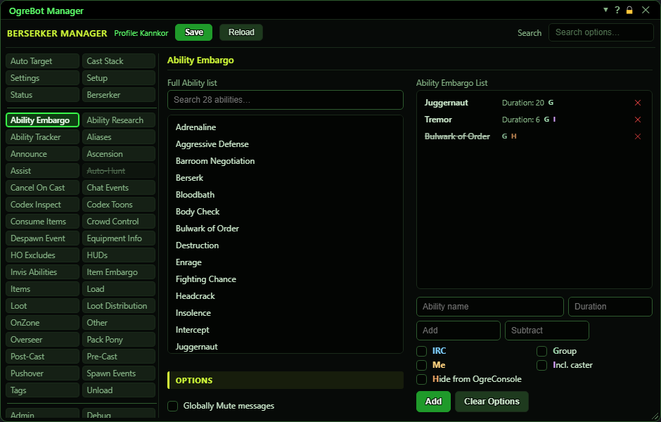
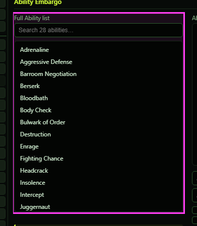
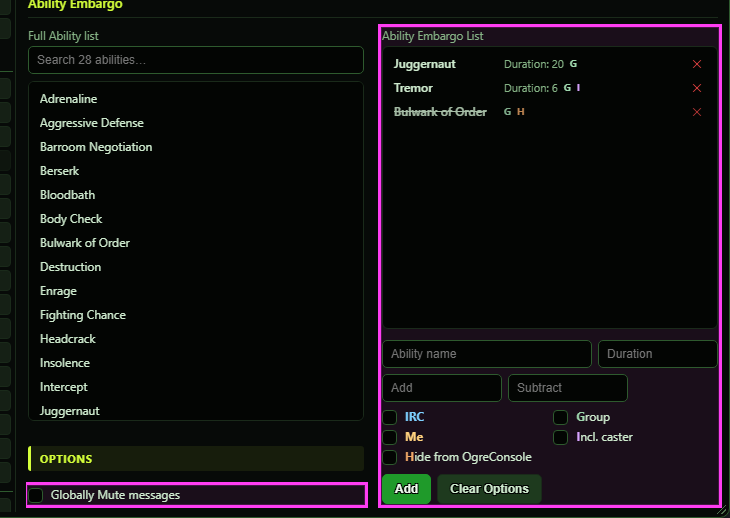

**OgreBot is in beta testing.** Looking for OgreBot Classic? [Click here](../../index.md).

# Ability Embargo

The tab is for abilities that only one of your characters should use at a time. When this character casts an ability on the list, it tells your other characters not to cast that same ability for a set time (the Duration, or the ability's own duration if left blank). It works while 'Enable Ability Embargo' is ticked on the Settings tab, on the character that casts it and on the ones that should hold off. To build the list, click an ability on the left, set the options in the form under the Ability Embargo List, then press Add. Click a row on the right to change it, double-click a row to switch it off, drag a row to move it, and use the X to remove it.

## Ability Embargo

| Option | What it does | Default |
|---|---|---|
| **Full Ability list** | All of this character's abilities. Click one to put it in the form under the Ability Embargo List, or double-click it to add it straight to the list with no options. The search box above filters it. | your abilities |

## Options

| Option | What it does | Default |
|---|---|---|
| **Globally Mute messages** | Sends every embargo from this tab without showing it in OgreConsole, as if every row had Hide from OgreConsole ticked. Nothing is stopped: the embargo still goes out, over IRC too if the row has IRC ticked. *Some Instance Controller setups tick it for you.* | off |
| **Ability Embargo List** | The abilities that are embargoed when you cast them, each with its Duration and options. When you cast an ability on this list, the other characters hold off that ability for its Duration. Click a row to load it into the form below and change it, double-click to switch it off, drag to reorder, X to remove. | empty |

## Add form (under the list)

| Control | What it does | Default |
|---|---|---|
| **Ability name** | The ability for the new row. Clicking an ability on the left fills it in, or you can type and pick from the suggestions. |  |
| **Duration** | How many seconds your other characters should hold off. Leave it blank to use the ability's own duration. | blank |
| **Add** | Seconds added to the duration, for example to hold off a little longer than the ability's own duration. | blank |
| **Subtract** | Seconds taken off the duration, for example so the next character is ready just before the first one's runs out. | blank |
| **IRC** | Also sends the embargo over IRC, to characters on other computers. | off |
| **Group** | Sends the embargo only to characters in this character's group. | off |
| **Me** | Stops only this character from recasting the ability for the duration. Nothing is sent to anyone else. | off |
| **Incl. caster** | Adds who cast it and the ability's name to the end of the embargo line, so anyone reading OgreConsole or IRC can see where it came from. | off |
| **Hide from OgreConsole** | Sends the embargo without showing it in OgreConsole. It still reaches your other characters. | off |
| **Add** | Adds the ability in the form, with the Duration and ticks you set, to the Ability Embargo List. Pressing Enter in a box does the same. After you click a row it becomes Update and saves your changes to that row instead (Cancel backs out). |  |
| **Clear Options** | Unticks every option in the form. Ticks otherwise carry over to the next Add. The Duration box is left as it is. |  |

## Good to know

- Nothing is sent unless 'Enable Ability Embargo' (Settings tab) is ticked on the character that casts the ability. The characters that should hold off need it ticked too, or they ignore the embargo.
- A row is matched by the ability, whatever its rank, and the embargo is sent by name, so a character with a different rank of it holds off too.
- An instant ability sends when it is cast. An ability with a cast time sends when the cast bar shows it, so a cast that never started sends nothing. If something makes it instant, so there is no cast bar, it sends once the ability is seen on cooldown, up to 3 seconds later. Casting a listed ability by hand counts too, if it shows on the cast bar.
- If a row has no Duration and the ability has none of its own (some last until cancelled), nothing is sent and the console says so. Give the row a Duration.
- The embargo is sent with the -AbilityEmbargo command, so you can watch it go out in OgreConsole (unless Hide from OgreConsole or Globally Mute is ticked). The character that cast the ability gets it too, as in the old bot. You can also send one yourself: -AbilityEmbargo takes an ability name or an ID.
- Loading a profile clears every ability and item embargo still running on that character.

