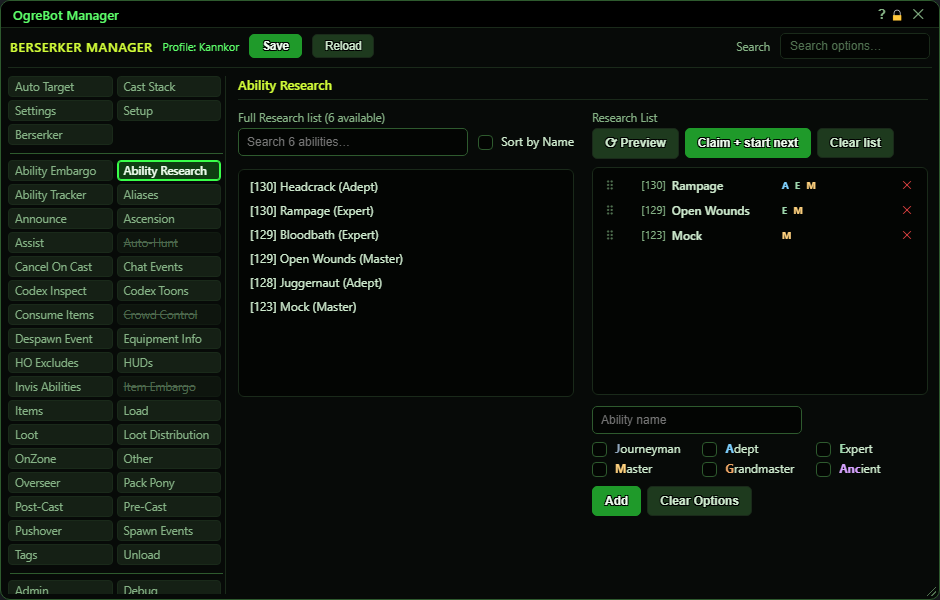

# Ability Research

**OgreBot is in beta testing.** Looking for OgreBot Classic? [Click here](../../index.md).

The game's Knowledge window can research one ability upgrade at a time, and each one takes days. This tab keeps a priority list of the abilities you want researched and which tiers you want. When it runs, the bot opens the Knowledge window, claims any finished research, and starts the first row on your list that the game offers at a tier you ticked. It runs by itself when your profile loads and 30 seconds after a 'Research of ... has been completed' message, unless 'Do not check Research on load' is ticked on the Settings tab. The left list shows what the game offers right now: press Preview to fill it. Click an ability there, tick the tiers you want, and press Add. On the right, drag rows to set priority (top first), click a row to change it, double-click to switch it off, and use the X to remove it.

| Option | What it does | Default |
|---|---|---|
| **Sort by Name** | Sorts the left list A to Z. When unticked it is sorted by level, highest first. Display only - it changes what you see, not what the bot does. *It sits beside the search box, which only appears once the list has entries.* | off |
| **Full Research list** | What the game's research window is offering right now. Each row reads like '[097] Kick IV (Adept)': the level, the ability, and the tier researching it would give. Click one to put it in the form on the right, or double-click to add it straight to your list with no tiers ticked. *The label shows '(press Preview)' while empty and '(N available)' once filled.* | empty until Preview, Claim + start next or a profile load fills it |
| **Research List** | Your research priorities, top first. Each row shows the ability's level, its name and the tiers you want (J, A, E, M, G, Anc). Drag to reorder, click to change, double-click to switch a row off, X to remove. *A switched-off row is skipped.* | empty |

## Full Research list (left)

| Control | What it does |
|---|---|
| **Search ... abilities** | Type to filter the left list. Display only. |

## Research List (right)

| Control | What it does |
|---|---|
| **Preview** | Opens the Knowledge window, fills the left list with what is on offer, and reports in the console what it would claim and start. It claims and starts nothing, then closes the window. |
| **Claim + start next** | Does it for real: claims any finished research, then, if nothing is being researched, starts the first enabled row on your list that the game offers at a tier you ticked. Research takes days. *Posts 'Researching ...' (or 'NO RESEARCH STARTED...') to OgreConsole.* |
| **Clear list** | Removes every row from your Research List after asking you to confirm. Your abilities are not touched. |

## Add form (under the list)

| Control | What it does | Default |
|---|---|---|
| **Ability name** | The ability for the new row. Clicking an ability on the left fills it in, or you can type and pick from the suggestions. It must be the full name with its rank, for example 'Kick IV'. |  |
| **Journeyman** | Research this ability when the upgrade on offer is to Journeyman. | off |
| **Adept** | Research this ability when the upgrade on offer is to Adept. | off |
| **Expert** | Research this ability when the upgrade on offer is to Expert. | off |
| **Master** | Research this ability when the upgrade on offer is to Master. | off |
| **Grandmaster** | Research this ability when the upgrade on offer is to Grandmaster. | off |
| **Ancient** | Research this ability when the upgrade on offer is to Ancient. | off |
| **Add** | Adds the ability in the form, with the tiers you ticked, to the bottom of your Research List. After you click a row it becomes Update and saves your changes to that row instead (Cancel backs out). |  |
| **Clear Options** | Unticks all six tiers in the form. Otherwise the ticks carry over to the next Add. |  |

## Good to know

- A tier tick means 'research it TO this tier', and only the tiers you tick. Ticking Expert and Ancient researches upgrades to Expert or Ancient but skips Master and Grandmaster, for example because you craft those yourself.
- A row with no tier ticked is never researched. Double-clicking an ability on the left adds it with no tiers, so click the row afterwards and tick some.
- Rows match the ability's full name, rank included, so 'Kick IV' is not 'Kick V'. The number in brackets on each row is its level. '[--]' means the ability is not in this character's ability export, usually because it is out of date or from another character. 'Clear list' empties the list so you can start again.
- If nothing on your list can be started, the bot posts 'NO RESEARCH STARTED. Review Ability Research Tab' to OgreConsole.
- The tier ticks stay ticked after Add, so you can add several abilities with the same tiers. 'Clear Options' unticks them.

