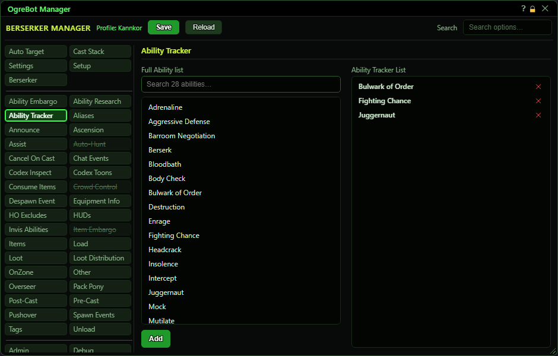

# Ability Tracker

**OgreBot is in beta testing.** Looking for OgreBot Classic? [Click here](../../index.md).

Ability Tracker watches the cooldowns of a short list of your abilities and shares them with all your characters. Its main use is the OgreMCP window: a button that casts a tracked ability turns red and counts down its cooldown, based on whichever of your characters has the longest wait for it. It only runs while 'Enable Ability Tracker' is ticked on the Settings tab. To add an ability, click it in the Full Ability list and press Add, or double-click it. On the right, double-click a row to switch it off, or use the X to remove it.

| Option | What it does | Default |
|---|---|---|
| **Full Ability list** | All of this character's abilities. Click one to select it for the Add button below, or double-click it to add it to the Ability Tracker List straight away. | your abilities |
| **Ability Tracker List** | The abilities whose cooldowns are tracked, shown A to Z. Twice a second the bot reads how long each has left and shares it with your other characters, and the OgreMCP window shows it on matching buttons. Double-click a row to switch it off, X to remove. *Needs 'Enable Ability Tracker' on the Settings tab.* | empty |

## Full Ability list (left)

| Control | What it does |
|---|---|
| **Search ... abilities** | Type to filter the ability list. Display only. |
| **Add** | Adds the ability you clicked in the list above to the Ability Tracker List. It is greyed out until you click one, and the name you picked is shown beside it. |

## Good to know

- Nothing happens until 'Enable Ability Tracker' is ticked on the Settings tab.
- An MCP button only lights up if its cast command names the ability without its rank, for example 'Kick' and not 'Kick VII'. The tracker matches on the plain name.
- Keep the list short. Every ability on it is checked twice a second and sent to your other characters.
- An ability this character does not have (not in its ability export) is skipped without a message.

