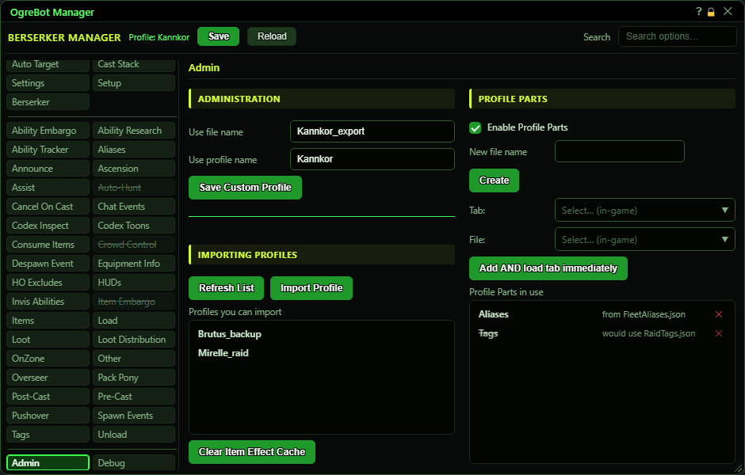
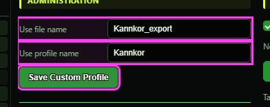
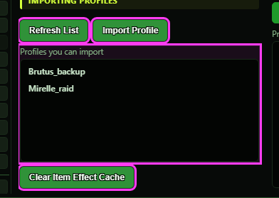
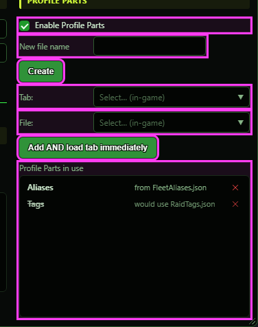

# Admin

**OgreBot is in beta testing.** Looking for OgreBot Classic? [Click here](../../index.md).

Admin is for sharing profiles and for Profile Parts. The left side saves a shareable copy of your current profile, and imports profiles other people give you. The right side, Profile Parts, lets several characters share one tab's settings: you point a tab (for example the Cast Stack) at a shared file, and every character pointed at that file reads and saves that tab there. The Clear Item Effect Cache button makes the bot look at your usable items again.

## Administration

| Option | What it does | Default |
|---|---|---|
| **Use file name** | The file name for the shareable copy, without .json. Leave blank to use 'SingleProfile' plus your class, for example SingleProfileBerserker. *No slashes or '..' allowed.* | empty |
| **Use profile name** | The profile name stored inside the shareable copy. This is the name the other person sees after importing it. Leave blank to use your class name. | empty |
| **Save Custom Profile** | Writes a shareable copy of the profile you are running to Scripts\OgreSave\EQ2\OgreBot\Profiles\Samples\<file name>.json. Your Aliases and Relay Groups are left out. *Refuses if that file already exists.* |  |

## Importing Profiles

| Option | What it does | Default |
|---|---|---|
| **Refresh List** | Reads the Profiles\Import folder again and shows the files you can import in the list below. *The list does not update by itself; press this after dropping in a file.* |  |
| **Import Profile** | Imports the file selected in the list below: every profile in it is added next to yours (renamed with _1, _2 if the name is taken) and not loaded. With nothing selected it says so and does nothing. |  |
| **Profiles you can import** | The .json files in Scripts\OgreSave\EQ2\OgreBot\Profiles\Import. Click a name to select it (it is highlighted), then press Import Profile. Click it again to clear the selection. | empty until you press Refresh List |
| **Clear Item Effect Cache** | Forgets everything the bot learned about what your usable items do, then examines the items on your Cast Stack again right away. Use it when an item's effect changed or was read wrong. *The cache is shared by every character on this PC.* |  |

## Profile Parts

| Option | What it does | Default |
|---|---|---|
| **Enable Profile Parts** | Master switch. On: each tab listed below loads from, and saves to, its shared file. Off: every tab uses your own profile, and the list is kept for later. *Takes effect at once by reloading your profile. Save your other changes first.* | off |
| **New file name** | Name for a new, empty shared file, without .json. | empty |
| **Create** | Creates the empty shared file Profiles\Shared\<name>.json so it appears in the File list. *Refuses if a file with that name already exists; pick it from the File list instead.* |  |
| **Tab:** | Which part of your profile to share: the list shows your profile's saved sections, one per tab. | empty |
| **File:** | Which shared file that tab should use: the files in Profiles\Shared. | empty |
| **Add AND load tab immediately** | Points the chosen tab at the chosen file and reloads your profile, so that tab now shows and saves the shared settings. Choosing a tab that is already listed moves it to the new file. *Needs Enable Profile Parts ticked to have any effect.* |  |
| **Profile Parts in use** | Each shared tab and the file it uses ('from <file>.json'). A struck-through row ('would use') is switched off and uses your own profile. | empty |

## Profile Parts

| Control | What it does |
|---|---|
| **Double-click a row** | Switches that mapping off (the tab goes back to your own profile) or back on. The mapping is kept either way. *Reloads your profile at once.* |
| **x (stop sharing this tab)** | Removes the mapping. The tab goes back to your own profile's settings, which were never changed while it was shared. *Reloads your profile at once. The shared file itself is not deleted.* |

## Good to know

- Save Custom Profile never overwrites. If a file with that name already exists in Profiles\Samples, it refuses; pick another name.
- The shared copy leaves out your Aliases and Relay Groups, because those name your own characters and sessions. Everything else is included as it is right now, including tabs that come from Profile Parts.
- To import, drop the .json file into Scripts\OgreSave\EQ2\OgreBot\Profiles\Import, press Refresh List, click the file's name in the list, then press Import Profile.
- Imported profiles are added next to yours and never replace one. If the name is taken, _1, _2 and so on is added. They are not loaded; pick one from the Profiles menu.
- Profile Parts files live in Scripts\OgreSave\EQ2\OgreBot\Profiles\Shared. Any character pointed at the same file shares that tab: a change saved by one changes it for all of them.
- Every Profile Parts change (Enable, Add, the X, a double-click) takes effect immediately by reloading your profile from its saved files. Unsaved changes on other tabs are lost, so press Save first.
- In the Profile Parts list, double-click a row to switch that mapping off or back on (a struck-through row loads and saves your own profile instead). Hover a row to see this.
- Clear Item Effect Cache clears one file shared by every character on this PC (Scripts\OgreSave\EQ2\OgreBot\ItemEffectDB.json).

