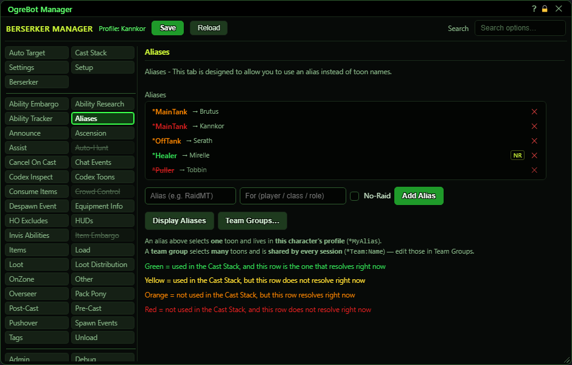

# Aliases

**OgreBot is in beta testing.** Looking for OgreBot Classic? [Click here](../../index.md).

An alias is a nickname for one character, so your setup can say `*MainTank` instead of a real name. Type the alias and who it is for, then Add. The bot puts a star in front, so 'MainTank' becomes `*MainTank`, and you use that in a Cast Stack target or in a command's 'for who'. 'For' can be a character name or a class word (a class, subclass or archetype such as Fury or Priest). The bot checks you first, then your group, then your raid, and picks the first character that fits. Aliases only work while 'Enable Aliases' on the Settings tab is ticked.

| Option | What it does | Default |
|---|---|---|
| **Aliases** | Your aliases, in the order they are tried. Drag to reorder, double-click to switch one off, x to delete. The colour shows whether the alias is used on the Cast Stack and whether this row is the one that wins right now. | empty |

## Add an alias

| Control | What it does | Default |
|---|---|---|
| **Alias (e.g. RaidMT)** | The nickname. The bot adds a star in front, so you use it as `*RaidMT`. | empty |
| **For (player / class / role)** | Who the alias means: a character name, or a class word such as a class, subclass or archetype. The first match wins: you, then your group, then your raid. *An alias with an empty For never points at anyone.* | empty |
| **No-Raid** | Only look in your own group for this alias, never the rest of the raid. | off |
| **Add Alias** | Adds the alias to the end of the list. The same alias name can be added again with a different For, as a backup. *An exact repeat (same alias, same For) is refused with a console message. Press Save to keep it.* |  |
| **Display Aliases** | Prints every alias, and the character each one points to right now, in the console. |  |
| **Team Groups…** | Opens the Team Groups window. A team group is one word (`*Team:Name`) that selects many characters and is shared by every session. |  |

## Good to know

- The alias list is drawn by its own code. Each row shows the alias, an arrow, and who it is for; NR means 'no raid'. Drag a row to reorder, double-click a row to switch it off, and the x deletes it (after a confirm).
- Several rows can share one alias name. The first row, from the top, that finds a character in your group or raid wins, so later rows are backups. Drag rows to choose which one is tried first.
- The name colour tells you two things. Green: used on the Cast Stack, and this row is the one the alias points to now. Yellow: used on the Cast Stack, but a different row (or nobody) wins right now. Orange: not used on the Cast Stack, but this row wins. Red: not used on the Cast Stack, and this row does not win.
- With 'Enable Aliases' (Settings tab) off, no alias resolves: every row shows yellow or red and a line above the list says so.
- Adding, removing or switching an alias off takes effect at once, but it is only kept if you press Save at the top.
- An alias picks ONE character. To aim at several characters with one word, use Team Groups (the button under the list) instead.

