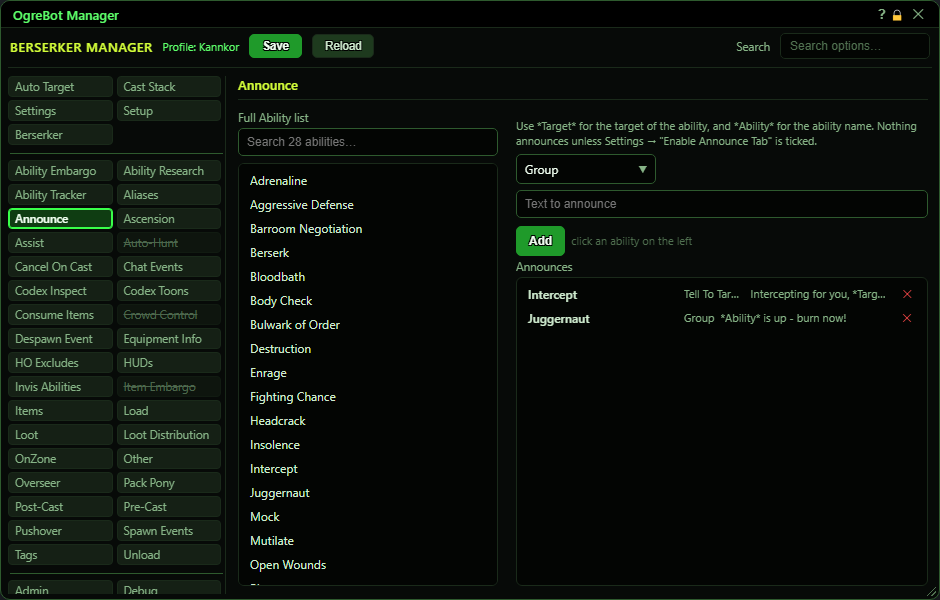

# Announce

**OgreBot is in beta testing.** Looking for OgreBot Classic? [Click here](../../index.md).

Announce says something, or runs a command, whenever one of your abilities goes off. Each row is an ability, where to send it (Group, Raid, a tell to the target, an in-game command or a console command) and the text. In the text, *Target* becomes the name of whoever the ability was cast on and *Ability* becomes the ability's name. Nothing is announced unless 'Enable Announce Tab' on the Settings tab is ticked.

| Option | What it does | Default |
|---|---|---|
| **Full Ability list** | All of this character's abilities. Click one to choose it for the next announce; its name appears next to the Add button. |  |
| **Announces** | Your announce rows, shown as ability, destination and text. Every switched-on row whose ability matches goes out, at any rank. *Click a row to edit it, double-click to switch it off.* | empty |

## Announce

| Control | What it does | Default |
|---|---|---|
| **Announce To** | Where the text goes. Group: group chat. Raid: raid chat. Tell To Target: a tell to whoever the ability was cast on. In-Game Command: runs the text as a game command, so it must start with /. Execute In Console: runs the text as a console command. | Group |
| **Text to announce** | What to say or run. *Target* becomes the target's name and *Ability* the ability's name. *Case matters: *target* is not replaced, and the row is then skipped.* | empty |
| **Add** | Adds a row for the ability you clicked, with this destination and text. When you are editing a row it says Update and saves your changes to that row instead. |  |

## Good to know

- To add a row: click an ability in the Full Ability list (its name shows next to Add), pick 'Announce To', type the text, then press Add or Enter.
- Click a saved row to load it back into the form; the button then says Update, and Cancel leaves it unchanged. Double-click a row to switch it off, and the x removes it. The list is shown A to Z.
- Instant abilities announce when the bot casts them. Abilities with a cast time announce when they appear on your cast bar, which includes casts you make by hand.
- For a cast you made by hand the bot does not know the target, so a row that uses *Target* or 'Tell To Target' is skipped for it.
- *Target* and *Ability* must be typed exactly like that, with the capitals. A text that still contains them, or contains NULL or ${, is not sent.
- 'In-Game Command' text must start with / (for example `/shout *Ability* is up!`). 'Execute In Console' text must NOT start with /; it runs as a console command, for example an `oc` line.
- Group rows only go out while you are grouped, Raid rows only while you are in a raid.
- Only abilities are listed, not items.

