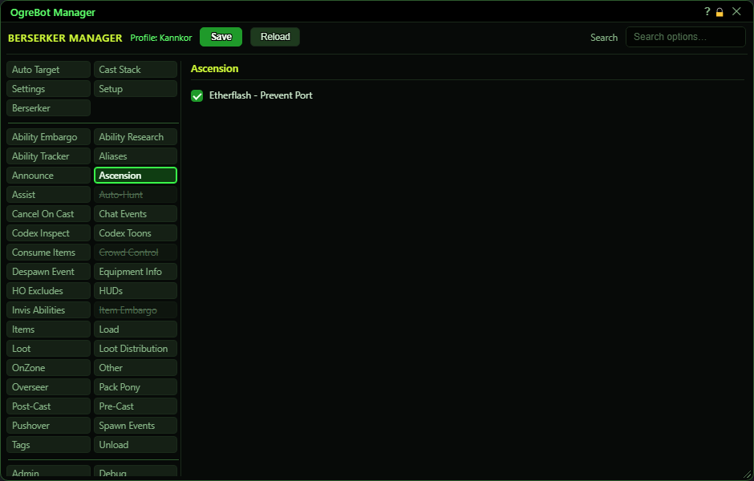

# Ascension

**OgreBot is in beta testing.** Looking for OgreBot Classic? [Click here](../../index.md).

The Ascension tab has one option. Etherflash normally teleports you to your target when it lands. With 'Etherflash - Prevent Port' ticked, the bot targets you yourself just before the cast finishes, so the damage still lands but you do not move. About a second after the cast ends it lets go, and your normal target comes back.

| Option | What it does | Default |
|---|---|---|
| **Etherflash - Prevent Port** | When the bot casts Etherflash, it switches your target to yourself once the cast is over 90% done, so the teleport takes you nowhere. About a second after the cast ends, your normal target returns. *Only for Etherflash casts made by the bot, any rank.* | off |

## Good to know

- It only works when the bot casts Etherflash (for example from the Cast Stack). If you press Etherflash yourself, nothing changes.
- If nothing else is choosing your target (no assist, no auto-target), the bot puts back the target you had before the cast.

