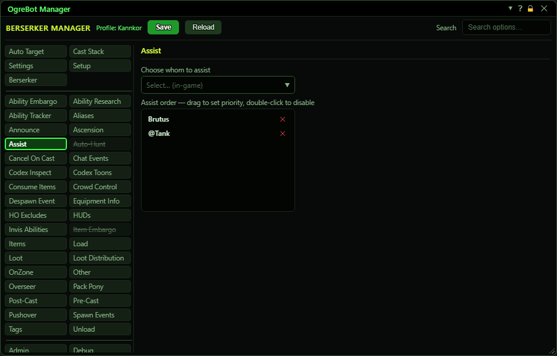

**OgreBot is in beta testing.** Looking for OgreBot Classic? [Click here](../../index.md).

# Assist

Assist tells the bot whose fight to join. Pick people (or aliases such as @Tank) from the dropdown and they go into the Assist order list. While the bot is running, it uses the FIRST person on the list who is in your group or raid and in your zone: it targets that player, so your attacks go at whatever they are fighting. With 'Direct Assist Targeting' on Settings ticked, it targets that player's target directly instead. Drag names to change the priority, double-click a name to switch it off, and click x to remove it.

| Option | What it does | Default |
|---|---|---|
| **Choose whom to assist** | Pick a group or raid member, or an alias such as @Tank, to add them to the bottom of the Assist order list. The dropdown then resets; a name already on the list is not added twice. *The choices are refreshed every time you open the dropdown.* | n/a (it adds a name, it stores nothing itself) |
| **Assist order — drag to set priority, double-click to disable** | The people to assist, in priority order. The bot uses the first one who is in your group or raid and in this zone, and ignores the rest until that person is gone. *Disabled names stay in place (struck through) and are skipped.* | empty |

## Assist

| Control | What it does |
|---|---|
| **Drag a row** | Drag a row up or down to change who is assisted first. |
| **Double-click a row** | Switches that name off or back on. A switched-off name is struck through and skipped, but keeps its place. |
| **x (remove)** | Removes that name from the list. |

## Good to know

- The list is used whenever the bot is running and Auto Target is off, even if 'Auto Assist' on Settings is unticked. To stop assisting, disable or remove the names here.
- When 'Enable Auto Target' is ticked on the Auto Target tab, this list is ignored completely.
- An assist set by the `-assist` command takes priority over this list until it is turned off.
- Someone in your group but in another zone is skipped, and the next name down is used.
- Aliases are looked up each time, so @Tank follows whoever is your tank right now. An alias that points at nobody is skipped.
- Changes take effect straight away. Press Save at the top to keep them after a reload.
- Type `ogre assist` to see who the bot is assisting right now and why.

