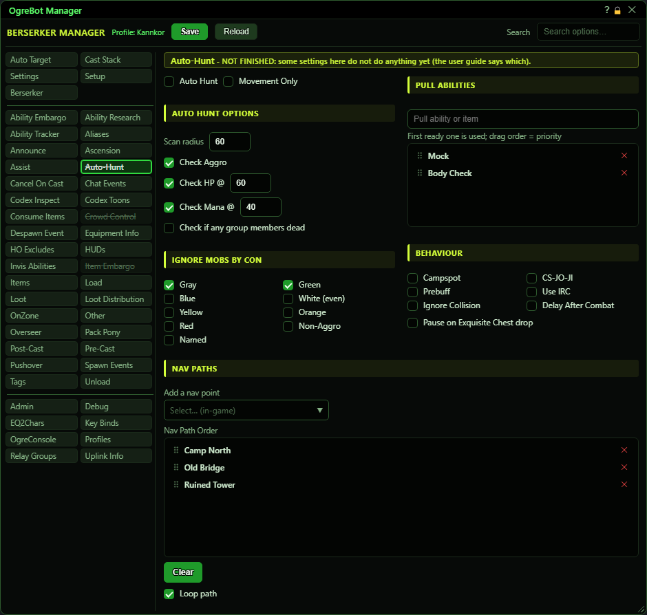
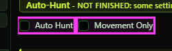
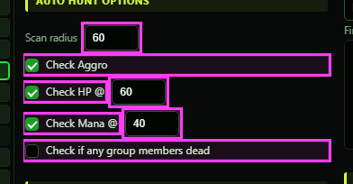
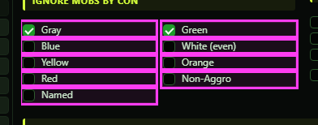
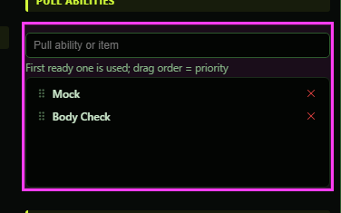
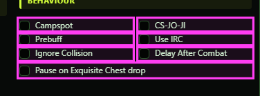
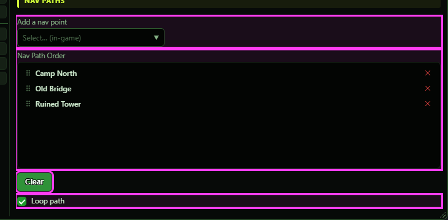

# Auto-Hunt (not finished)

**OgreBot is in beta testing.** Looking for OgreBot Classic? [Click here](../../index.md).

> **:warning: Not finished**
>
> OgreBot marks this tab as not finished (its name is struck through). Some options below work and some do not yet - each one says which.

Auto-Hunt is a simple grinding mode. The bot looks for a mob near you, targets it and opens the fight with the first ready ability from your Pull Abilities list; your Cast Stack then fights as usual. This tab is marked not finished: the mob choice and safety settings work, but the walking part does not. The Auto Hunt and Movement Only boxes and the nav path list do nothing yet, so the bot never walks a route; it pulls what comes within the scan radius. To switch it on, use the OgreConsole command `-autohunt` with hunt, movement or off. It only runs while OgreBot is open with a profile loaded and the bot is not paused.

## Auto-Hunt

| Option | What it does | Default |
|---|---|---|
| **Auto Hunt** | **Not active yet.** It will be the on/off switch for Auto-Hunt. For now, start and stop it with the OgreConsole command `-autohunt` (hunt, movement or off). | off |
| **Movement Only** | **Not active yet.** It will make Auto-Hunt walk without pulling. The command `-autohunt movement` exists, but for now it does not walk anywhere; it only holds you still while a safety check is tripped. | off |

## Auto Hunt Options

| Option | What it does | Default |
|---|---|---|
| **Scan radius (box)** | How far around you the bot looks for a mob to pull, and for mobs attacking your group. Leave it blank to use 35. | empty (35 is used) |
| **Check Aggro** | While anyone in your group (or raid) is in combat, the bot stops pulling and holds still. Your normal combat settings handle the fight. | off |
| **Check HP @** | While anyone in your group (or raid) has less health than the % in the box beside it, the bot stops pulling and holds still. *A group member who is not in the zone counts as low health. A blank box never stops the hunt.* | off |
| **Check HP @ (box)** | The health % used by Check HP @. Only used while Check HP @ is ticked. | empty (never stops the hunt) |
| **Check Mana @** | While anyone in your group (or raid) has less power than the % in the box beside it, the bot stops pulling and holds still. | off |
| **Check Mana @ (box)** | The power % used by Check Mana @. Only used while Check Mana @ is ticked. | empty (never stops the hunt) |
| **Check if any group members dead** | While anyone in your group (or raid) is dead, the bot stops pulling and holds still. *A group member who is not in the zone also counts as dead, so the hunt waits for them to arrive.* | off |

## Ignore mobs by con

| Option | What it does | Default |
|---|---|---|
| **Gray** | The bot never pulls gray-con mobs. *A gray mob already attacking your group is still fought.* | off |
| **Green** | The bot never pulls green-con mobs. | off |
| **Blue** | The bot never pulls blue-con mobs. | off |
| **White (even)** | The bot never pulls white-con (even) mobs. | off |
| **Yellow** | The bot never pulls yellow-con mobs. | off |
| **Orange** | The bot never pulls orange-con mobs. | off |
| **Red** | The bot never pulls red-con mobs. | off |
| **Non-Aggro** | The bot only pulls mobs that would attack you on sight. Mobs that leave you alone are skipped. | off |
| **Named** | The bot never pulls named mobs. *Even when unticked, normal mobs in range are pulled before named ones.* | off |

## Pull Abilities

| Option | What it does | Default |
|---|---|---|
| **First ready one is used; drag order = priority** | Your pull list. When the bot has a mob targeted and you are out of combat, it uses the first entry from the top that is ready. Type in the box above to find one of your abilities or items; picking it adds it. Drag rows to change the order, double-click a row to switch it off or on. *With an empty list the bot targets mobs but never pulls them.* | empty |

## Behaviour

| Option | What it does | Default |
|---|---|---|
| **Campspot** | When the bot finds a mob to pull, it sets a camp spot where you stand and holds you there for the fight. When no mob is left, it clears that camp spot again. *It only sets and clears this character's own camp spot, not the group's.* | off |
| **CS-JO-JI** | Right now this does exactly the same as Campspot. | off |
| **Prebuff** | Before each pull, the bot targets you, turns auto-attack on and waits 3 seconds, so your normal buffs have time to go out. Then it targets the mob. *It does not cast buffs itself; your Cast Stack does that.* | off |
| **Use IRC** | **Not active yet.**  | off |
| **Ignore Collision** | Normally the bot skips mobs it cannot see (a wall or hill in the way). Tick this to let it pull those too. | off |
| **Delay After Combat** | **Not active yet.**  | off |
| **Pause on Exquisite Chest drop** | While an Exquisite chest is lying within 50 of you, the bot stops pulling and holds still, so you can deal with it. *It carries on by itself once the chest is gone.* | off |

## Nav Paths

| Option | What it does | Default |
|---|---|---|
| **Add a nav point** | **Not active yet.** It will list named places in the zone to add to the route; for now the list is always empty. *Opened, it says 'No named nav points yet - not built in the new bot'.* | empty |
| **Nav Path Order** | **Not active yet.** It will hold the route Auto-Hunt walks, in order. It is saved with your profile, but nothing uses it. | empty |
| **Clear** | Empties the Nav Path Order list. Press Save at the top to keep the change. |  |
| **Loop path** | **Not active yet.** It will make the route start over when it reaches the end. | off |

## Good to know

- Ticking Auto Hunt does not start anything. Use `-autohunt` in OgreConsole (hunt / movement / off). That choice is not saved with your profile, so Auto-Hunt starts off every time the bot is loaded fresh.
- A mob that is already attacking your group is targeted before any new pull, whatever its con. The con, Non-Aggro and Named filters only decide which NEW mob to pull. With 'Check Aggro' ticked the bot instead holds still and leaves that fight to your normal combat settings.
- 'Check if any group members dead' and 'Check HP @' also count a group member who is not in the zone. The hunt waits until they arrive.
- Pulls only happen while you are out of combat, and only if at least one entry in the pull list is ready to use. With an empty list the bot targets a mob and just waits.
- If the Scan radius box is blank, the bot looks 35 around you.
- Movement mode (`-autohunt movement`) does not walk anywhere yet and never pulls. The safety checks still apply in it: while one of them is tripped (Check Aggro, HP, Mana, dead members, Exquisite chest), the bot holds you still.

