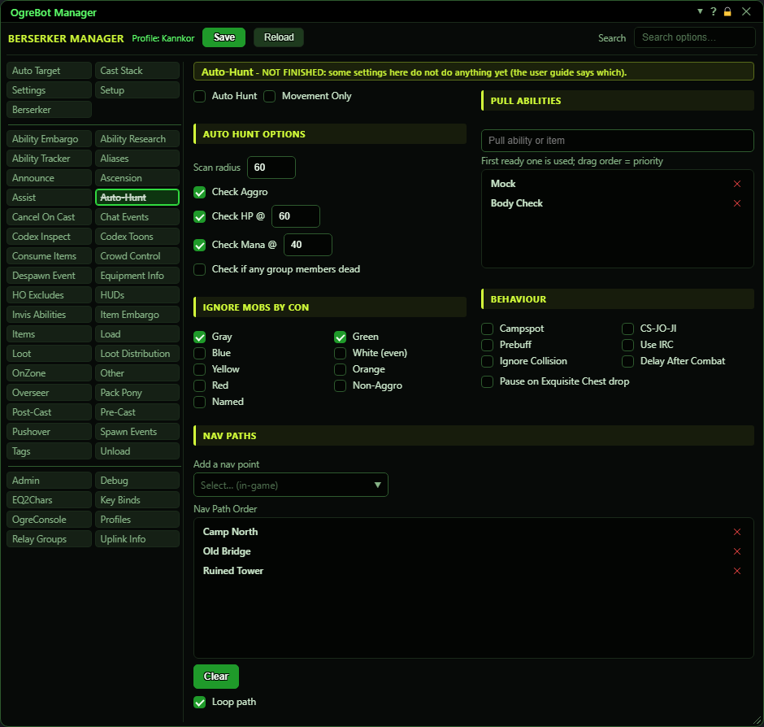
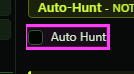
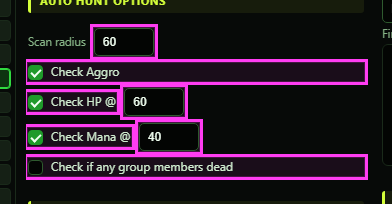
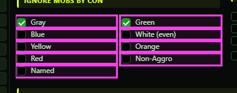
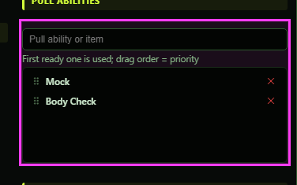
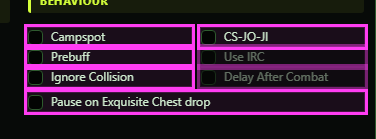
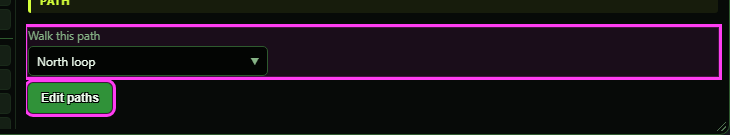

**OgreBot is in beta testing.** Looking for OgreBot Classic? [Click here](../../index.md).

# Auto-Hunt (not finished)

> **:warning: Not finished**
>
> OgreBot marks this tab as not finished (its name is struck through). Some options below work and some do not yet - each one says which.

Auto-Hunt is a simple grinding mode. The bot looks for a mob near you, targets it and opens the fight with the first ready ability from your Pull Abilities list; your Cast Stack then fights as usual. Pick a saved path under Path and it walks that path between pulls; with none picked it pulls what comes within the scan radius. This tab is marked not finished. To switch it on, tick Auto Hunt or use the OgreConsole command `-autohunt` with hunt or off. It only runs while OgreBot is open with a profile loaded and the bot is not paused.

## Auto-Hunt

| Option | What it does | Default |
|---|---|---|
| **Auto Hunt** | Ticked, Auto-Hunt runs on this character: scan, camp, prebuff, pull, and walk the path picked below between pulls. Switching it on tells the rest of your group to follow you (OgreFollow, through OgreConsole); switching it off leaves them following. It pulls nothing while you fly, and pulls again once you land. The same switch as the OgreConsole command `-autohunt` (hunt or off). It never loads ticked: a profile always starts with it off. | off |

## Auto Hunt Options

| Option | What it does | Default |
|---|---|---|
| **Scan radius (box)** | How far around you the bot looks for a mob to pull, and for mobs attacking your group. Leave it blank to use the longest reach among your pull abilities (35 if none has a reach on file). A pull is only used on a mob it can reach. | empty (the longest pull reach) |
| **Check Aggro** | While anyone in your group (or raid) is in combat, the bot stops pulling and holds still. Your normal combat settings handle the fight. | off |
| **Check HP @** | While anyone in your group (or raid) has less health than the % in the box beside it, the bot stops pulling and holds still. *A group member who is not in the zone counts as low health. A blank box never stops the hunt.* | off |
| **Check HP @ (box)** | The health % used by Check HP @. Only used while Check HP @ is ticked. | empty (never stops the hunt) |
| **Check Mana @** | While anyone in your group (or raid) has less power than the % in the box beside it, the bot stops pulling and holds still. | off |
| **Check Mana @ (box)** | The power % used by Check Mana @. Only used while Check Mana @ is ticked. | empty (never stops the hunt) |
| **Check if any group members dead** | While anyone in your group (or raid) is dead, the bot stops pulling and holds still. *A group member who is not in the zone also counts as dead, so the hunt waits for them to arrive.* | off |

## Ignore mobs by con

| Option | What it does | Default |
|---|---|---|
| **Gray** | The bot never pulls gray-con mobs. *A gray mob already attacking your group is still fought.* | off |
| **Green** | The bot never pulls green-con mobs. | off |
| **Blue** | The bot never pulls blue-con mobs. | off |
| **White (even)** | The bot never pulls white-con (even) mobs. | off |
| **Yellow** | The bot never pulls yellow-con mobs. | off |
| **Orange** | The bot never pulls orange-con mobs. | off |
| **Red** | The bot never pulls red-con mobs. | off |
| **Non-Aggro** | The bot only pulls mobs that would attack you on sight. Mobs that leave you alone are skipped. | off |
| **Named** | The bot never pulls named mobs. *Even when unticked, normal mobs in range are pulled before named ones.* | off |

## Pull Abilities

| Option | What it does | Default |
|---|---|---|
| **First ready one is used; drag order = priority** | Your pull list. When the bot has a mob targeted and you are out of combat, it uses the first entry from the top that is ready. Type in the box above to find one of your abilities or items; picking it adds it. Drag rows to change the order, double-click a row to switch it off or on. *With an empty list the bot targets mobs but never pulls them.* | empty |

## Behaviour

| Option | What it does | Default |
|---|---|---|
| **Campspot** | When the bot finds a mob to pull, the whole group camps at your spot and holds there for the fight. A new pull from the same spot sends nothing. When no mob has been in reach for 1.5 seconds, the group is let go and follows you again; turning Auto Hunt off or pausing the bot lets it go too. *It switches 'Allow Camp Spot' on for each toon. The rest of the group is let go with a full LetsGo. A toon more than 125 from your spot is not pulled in: it stands where it is until the group moves on, and one line in the console names it. Only toons on this PC are reached (OgreConsole).* | off |
| **CS-JO-JI** | Like Campspot, and the casters stay at the camp while the rest of the group may leave it to fight. Campspot wins if both are ticked. | off |
| **Prebuff** | Before each pull, the bot targets you, turns auto-attack on and waits 3 seconds, so your normal buffs have time to go out. Then it targets the mob. *It does not cast buffs itself; your Cast Stack does that.* | off |
| **Use IRC** | **Not built yet.**  | off |
| **Ignore Collision** | Normally the bot skips mobs it cannot see (a wall or hill in the way). Tick this to let it pull those too. *It looks from your eye height to the mob's, the same check your pull ability must pass to be cast.* | off |
| **Delay After Combat** | **Not built yet.**  | off |
| **Pause on Exquisite Chest drop** | While an Exquisite chest is lying within 50 of you, the bot stops pulling and holds still, so you can deal with it. *It carries on by itself once the chest is gone.* | off |

## Path

| Option | What it does | Default |
|---|---|---|
| **Walk this path** | Which of this zone's saved paths Auto-Hunt walks between pulls. It stops for each pull and carries on at the same point. A walk that ended or could not start stays ended: pick the path again to walk it. Choose (none) to hunt where you stand. The list is the zone you are in: another zone has its own. *A name saved for another zone gets one line here, and the bot hunts where it stands.* | (none) |
| **Edit** | Opens the picked path in the Paths window, where you add, insert, drag and remove its points: `ogre paths <path>`. With (none) picked, the window opens with no path selected. A picked path this zone does not have gets one line. |  |

## Good to know

- The Auto Hunt box and `-autohunt` in OgreConsole (hunt / off) are one switch. It is not saved with your profile, so Auto-Hunt starts off every time the bot is loaded fresh.
- A mob that is already attacking your group is targeted before any new pull, whatever its con. The con, Non-Aggro and Named filters only decide which NEW mob to pull. With 'Check Aggro' ticked the bot instead holds still and leaves that fight to your normal combat settings.
- 'Check if any group members dead' and 'Check HP @' also count a group member who is not in the zone. The hunt waits until they arrive.
- Pulls only happen while you are out of combat, and only if at least one entry in the pull list is ready to use. With an empty list the bot targets a mob and just waits, and one line in the console says so.
- If the Scan radius box is blank, the bot looks 35 around you.
- A mob it picks stays picked until a different answer has held for 0.3 seconds, so a mob that blinks out of sight for a moment does not stop and start the hunt.
- Auto-Hunt only walks: it never flies a path, whatever the Nav window's fly setting, and a toon in the air lands first. A point no walking route reaches ends the walk with a line naming it. It stops walking for each pull, for a tripped safety check, for anything that attacks it and while it is dead, then carries on at the same point. A path that ends, is ended by a zone, or cannot start is not tried again until you pick it again in the list or send `-autohunt hunt`; the bot hunts where it stands.
- Auto-Hunt pulls nothing while you fly: no pull, no target, no camp and no safety hold, and a pull it was working ends. One line in the console says so as you take off. Its own walk lands first and then pulls; a walk you started yourself flies on.
- The group: switching Auto Hunt on makes the rest of your group follow you. With Campspot or CS-JO-JI ticked, each pull camps everyone at your spot (not where each toon happens to stand), nothing more goes out during the fight, and when no mob has been in reach for 1.5 seconds they are let go and follow you again. Only a pull more than 5 from the held spot sends the spot again. Death holds everything as it is; a zone forgets the camp without sending anything.
- A walk with no hunting is the Start button of the `ogre paths` window. Hunting does not end a walk you started, and that walk waits while the bot works a pull, but never in the air.

