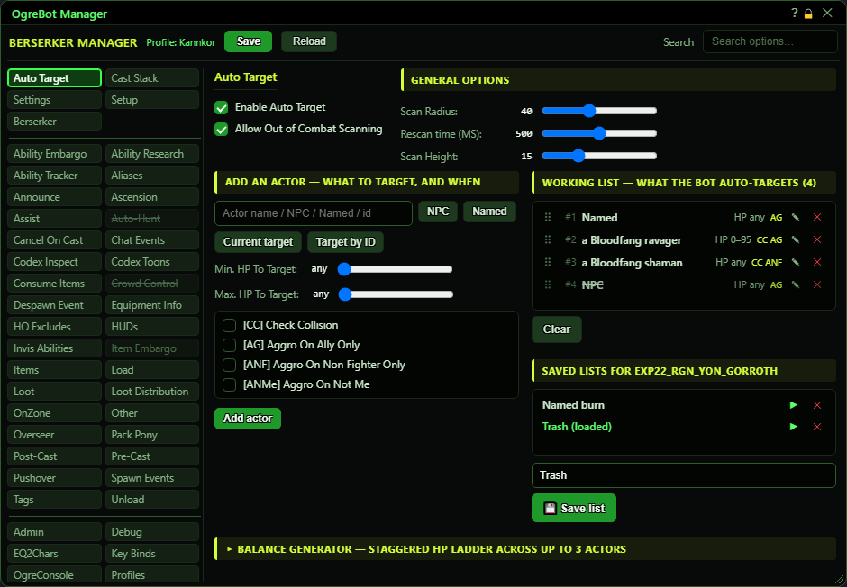
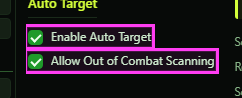
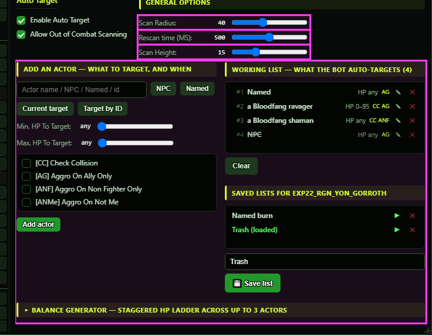

# Auto Target

**OgreBot is in beta testing.** Looking for OgreBot Classic? [Click here](../../index.md).

Auto Target lets the bot pick its own targets from a list, instead of assisting someone. Tick 'Enable Auto Target' and build the working list: each row says what to target (a name, NPC, Named or an actor ID) plus optional health limits and aggro rules. About three times a second the bot goes down the list from the top, and the first row that matches any nearby mob wins; it targets that mob, or keeps your current target if it also matches that row. The left half of the editor builds a row (type or fill the name, set the HP sliders and tick boxes, press Add actor). The right half is the working list, and under it the lists saved for this zone, which you can load, save and delete. The collapsed Balance generator at the bottom adds a ladder of rows that spreads your damage across up to three mobs.

## Auto Target

| Option | What it does | Default |
|---|---|---|
| **Enable Auto Target** | The bot picks its own targets from the working list below instead of assisting. It targets the first nearby match for the highest row on the list, and keeps your current target if it matches that same row. *While on, the Assist tab list is ignored.* | off |
| **Allow Out of Combat Scanning** | Lets Auto Target pick a target while nothing is fighting you. Unticked, it only picks once a mob has aggro on you or you are in combat. *It only stops new picks; your current target is kept.* | off |

## General Options

| Option | What it does | Default |
|---|---|---|
| **Scan Radius:** | How far Auto Target looks for targets, measured straight-line around you. | 0 (counts as 50) |
| **Rescan time (MS):** | Not used by the new bot. Auto Target re-checks every 0.25 seconds whatever this says - a fixed rate, fast enough for every fight. | 0 |
| **Scan Height:** | Only mobs whose height differs from yours by less than this are considered, so mobs on a floor above or below are ignored. | 0 (counts as 5) |
| **Auto-Target List Editor** | The editor below: build rows on the left, the working list and this zone's saved lists on the right, and the Balance generator underneath. | empty |

## Add an actor

| Control | What it does | Default |
|---|---|---|
| **Actor name / NPC / Named / id** | What this row matches. Any part of a name matches (not case-sensitive). 'NPC' means any ordinary mob, 'Named' any named mob, and a number matches that one actor ID. *Add actor does nothing while this box is empty.* |  |
| **NPC** | Puts 'NPC' in the name box: match any ordinary (not named) mob. |  |
| **Named** | Puts 'Named' in the name box: match any named mob. |  |
| **Current target** | Puts your current target's name in the name box. Nothing is added until you press Add actor. *With nothing targeted you get the message 'AutoTarget: no current target'.* |  |
| **Target by ID** | Puts your current target's actor ID in the name box, so the row matches only that one spawn. |  |
| **Min. HP To Target:** | Only match mobs whose health is at or above this percent. 'any' (0) means no lower limit. | any |
| **Max. HP To Target:** | Only match mobs whose health is below this percent. 'any' (0) means no upper limit. *At 100, a mob at full health does not match, because it must be below the value.* | any |
| **[CC] Check Collision** | Only match mobs you have a clear line of sight to. | off |
| **[AG] Aggro On Ally Only** | Only match mobs that are targeting someone in your group. | off |
| **[ANF] Aggro On Non Fighter Only** | Only match mobs that are targeting a player who is not a fighter class. | off |
| **[ANMe] Aggro On Not Me** | Skip mobs that are targeting you. | off |
| **Add actor** | Adds a row with these settings to the bottom of the working list; the bot uses it straight away. While editing a row it adds a NEW row, leaves the edited one alone and keeps your settings in the form. |  |
| **Update actor** | Only while editing: replaces the selected row with these settings and leaves edit mode. |  |
| **Cancel** | Only while editing: leaves edit mode without changing the row and clears the form. |  |

## Working list

| Control | What it does | Default |
|---|---|---|
| **Working list — what the bot auto-targets (N)** | The rows Auto Target uses right now, top first. Each row shows its number, the name ('(any)' if blank), the health range ('HP any' or e.g. 'HP 20–80', ∞ for no upper limit) and badges for the ticked options (CC, AG, ANF, ANMe). | empty |
| **Drag a row** | Drag a row up or down to change its priority. |  |
| **Click a row's name** | Loads that row into the form on the left for editing; the row is highlighted. |  |
| **Double-click a row** | Switches that row off or back on. A switched-off row is struck through and skipped, but keeps its place. |  |
| **✎ (edit)** | Loads that row into the form for editing, the same as clicking its name. |  |
| **✕ (remove)** | Removes that row from the working list. |  |
| **Clear** | Empties the working list at once, with no confirmation, and removes the '(loaded)' mark. Your saved lists are not touched. *With the working list empty, the bot falls back to the profile's own auto-target list, if it has one.* |  |

## Saved lists

| Control | What it does | Default |
|---|---|---|
| **Saved lists for <zone>** | The lists saved for the zone you are in. The one currently in the working list is shown in green with '(loaded)'. *They are stored per zone in Scripts\OgreSave\EQ2\OgreBot\AutoTarget\autotarget_<zone>.json; the old bot's lists are read if the new folder has none.* | empty |
| **▶ (load)** | Copies that saved list into the working list, replacing what was there. The bot uses it straight away. |  |
| **✕ (delete)** | Deletes that saved list from this zone's file, after you confirm. |  |
| **Save current list as…** | The name to save the working list under. It starts with the name of the list you loaded. |  |
| **💾 Save list** | Saves the working list to this zone's file under the typed name. A saved list with the same name is overwritten. *Nothing happens if the name box is empty.* |  |

## Balance generator

| Control | What it does | Default |
|---|---|---|
| **▸ Balance generator — staggered HP ladder across up to 3 actors** | Click to open or close the Balance generator. It adds rows that make the bot switch between up to three mobs as their health drops, so they go down together. |  |
| **#1 / #2 / #3 + Actor name 1-3** | Up to three mob names. Only ticked rows are used; typing a name ticks its box for you. *A ticked row with no name gives an error message and is left out.* |  |
| **step %** | How many percent of health between one row and the next. *Must be 1 or more.* | 5 |
| **Alternating** | The mobs take turns down one shared ladder: #1 at 95, #2 at 90, #3 at 85, #1 at 80, and so on. | selected |
| **Static** | Every mob gets a row at every step: all at 95, all at 90, all at 85, and so on. |  |
| **Check collision** | Gives every generated row the [CC] Check Collision option. | off |
| **Aggro on ally only** | Gives every generated row the [AG] Aggro On Ally Only option. | off |
| **Generate list** | Adds the generated rows (each with a minimum HP) to the bottom of the working list. It does not replace or save anything; check the rows, then use Save list. |  |

## Good to know

- While Auto Target is on, the Assist tab is ignored completely.
- With 'Allow Out of Combat Scanning' unticked, the bot picks nothing until a mob has aggro on you or you are in combat. Your current target is never dropped by this.
- The working list lasts for this game session only. It survives zoning, but not a restart, and the Save button at the top does NOT save it. Use 'Save list' to keep it.
- If the working list is empty, the bot falls back to the auto-target list stored in your profile, if the profile has one (for example from an old bot profile).
- Saved lists belong to one zone. Loading one never happens by itself: after zoning, the old working list stays until you load or clear it.
- A name matches any part of a mob's name, not case-sensitive, so 'orc' also matches 'an orc pawn'. It can match players too; pets never match.
- 'NPC' matches only ordinary mobs, not named ones. Use 'Named' for named mobs, or add both rows.
- Row order is priority. Disabling a row (double-click) keeps its place, so you can switch it back on without rebuilding the order.
- Auto Target only works while the bot is running, not while paused.
- Rescan time is not used: the list is always re-checked every 0.25 seconds, which is fast enough for every fight.

