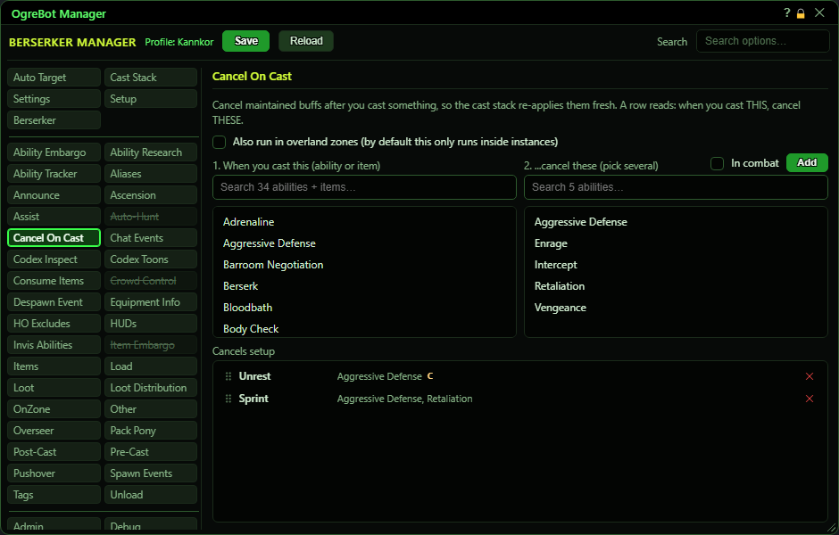

# Cancel On Cast

**OgreBot is in beta testing.** Looking for OgreBot Classic? [Click here](../../index.md).

Some casts spoil a buff you keep up, so that buff needs to be cancelled and cast again fresh. Each row here says: when you cast THIS, cancel THESE buffs. The Cast Stack then puts them back. To build a row, click what you cast in list 1 and one or more buffs in list 2 (click a buff again to unpick it), then press Add. The row appears in Cancels setup, for example 'Armored -> Battle Tactics, Call of Shielding'. It only runs inside instances unless you tick the overland box. It waits while you are in combat, and it waits while the bot is paused.

| Option | What it does | Default |
|---|---|---|
| **1. When you cast this  (ability or item)** | Pick the cast that should trigger the cancel. Abilities and items are both listed; items start with 'Item:'. Click one to select it. It is highlighted until you press Add. | your abilities and items |
| **2. ...cancel these  (pick several)** | Pick the buffs to cancel when that cast happens. Click as many as you like, and click one again to unpick it. Only buffs that last until cancelled are listed. | your until-cancelled buffs |
| **Cancels setup** | Your rows: the cast, then the buffs it cancels. After that cast, each buff still up is cancelled one at a time, once a second, until it is gone. Drag to reorder, double-click to switch a row off, X to remove. *A 'C' on a row means it may cancel during combat. Tick 'In combat' beside Add when you make the row.* | empty |

## Options

| Control | What it does | Default |
|---|---|---|
| **Also run in overland zones (by default this only runs inside instances)** | Lets the cancels happen in overland zones too. When unticked they only happen inside instances. | off |

## Build a row

| Control | What it does |
|---|---|
| **Add** | Adds a row with your picks from lists 1 and 2 to Cancels setup. Tick 'In combat' beside it first to let that row cancel during a fight. It is greyed out until both lists have a pick (hover it to see which is missing). When several buffs are picked it reads 'Add (3)'. |

## Good to know

- While you are in combat the cancel is held until combat ends, however long the fight lasts. The 30-second limit below only starts counting once it is out of combat.
- Every cast the bot makes counts. A cast you make by hand counts only if it shows a cast bar, so an instant cast by hand is missed. Ranks do not matter: a row for 'Armored' fires on 'Armored IV' too.
- List 2 only shows buffs that last until cancelled. Timed buffs run out on their own, so they are left out.
- A buff on several people is cancelled once per second until it is gone everywhere. The bot gives up after 30 seconds or 12 tries (time held in combat does not count).
- Scripts can fire a row without casting anything: -CancelOnCast <who> "Armored" acts as if you had just cast Armored.

