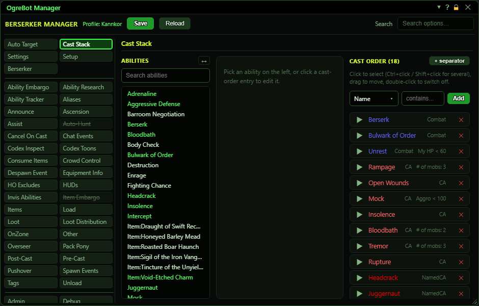

# Cast Stack

**OgreBot is in beta testing.** Looking for OgreBot Classic? [Click here](../../index.md).

The Cast Stack is the bot's main casting list. Every turn the bot walks the Cast order from the top and casts the FIRST entry that is allowed right now, so the order is your priority. The tab has three columns. Abilities (left) lists this character's abilities plus your registered items; click one to start a new entry. The entry editor (middle) sets the entry's Type, Target and optional conditions and options; only fields marked with a red * are required, and the fields shown change with the ability and the Type you pick. Press Add to put it at the bottom of the Cast order, ↑ Top to put it at the top, or Place and then click a row to put it just above that row. The Cast order (right) shows every entry coloured by its Type: click an entry to select it and open it in the editor, double-click to switch it off, drag an entry to move it, and click ▶ to see its settings. The filter above the Cast order shows only the entries that match any mix of their own settings and their ability's export fields, and the Enable / Disable buttons switch what it shows (or what you selected) on or off together. Ctrl+click or Shift+click entries to select several, then drag any one of them to move them all. Edits reach the running bot at once, but press Save at the top to keep them.

## Abilities (left column)

| Control | What it does |
|---|---|
| **Search abilities** | Type part of a name to show only matching abilities and items. The ✕ at the right clears the search. |
| **↔** | Makes the Abilities column wider or narrower. Hovering a cut-off name shows it in full. |
| **Ability or item names** | Click one to start a new entry. A green name already has an entry in the Cast order. Ctrl+click a name to filter the Cast order to that ability or item. |

## Entry editor (middle column)

| Control | What it does |
|---|---|
| **↑ Top** | Adds the entry to the TOP of the Cast order instead, so it is checked first. |
| **Place** | Choose where the entry goes: press Place (it reads Placing…), then click any row in the Cast order and the entry is added just above it. Press it again, or Cancel, to stop. |
| **Update** | Shown while editing an existing entry: saves your changes to it. |
| **+ New** | Shown while editing: adds a copy with your changes as a new entry at the bottom, leaving the original as it was. |
| **Cancel** | Throws away what is in the editor without changing the Cast order. |

## Cast order (right column)

| Control | What it does |
|---|---|
| **Filter: [field] [value] Add** | Shows only the Cast order entries that match. Pick a field, then a value: a name or text field takes what you type (it matches anywhere in the text; put it in double quotes, like "Assault", to match the whole text only), a Yes/No field takes TRUE or FALSE, a list field (Type, Target, the tags and roles) offers the values in use, and a number field takes 30, >30, <30, >=30, <=30 or !=30. Every field also takes (set) or (not set). The field list and the value lists have a box at the top: type in it to show only the matching choices, and press Enter to pick the first one. The fields are everything an entry can have (Name, Type, Target, Disabled, Item, every option and flag, the embargo, allow and custom tags) and then every field of the ability's export, listed as Export: ... (for example Export: IsStun, Export: IsAE, Export: RecastTime, Export: Effects - the ability's effect lines). The filter applies as you type or pick, even before you press Add; the ✕ after Add (or picking — (none) as the field) clears it and shows every entry again. Add keeps it and starts another, and every added filter must match. |
| **Added filters** | Each added filter, e.g. Type = CA or Export: IsStun = TRUE. The x removes one; Clear all removes them all. |
| **Enable / Disable shown (N), or selected (N)** | Switches several entries on or off at once. With two or more entries selected it acts on those; otherwise, with a filter on, it acts on every entry the filter shows. The number is how many it would change. The buttons are hidden when there is no filter and no multi-selection, so the whole Cast Stack is never one stray click away from being switched off. |
| **Drag a row** | Press an entry and drag it up or down to change its priority - anywhere on the row; the drag starts once the mouse moves a few pixels, so a click is never taken for a drag. Dragging a selected entry moves every selected entry, kept in their order. |
| **▶ / ▼** | Shows or hides the entry's settings under the row, or '(no options set)'. |
| **Click an entry** | Selects the entry at once and, a moment later (after the double-click wait), opens it in the editor, where Update saves your changes. The entry being edited is always part of the selection: selecting a different entry closes the edit. |
| **Ctrl+click / Shift+click a name** | Ctrl+click adds or removes one entry from the selection; Shift+click selects every entry from the last one you clicked. Selected entries are outlined and the heading counts them. Drag any selected entry to move them all together. A plain click selects just that entry. |
| **Double-click an entry** | Switches the entry off or back on. A switched-off entry is struck through and never cast, but keeps its place. |
| **✕ (remove)** | Removes the entry. The Undo button below can put it back. |
| **↶ Undo remove (N)** | Puts the last removed entry back where it was. It remembers up to 25 removals. |

## Good to know

- Types, in short. Buff: kept up, re-cast when it drops. NonCombatBuff: the same, but only while you are out of combat. Combat: only while the target is in combat. Heal / PowerHeal: when the target's health / power is at or below the HP / Mana %. Cure / CureCurse: when someone has something that ability can remove / a curse. Res: resurrects a dead player. CA and Debuff: attacks on your target; NamedCA and NamedDebuff only on named mobs, NonNamedCA only on non-named mobs. Special / Custom: advanced types that are cast when ready.
- The Type list only offers the types that fit the ability (a resurrection only offers Res, a buff offers Buff or NonCombatBuff). Items offer the 12 basic types. If your ability export is missing, every type is offered.
- Fields appear and disappear with the Type: Target only shows where you can choose one (attacks always go at your target), '# of ppl' / '# of mobs' only for group or area abilities, HP / Mana % only for heals, Savagery only for Beastlords, Diss only for Channelers. Items only get Type, Target, HP / Mana % and Requires Item Equipped.
- When you press Add or Update, values in fields that are hidden for the chosen Type are thrown away.
- If a required field is missing, Add / Update does nothing and a message lists what is wrong.
- Cast order colours: gold = Buff or NonCombatBuff, blue = Combat, light red = CA, red = NamedCA, pink = NonNamedCA, orange = Debuff, dark orange = NamedDebuff, magenta = Res, dark green = Cure, teal = CureCurse, bright green = Heal, cyan = PowerHeal, light cyan = Custom, lavender = Special. Pale yellow means this character does not have that ability (or the item is not in your bags or gear) right now. A switched-off entry keeps its colour but is struck through and dimmed.
- In the Target list, an alias shown in red points at nobody right now (for example @Healer2 with only one healer in the group).
- The Setup tab's '% Health / % Power req. to use CAs' and '% NPC HP to attack' apply to CA and Debuff entries unless the entry has its own My HP, My MP or NPC HP condition.
- The Disable CS_ boxes on the Settings tab switch whole Types off without touching this list.
- Edits apply to the running bot straight away, but only Save (top of the window) writes them to your profile. Reload throws unsaved edits away.
- '+ separator' lines are only for your eyes; the bot skips them.

