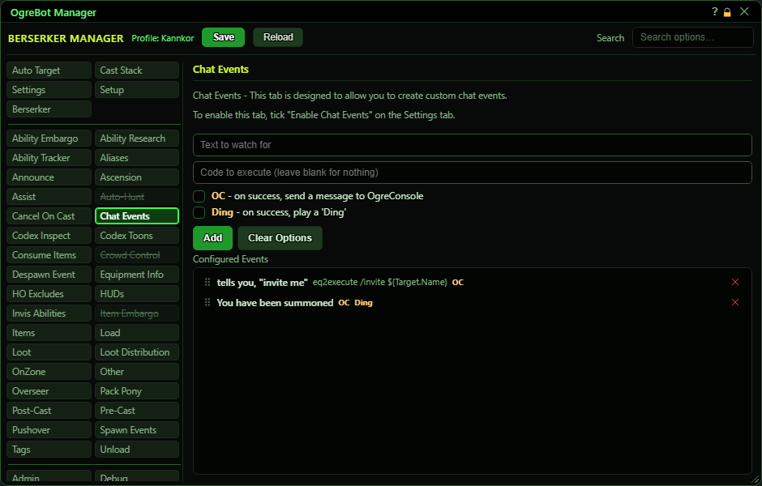

# Chat Events

**OgreBot is in beta testing.** Looking for OgreBot Classic? [Click here](../../index.md).

Chat Events watches the game's incoming text for words you choose. When a line contains your text, the bot can run a console command, post a line to OgreConsole, play a 'Ding' sound, or any mix of the three. Nothing happens until you tick "Enable Chat Events" on the Settings tab. You build the events with the boxes at the top, and they appear in the Configured Events list below. Click a row to edit it, double-click it to switch it off or on, drag it to reorder, and use the X to delete it.

| Option | What it does | Default |
|---|---|---|
| **Configured Events** | Your chat events. Each row shows the text it watches for, its command, and OC or Ding if ticked. Click a row to edit it, double-click to switch it off or on, drag a row to reorder, and click X to delete it. *A switched-off row is kept but never fires. The order does not change anything; every active row is checked.* | empty |

## Add an event

| Control | What it does | Default |
|---|---|---|
| **Text to watch for** | The text to look for in incoming game text. An event fires whenever a line contains this text, in any case. *Required. An event with no text cannot be added.* | empty |
| **Code to execute (leave blank for nothing)** | A console command to run when the text is seen. It runs exactly as if you typed it into the InnerSpace console. Leave it blank if you only want the OC line or the Ding. | empty |
| **OC - on success, send a message to OgreConsole** | When the text is seen, a line goes to OgreConsole saying which character saw it, the text it matched and the full line. | off |
| **Ding - on success, play a 'Ding'** | When the text is seen, a 'Ding' sound plays on this PC. | off |
| **Add** | Adds the event to the list below. Pressing Enter in either text box does the same. While you are editing a row this button reads Update and saves your changes to that row. |  |
| **Clear Options** | Unticks OC and Ding. Ticks otherwise carry over to the next event you add. |  |
| **Cancel** | Only shown while editing a row. Stops editing without changing the row. |  |

## Good to know

- Nothing here works until "Enable Chat Events" is ticked on the Settings tab.
- The match ignores upper and lower case and can be anywhere in the line. Short text like "a" or "the" matches almost every line.
- An event with no command, no OC and no Ding is ignored, and the console prints a warning about it.
- The OC and Ding ticks stay ticked for the next event you add. Use Clear Options to untick them.
- Changes take effect within about a second. Press Save at the top to keep them for next time.
- Chat Events keep working while OgreBot is paused.

