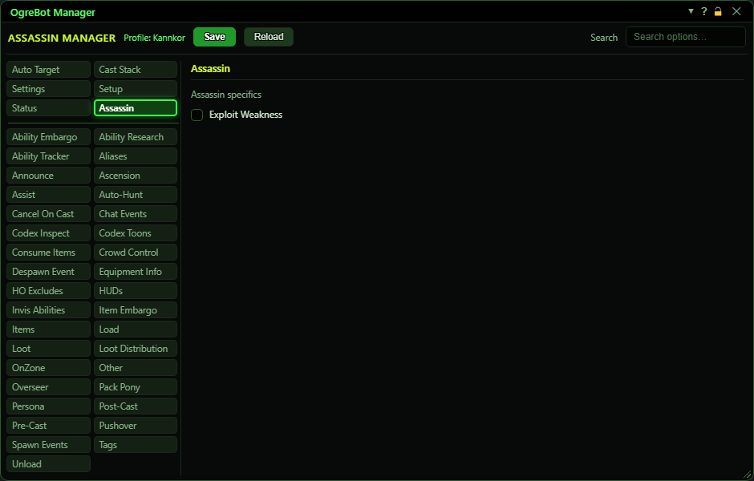
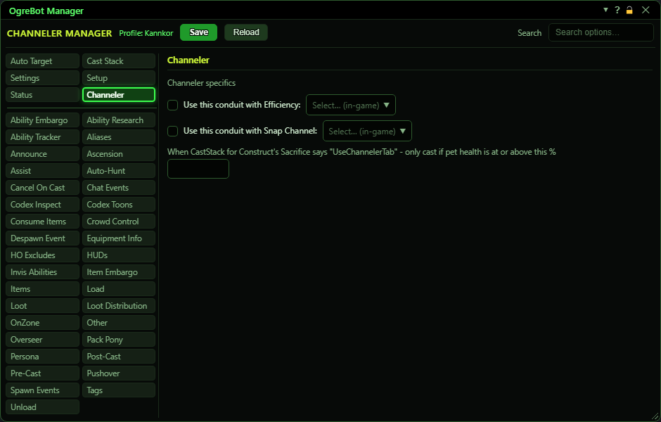
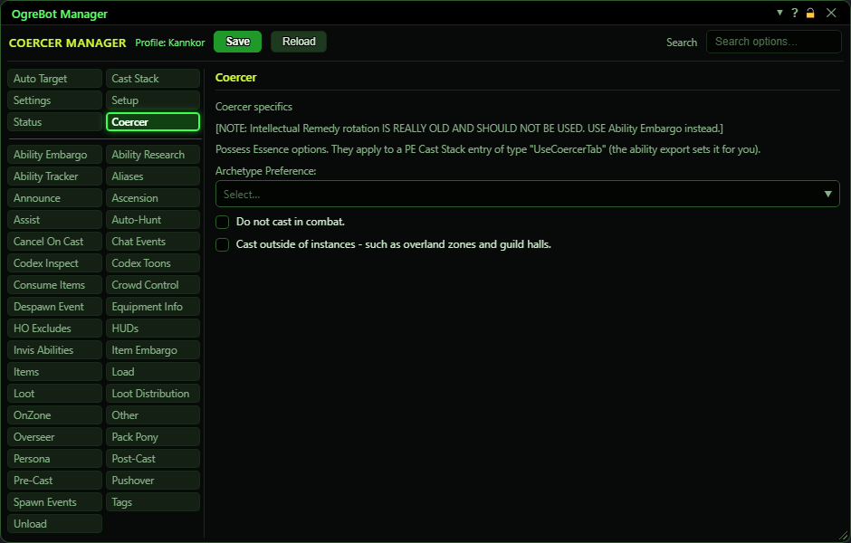
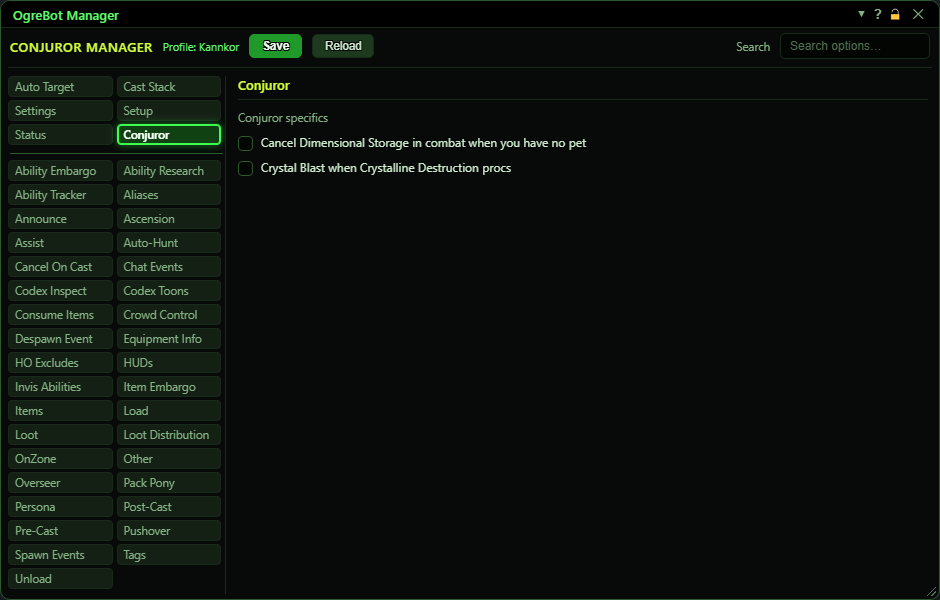
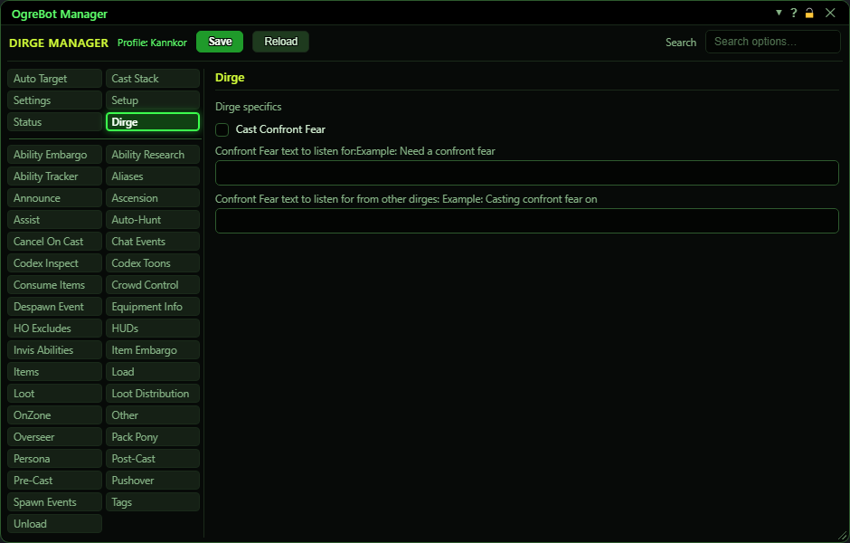
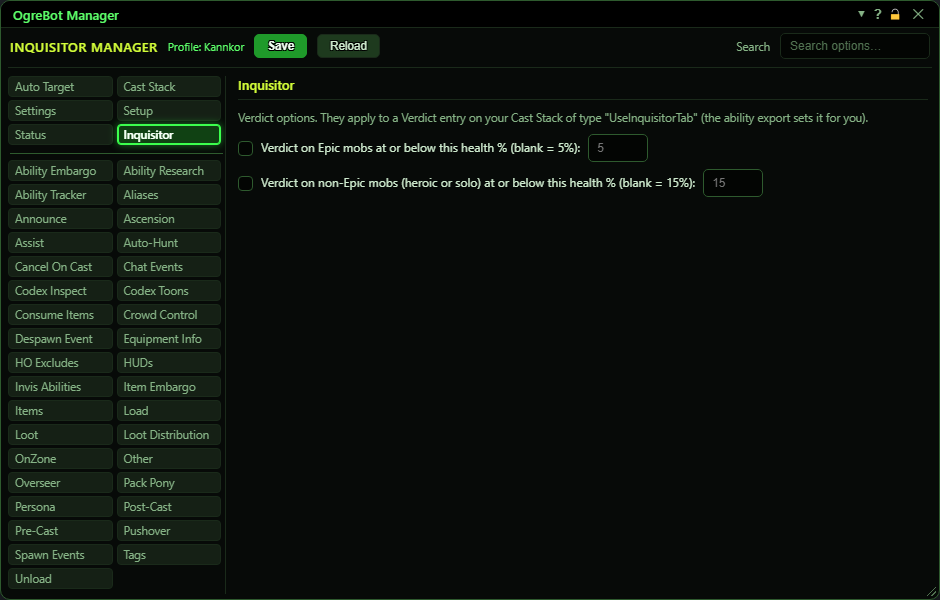
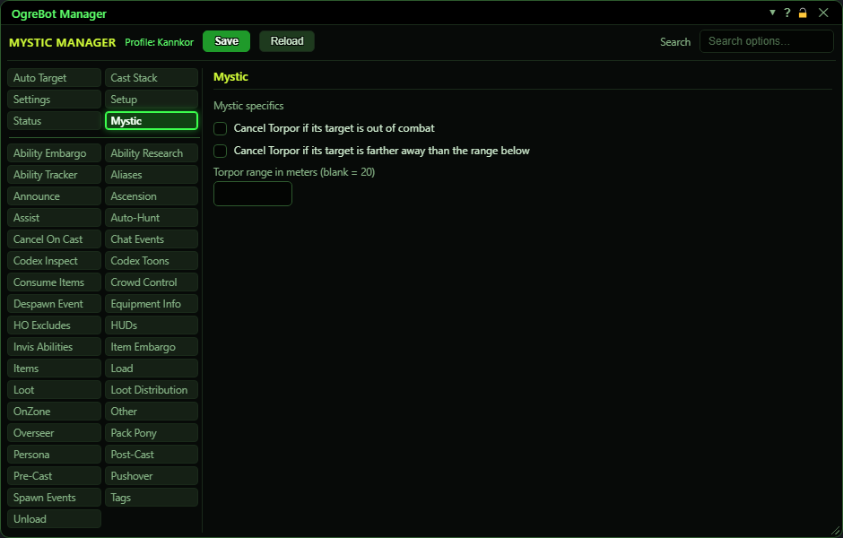
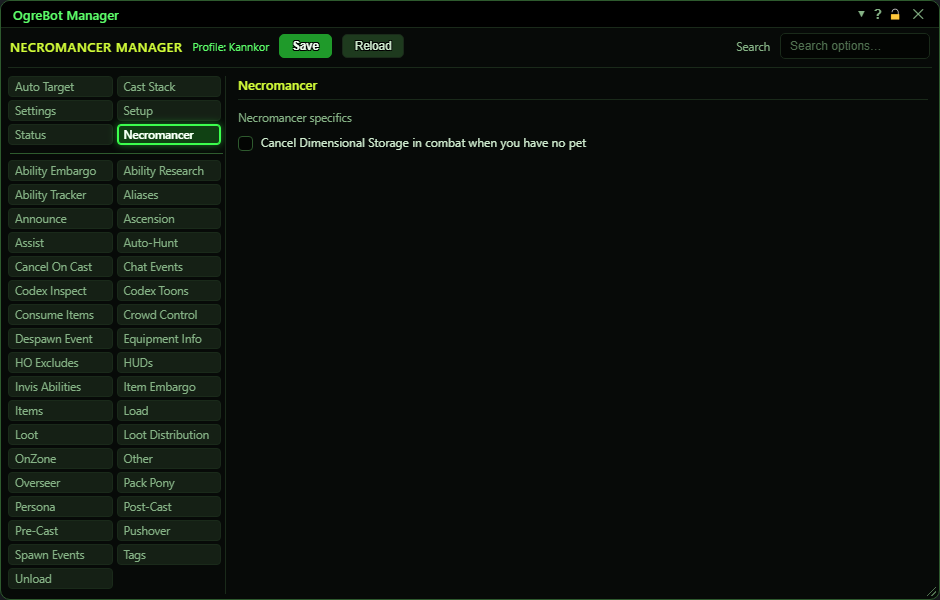
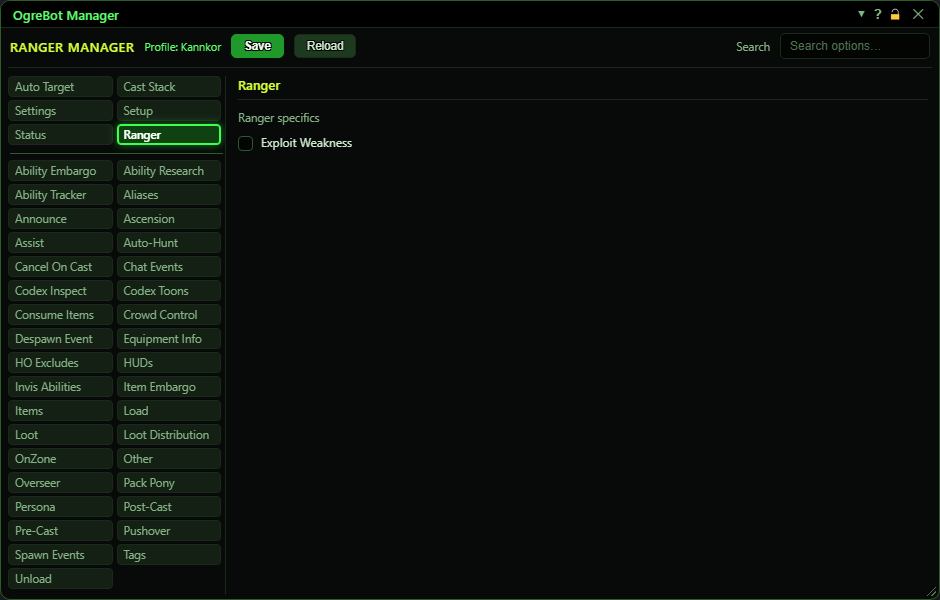
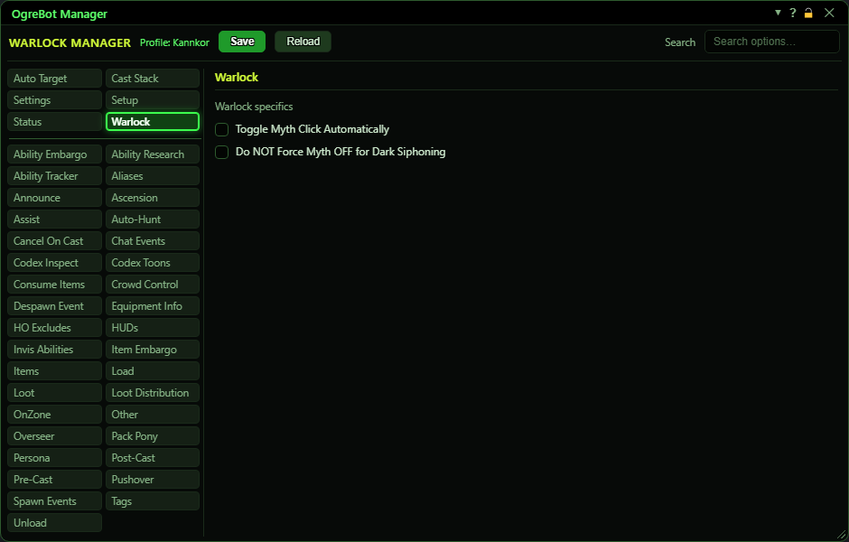

**OgreBot is in beta testing.** Looking for OgreBot Classic? [Click here](../../index.md).

# Class tab

The class tab is named after your class (Coercer, Dirge, Channeler, and so on) and sits in the top group of tabs next to Settings and Setup. It only holds options for your own class, so every character sees a different tab. Ten classes have options here. Berserker, Brigand, Troubador, Defiler, Wizard, Illusionist and Templar show only a heading with nothing below it, and every other class shows '(no class-specific options for ...)'. Most of these options came over from the old bot and are not active yet in the new bot. The ones that work today are the Channeler's Construct's Sacrifice pet health % and conduits, the Coercer's Possess Essence options, the Dirge's Confront Fear options, the Mystic's Cancel Torpor options, and the Conjuror and Necromancer Dimensional Storage box.

## Assassin

| Option | What it does | Default |
|---|---|---|
| **Exploit Weakness** | When the game says "You can see a weakness in your enemy's defenses", the bot casts Exploit Weakness at the mob you are fighting - or the moment it is ready, if that is within 5 seconds. Not while the bot is paused or working a Heroic Opportunity. *Exploit Weakness is always ready to cast; it only does anything after that line, so a Cast Stack row cannot time it.* | off |

## Channeler

| Option | What it does | Default |
|---|---|---|
| **Use this conduit with Efficiency:** | Whenever your Efficiency buff is up, the bot casts the conduit picked in the drop-down beside it as soon as it is ready. *Only while the bot is running. It does not need a target.* | off |
| **(drop-down beside the box)** | The conduit to cast while Efficiency is up. The list shows your abilities that fit conduit slots 1 to 3, from your ability export. *The saved value is the ability's name, so a choice carried over from an old profile works.* | empty |
| **Use this conduit with Snap Channel:** | Whenever your Snap Channel buff is up, the bot casts the conduit picked in the drop-down beside it as soon as it is ready. *Only while the bot is running. It does not need a target.* | off |
| **(drop-down beside the box)** | The conduit to cast while Snap Channel is up. The list shows your abilities that fit conduit slots 4 to 8, from your ability export. *The saved value is the ability's name, so a choice carried over from an old profile works.* | empty |
| **When CastStack for Construct's Sacrifice says "UseChannelerTab" - only cast if pet health is at or above this %** | For a Construct's Sacrifice entry on your Cast Stack set to 'UseChannelerTab': the bot only casts it in combat, on your own pet, when the pet's health is at or above this %, and not while the buff is already on you. *The ability export tags Construct's Sacrifice as 'UseChannelerTab' for you. Other types ignore this box.* | empty (counts as 0: any pet health) |

## Coercer

| Option | What it does | Default |
|---|---|---|
| **Archetype Preference:** | The archetype (fighter, priest, mage or scout) Possess Essence is cast on: the first of you and your group of that archetype who is alive and in the zone - you first. If your pet came from a different essence and someone of this archetype is here, the bot dismisses the pet so the next Possess Essence goes to them. *Empty means Possess Essence is never cast, as in the old bot. Only your group is searched, not the rest of a raid. The list offers fighter, priest, mage and scout.* | empty |
| **Do not cast in combat.** | Possess Essence is not cast while you are in combat. | off |
| **Cast outside of instances - such as overland zones and guild halls.** | Allows Possess Essence outside instances. Unticked, it is only cast inside instances. | off |

## Conjuror

| Option | What it does | Default |
|---|---|---|
| **Cancel Dimensional Storage in combat when you have no pet** | While the bot is running, if you are in combat with no pet out and Dimensional Storage is on you, the bot cancels Dimensional Storage so your stored pet can come back. It never casts Dimensional Storage itself. | off |
| **Crystal Blast when Crystalline Destruction procs** | When the game says "You feel energized by Crystalline Destruction", the bot casts Crystal Blast at the mob you are fighting - or the moment it is ready, if that is within 5 seconds. Not while the bot is paused or working a Heroic Opportunity. *OldBot's wait for a Crystal Blast that was nearly ready never ran (it called a function as if it were an atom); here it does. OldBot also cast while paused, and had no Heroic Opportunity check; this waits for both.* | off |

## Dirge

| Option | What it does | Default |
|---|---|---|
| **Cast Confront Fear** | Your dirge casts Confront Fear on whoever is waiting for it: fighters first, then priests, then everyone else, oldest request first. Requests come from your other characters, the request text below, and your own revive sickness. *Nothing is cast while it is unticked: requests still queue and are dropped after 2 minutes. Requests are sent by the 'Request confront fear' boxes on the Other tab of the character who died.* | off |
| **Confront Fear text to listen for:Example: Need a confront fear** | When someone says a line containing this text in group, raid or a tell, your dirge adds them to its Confront Fear list. Capital letters do not matter. *Empty means chat is not listened to. The cure itself still needs 'Cast Confront Fear' ticked.* | empty |
| **Confront Fear text to listen for from other dirges: Example: Casting confront fear on** | When another player says a line containing this text in group, raid or a tell, your dirge takes the LAST word of that line as a name and removes that player from its Confront Fear list, so two dirges do not cure the same player. *Put the name at the end of the line, for example 'Casting confront fear on Bob'. Your own lines are ignored. The bot does not say this line itself.* | empty |

## Inquisitor

| Option | What it does | Default |
|---|---|---|
| **Verdict on Epic mobs at or below this health % (blank = 5%):** | Verdict for Epic mobs: a Verdict entry on your Cast Stack with the type 'UseInquisitorTab' is used on epic mobs only while this is ticked and the mob is at or below the health % beside it. The entry's own options, such as Named NPCs Only, still apply. | off |
| **(% box beside it)** | The mob health % for Epic mobs. Left blank, it is 5%, shown greyed in the box. | empty (5%) |
| **Verdict on non-Epic mobs (heroic or solo) at or below this health % (blank = 15%):** | Verdict for non-Epic mobs: a Verdict entry on your Cast Stack with the type 'UseInquisitorTab' is used on heroic and solo mobs only while this is ticked and the mob is at or below the health % beside it. The entry's own options, such as Named NPCs Only, still apply. | off |
| **(% box beside it)** | The mob health % for non-Epic mobs. Left blank, it is 15%, shown greyed in the box. | empty (15%) |

## Mystic

| Option | What it does | Default |
|---|---|---|
| **Cancel Torpor if its target is out of combat** | At lower levels Torpor slows whoever it is on. While the bot is running, if your Torpor is on someone who is no longer in combat, the bot cancels it so they are not left walking around slowed. It only cancels your own Torpor. | off |
| **Cancel Torpor if its target is farther away than the range below** | While the bot is running, if your Torpor is on someone farther away from you than the range below, the bot cancels it so they are not slowed while running ahead. It only cancels your own Torpor. | off |
| **Torpor range in meters (blank = 20)** | How far away, in meters, the target of your Torpor can be before the bot cancels it. Leave it blank for 20, which is also Torpor's own casting range. | blank (20) |

## Necromancer

| Option | What it does | Default |
|---|---|---|
| **Cancel Dimensional Storage in combat when you have no pet** | While the bot is running, if you are in combat with no pet out and Dimensional Storage is on you, the bot cancels Dimensional Storage so your stored pet can come back. It never casts Dimensional Storage itself. | off |

## Ranger

| Option | What it does | Default |
|---|---|---|
| **Exploit Weakness** | When the game says "You can see a weakness in your enemy's defenses", the bot casts Exploit Weakness at the mob you are fighting - or the moment it is ready, if that is within 5 seconds. Not while the bot is paused or working a Heroic Opportunity. *Exploit Weakness is always ready to cast; it only does anything after that line, so a Cast Stack row cannot time it.* | off |

## Warlock

| Option | What it does | Default |
|---|---|---|
| **Toggle Myth Click Automatically** | Right before a cast, the bot turns Negative Void (the Mythical click) on, or off. With Singular Focus up it is always on. Dark Siphoning turns it off. Apocalypse, Absolution, Dark Nebula and Decimation turn it off when more than one mob is in the encounter, and on for one. Any other cast turns it on. What it did is in the Cast log. *It acts only for a cast that goes out on the mob you are fighting, on yourself, your group, raid or pet - the same casts as OgreBot Classic. Turning it on holds that cast up to half a second for Negative Void to show. The mobs counted are those within 30 of you in your target's encounter.* | off |
| **Do NOT Force Myth OFF for Dark Siphoning** | Goes with 'Toggle Myth Click Automatically' above. Dark Siphoning is then treated like the other four encounter spells: Negative Void is off for more than one mob in the encounter, and on for one. | off |

## Good to know

- Only your own class's options are shown. To see another class's tab, open the bot on a character of that class.
- Most boxes here are saved with your profile but do nothing yet in the new bot. Each one below says so.
- The three 'rotation text to listen for' boxes (Troubador POTM, Dirge COB, Coercer Intellectual Remedy) belong to an old way of taking turns that the new bot does not use. The Ability Embargo tab is the current way to share an ability between several players.
- Channeler: the conduit drop-downs hold an ability NAME. A choice carried over from an old profile works; the bot finds that ability in your ability export.
- Coercer: for the Possess Essence options to count, the Possess Essence entry in your Cast Stack must have the type 'UseCoercerTab' (the ability export sets this for you). With no Archetype Preference chosen, Possess Essence is never cast.
- Dirge: 'Cast Confront Fear' must be ticked for your dirge to cure anyone - requests from the uplink, from chat, and your own revive sickness. Requests still queue while it is off and are dropped after 2 minutes.
- Inquisitor: for the Verdict options to count, the Verdict entry in your Cast Stack must have the type 'UseInquisitorTab' (the ability export sets this for you; export again if the type is not offered). Heroic and solo mobs are the same setting: only epic or not epic matters.

