# Class tab

**OgreBot is in beta testing.** Looking for OgreBot Classic? [Click here](../../index.md).

The class tab is named after your class (Coercer, Dirge, Channeler, and so on) and sits in the top group of tabs next to Settings and Setup. It only holds options for your own class, so every character sees a different tab. Thirteen classes have options here. Berserker, Wizard, Illusionist and Templar show only a heading with nothing below it, and every other class shows '(no class-specific options for ...)'. Most of these options came over from the old bot and are not active yet in the new bot. The ones that work today are the Channeler's Construct's Sacrifice pet health % and conduits, the Coercer's Possess Essence options, the Dirge's Confront Fear options, the Mystic's Cancel Torpor options, and the Conjuror and Necromancer Dimensional Storage box.

## Assassin

[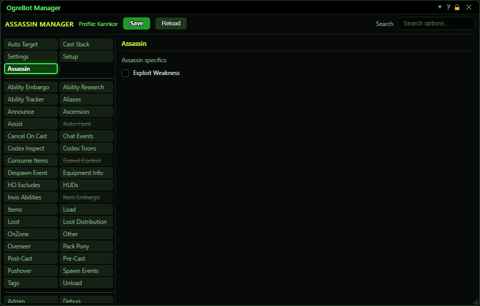](../assets/ogrebot-classes/class-assassin.png "Click for full size")

| Option | What it does | Default |
|---|---|---|
| **Exploit Weakness** | **Not active yet.** It is meant to control how the bot uses the Exploit Weakness ability. | off |

## Brigand

[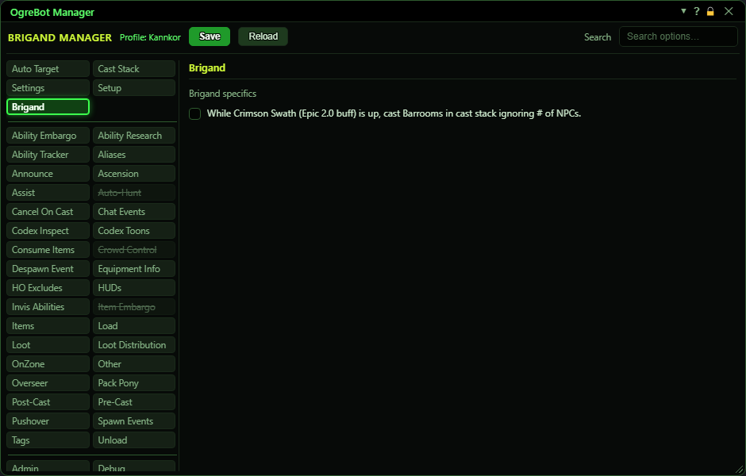](../assets/ogrebot-classes/class-brigand.png "Click for full size")

| Option | What it does | Default |
|---|---|---|
| **While Crimson Swath (Epic 2.0 buff) is up, cast Barrooms in cast stack ignoring # of NPCs.** | **Not active yet.** It is meant to let your Barroom abilities on the Cast Stack fire while Crimson Swath is up, even when too few mobs are in range for the area-attack rules. | off |

## Channeler

[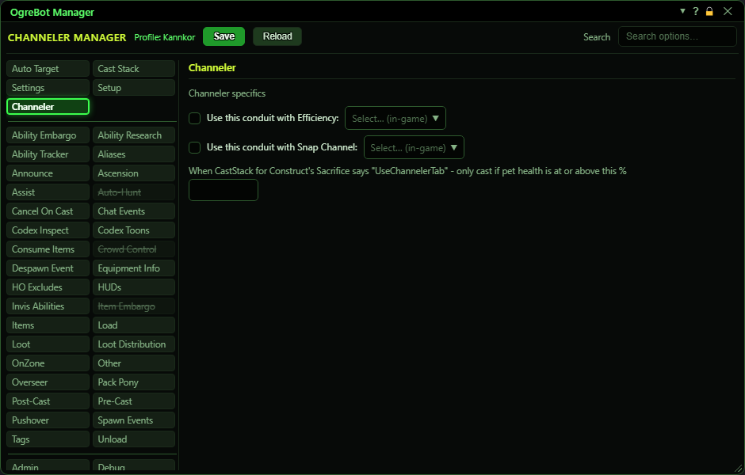](../assets/ogrebot-classes/class-channeler.png "Click for full size")

| Option | What it does | Default |
|---|---|---|
| **Use this conduit with Efficiency:** | Whenever your Efficiency buff is up, the bot casts the conduit picked in the drop-down beside it as soon as it is ready. *Only while the bot is running. It does not need a target.* | off |
| **(drop-down beside the box)** | The conduit to cast while Efficiency is up. The list shows your abilities that fit conduit slots 1 to 3, from your ability export. *The saved value is the ability's name, so a choice carried over from an old profile works.* | empty |
| **Use this conduit with Snap Channel:** | Whenever your Snap Channel buff is up, the bot casts the conduit picked in the drop-down beside it as soon as it is ready. *Only while the bot is running. It does not need a target.* | off |
| **(drop-down beside the box)** | The conduit to cast while Snap Channel is up. The list shows your abilities that fit conduit slots 4 to 8, from your ability export. *The saved value is the ability's name, so a choice carried over from an old profile works.* | empty |
| **When CastStack for Construct's Sacrifice says "UseChannelerTab" - only cast if pet health is at or above this %** | For a Construct's Sacrifice entry on your Cast Stack set to 'UseChannelerTab': the bot only casts it in combat, on your own pet, when the pet's health is at or above this %, and not while the buff is already on you. *The ability export tags Construct's Sacrifice as 'UseChannelerTab' for you. Other types ignore this box.* | empty (counts as 0: any pet health) |

## Coercer

[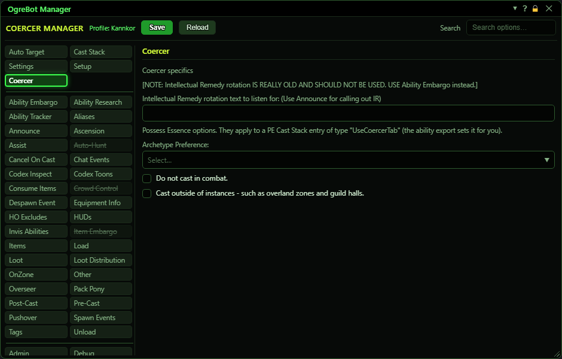](../assets/ogrebot-classes/class-coercer.png "Click for full size")

| Option | What it does | Default |
|---|---|---|
| **Intellectual Remedy rotation text to listen for: (Use Announce for calling out IR)** | **Not active yet.** In the old bot, several coercers took turns casting Intellectual Remedy (IR) by listening for this chat line. *The hint in brackets means: the call-out itself is set up on the Announce tab.* | empty |
| **Archetype Preference:** | The archetype (fighter, priest, mage or scout) Possess Essence is cast on: the first of you and your group of that archetype who is alive and in the zone - you first. If your pet came from a different essence and someone of this archetype is here, the bot dismisses the pet so the next Possess Essence goes to them. *Empty means Possess Essence is never cast, as in the old bot. Only your group is searched, not the rest of a raid. The list offers fighter, priest, mage and scout.* | empty |
| **Do not cast in combat.** | Possess Essence is not cast while you are in combat. | off |
| **Cast outside of instances - such as overland zones and guild halls.** | Allows Possess Essence outside instances. Unticked, it is only cast inside instances. | off |

## Conjuror

[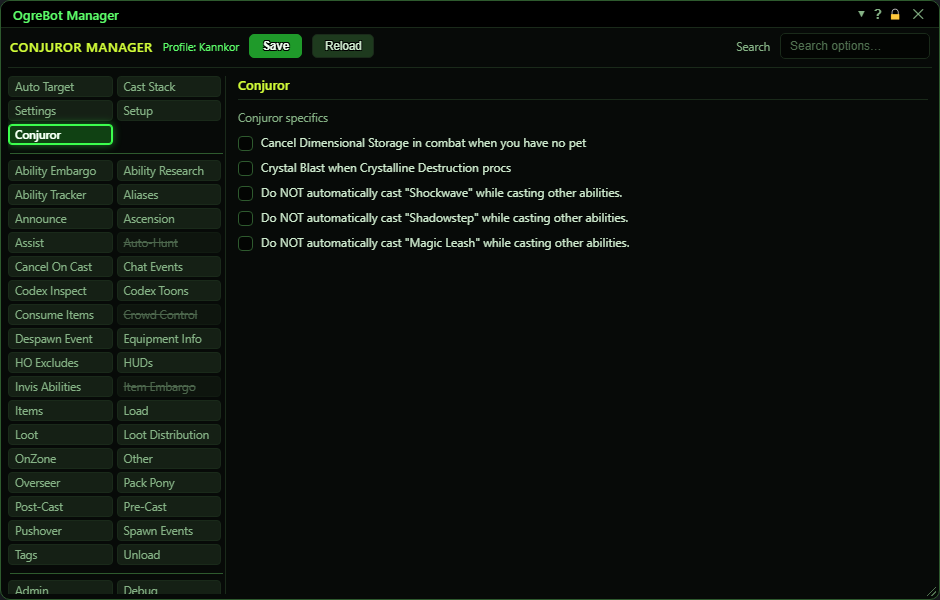](../assets/ogrebot-classes/class-conjuror.png "Click for full size")

| Option | What it does | Default |
|---|---|---|
| **Cancel Dimensional Storage in combat when you have no pet** | While the bot is running, if you are in combat with no pet out and Dimensional Storage is on you, the bot cancels Dimensional Storage so your stored pet can come back. It never casts Dimensional Storage itself. | off |
| **Crystal Blast when Crystalline Destruction procs** | **Not active yet.** It is meant to cast Crystal Blast when Crystalline Destruction procs. | off |
| **Do NOT automatically cast "Shockwave" while casting other abilities.** | **Not active yet.** In the old bot, Shockwave was slipped in automatically alongside your other casts unless this was ticked. The new bot does not do that automatic cast at all. | off |
| **Do NOT automatically cast "Shadowstep" while casting other abilities.** | **Not active yet.** In the old bot, Shadowstep was slipped in automatically alongside your other casts unless this was ticked. The new bot does not do that automatic cast at all. | off |
| **Do NOT automatically cast "Magic Leash" while casting other abilities.** | **Not active yet.** In the old bot, Magic Leash was slipped in automatically alongside your other casts unless this was ticked. The new bot does not do that automatic cast at all. | off |

## Defiler

[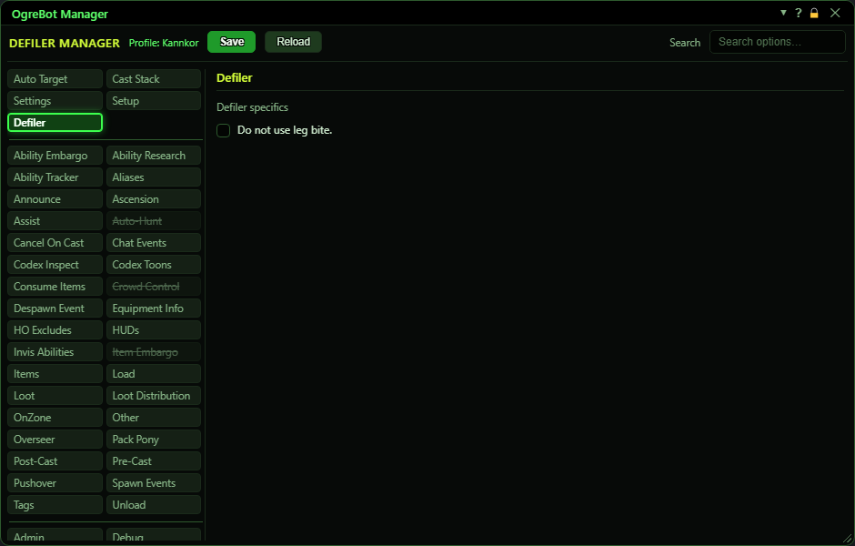](../assets/ogrebot-classes/class-defiler.png "Click for full size")

| Option | What it does | Default |
|---|---|---|
| **Do not use leg bite.** | **Not active yet.** In the old bot, Leg Bite was cast automatically alongside your other abilities unless this was ticked. *One encounter file (the Unseen) ticks it for 20 seconds, but nothing reads it yet.* | off |

## Dirge

[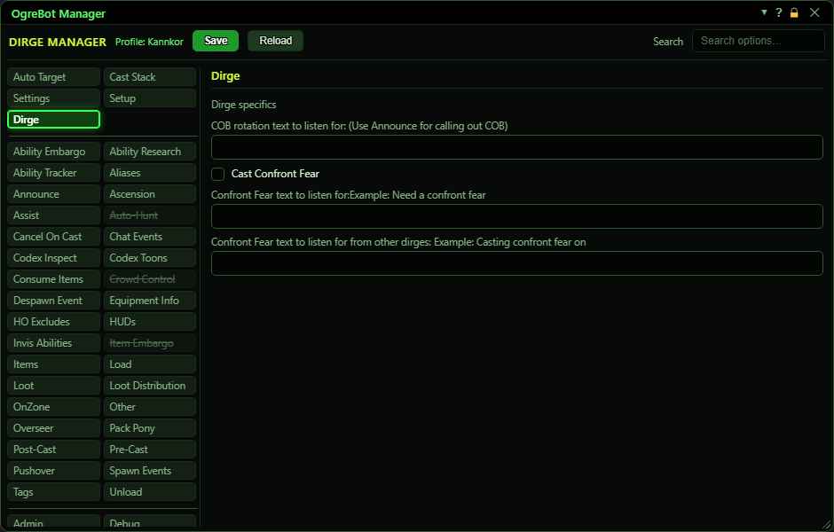](../assets/ogrebot-classes/class-dirge.png "Click for full size")

| Option | What it does | Default |
|---|---|---|
| **COB rotation text to listen for: (Use Announce for calling out COB)** | **Not active yet.** In the old bot, several dirges took turns on their COB ability by listening for this chat line. *The hint in brackets means: the call-out itself is set up on the Announce tab. For taking turns today, use the Ability Embargo tab.* | empty |
| **Cast Confront Fear** | Your dirge casts Confront Fear on whoever is waiting for it: fighters first, then priests, then everyone else, oldest request first. Requests come from your other characters, the request text below, and your own revive sickness. *Nothing is cast while it is unticked: requests still queue and are dropped after 2 minutes. Requests are sent by the 'Request confront fear' boxes on the Other tab of the character who died.* | off |
| **Confront Fear text to listen for:Example: Need a confront fear** | When someone says a line containing this text in group, raid or a tell, your dirge adds them to its Confront Fear list. Capital letters do not matter. *Empty means chat is not listened to. The cure itself still needs 'Cast Confront Fear' ticked.* | empty |
| **Confront Fear text to listen for from other dirges: Example: Casting confront fear on** | When another player says a line containing this text in group, raid or a tell, your dirge takes the LAST word of that line as a name and removes that player from its Confront Fear list, so two dirges do not cure the same player. *Put the name at the end of the line, for example 'Casting confront fear on Bob'. Your own lines are ignored. The bot does not say this line itself.* | empty |

## Inquisitor

[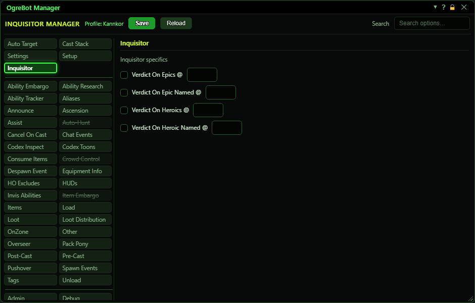](../assets/ogrebot-classes/class-inquisitor.png "Click for full size")

| Option | What it does | Default |
|---|---|---|
| **Verdict On Epics @** | **Not active yet.** It is meant to use Verdict on epic mobs when they reach the health % typed in the box below. | off |
| **(% box beside it)** | **Not active yet.** The mob health % for 'Verdict On Epics @'. | empty |
| **Verdict On Epic Named @** | **Not active yet.** It is meant to use Verdict on named epic mobs when they reach the health % typed in the box below. | off |
| **(% box beside it)** | **Not active yet.** The mob health % for 'Verdict On Epic Named @'. | empty |
| **Verdict On Heroics @** | **Not active yet.** It is meant to use Verdict on heroic mobs when they reach the health % typed in the box below. | off |
| **(% box beside it)** | **Not active yet.** The mob health % for 'Verdict On Heroics @'. | empty |
| **Verdict On Heroic Named @** | **Not active yet.** It is meant to use Verdict on named heroic mobs when they reach the health % typed in the box below. | off |
| **(% box beside it)** | **Not active yet.** The mob health % for 'Verdict On Heroic Named @'. | empty |

## Mystic

| Option | What it does | Default |
|---|---|---|
| **Do not use leg bite.** | **Not active yet.** In the old bot, Leg Bite was cast automatically alongside your other abilities unless this was ticked. *One encounter file (the Unseen) ticks it for 20 seconds, but nothing reads it yet.* | off |
| **Cancel Torpor if its target is out of combat** | At lower levels Torpor slows whoever it is on. While the bot is running, if your Torpor is on someone who is no longer in combat, the bot cancels it so they are not left walking around slowed. It only cancels your own Torpor. | off |
| **Cancel Torpor if its target is farther away than the range below** | While the bot is running, if your Torpor is on someone farther away from you than the range below, the bot cancels it so they are not slowed while running ahead. It only cancels your own Torpor. | off |
| **Torpor range in meters (blank = 20)** | How far away, in meters, the target of your Torpor can be before the bot cancels it. Leave it blank for 20, which is also Torpor's own casting range. | blank (20) |

## Necromancer

[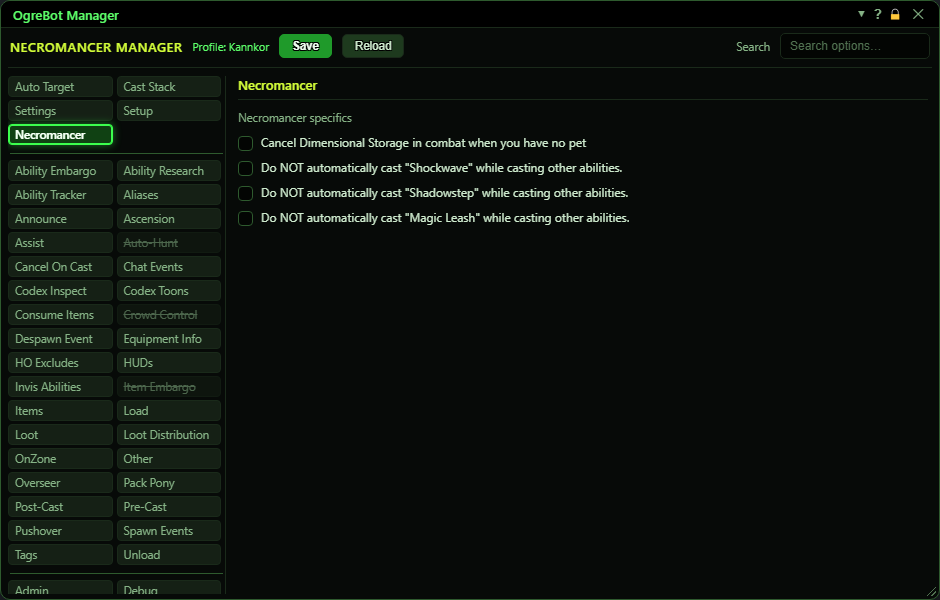](../assets/ogrebot-classes/class-necromancer.png "Click for full size")

| Option | What it does | Default |
|---|---|---|
| **Cancel Dimensional Storage in combat when you have no pet** | While the bot is running, if you are in combat with no pet out and Dimensional Storage is on you, the bot cancels Dimensional Storage so your stored pet can come back. It never casts Dimensional Storage itself. | off |
| **Do NOT automatically cast "Shockwave" while casting other abilities.** | **Not active yet.** In the old bot, Shockwave was slipped in automatically alongside your other casts unless this was ticked. The new bot does not do that automatic cast at all. | off |
| **Do NOT automatically cast "Shadowstep" while casting other abilities.** | **Not active yet.** In the old bot, Shadowstep was slipped in automatically alongside your other casts unless this was ticked. The new bot does not do that automatic cast at all. | off |
| **Do NOT automatically cast "Magic Leash" while casting other abilities.** | **Not active yet.** In the old bot, Magic Leash was slipped in automatically alongside your other casts unless this was ticked. The new bot does not do that automatic cast at all. | off |

## Ranger

[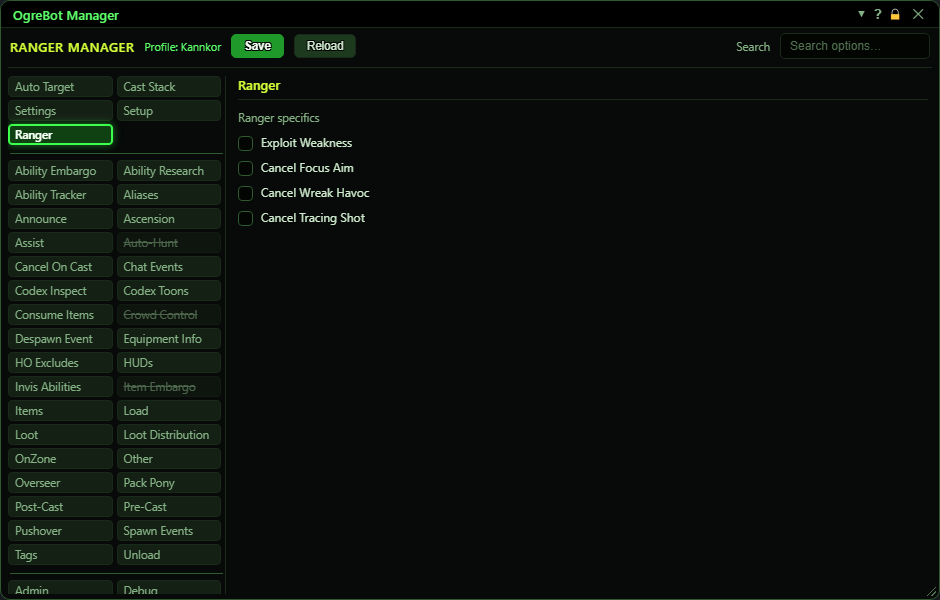](../assets/ogrebot-classes/class-ranger.png "Click for full size")

| Option | What it does | Default |
|---|---|---|
| **Exploit Weakness** | **Not active yet.** It is meant to control how the bot uses the Exploit Weakness ability. | off |
| **Cancel Focus Aim** | **Not active yet.** It is meant to let the bot cancel your Focus Aim. | off |
| **Cancel Wreak Havoc** | **Not active yet.** It is meant to let the bot cancel your Wreak Havoc. *The bot does notice Wreak Havoc on its own (it lets you cast while moving), but this box plays no part in that.* | off |
| **Cancel Tracing Shot** | **Not active yet.** It is meant to let the bot cancel your Tracing Shot. | off |

## Troubador

[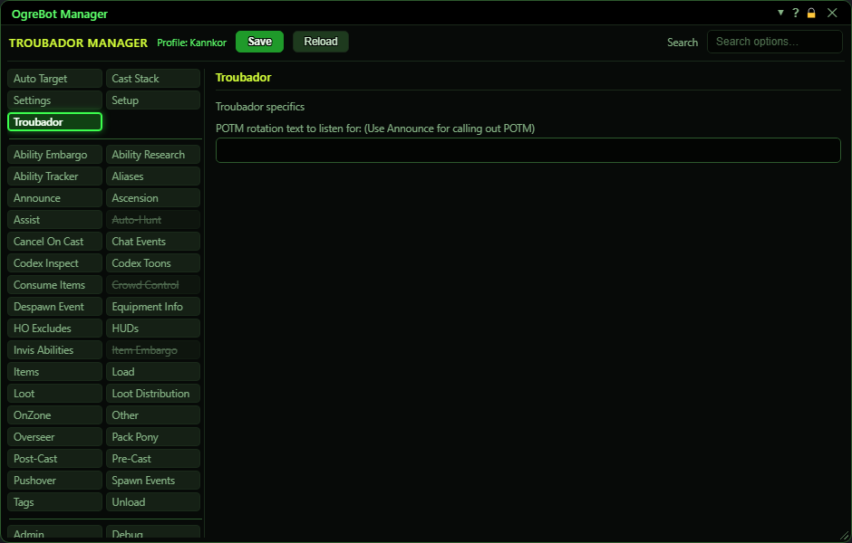](../assets/ogrebot-classes/class-troubador.png "Click for full size")

| Option | What it does | Default |
|---|---|---|
| **POTM rotation text to listen for: (Use Announce for calling out POTM)** | **Not active yet.** In the old bot, several troubadors took turns casting Perfection of the Maestro (POTM) by listening for this chat line. *The hint in brackets means: the call-out itself is set up on the Announce tab. For taking turns today, use the Ability Embargo tab.* | empty |

## Warlock

[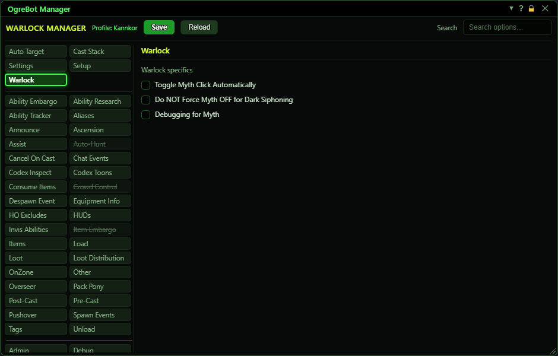](../assets/ogrebot-classes/class-warlock.png "Click for full size")

| Option | What it does | Default |
|---|---|---|
| **Toggle Myth Click Automatically** | **Not active yet.** It is meant to let the bot switch your Mythical weapon's click on and off for you. | off |
| **Do NOT Force Myth OFF for Dark Siphoning** | **Not active yet.** It belongs to 'Toggle Myth Click Automatically' above: it would stop the bot turning the Myth click off for Dark Siphoning. | off |
| **Debugging for Myth** | **Not active yet.** It would print extra messages about the automatic Myth toggle. | off |

## Good to know

- Only your own class's options are shown. To see another class's tab, open the bot on a character of that class.
- Most boxes here are saved with your profile but do nothing yet in the new bot. Each one below says so.
- The three 'rotation text to listen for' boxes (Troubador POTM, Dirge COB, Coercer Intellectual Remedy) belong to an old way of taking turns that the new bot does not use. The Ability Embargo tab is the current way to share an ability between several players.
- Channeler: the conduit drop-downs hold an ability NAME. A choice carried over from an old profile works; the bot finds that ability in your ability export.
- Coercer: for the Possess Essence options to count, the Possess Essence entry in your Cast Stack must have the type 'UseCoercerTab' (the ability export sets this for you). With no Archetype Preference chosen, Possess Essence is never cast.
- Dirge: 'Cast Confront Fear' must be ticked for your dirge to cure anyone - requests from the uplink, from chat, and your own revive sickness. Requests still queue while it is off and are dropped after 2 minutes.

