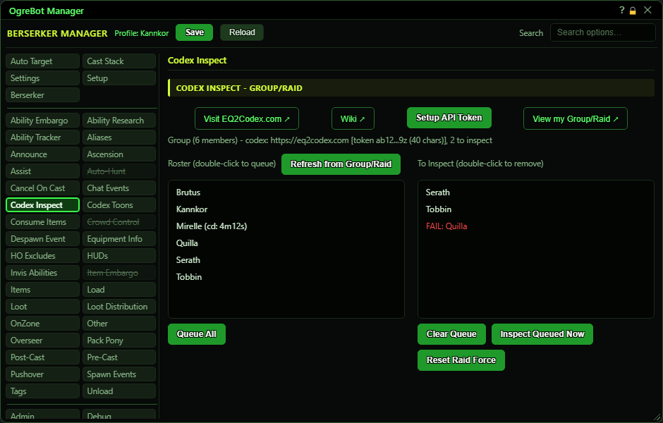

# Codex Inspect

**OgreBot is in beta testing.** Looking for OgreBot Classic? [Click here](../../index.md).

Codex Inspect uploads the gear of the people in your group or raid to the EQ2Codex.com website, so you can see it there. You need an EQ2Codex API token first: press Setup API Token and paste the one from your eq2codex.com account. Opening the tab fills the left list (Roster) with your raid, or your group, or just you when solo. Each name shows how long until it can be inspected again, or 'ready'. Double-click names to move them into the right list (To Inspect), or press Queue All, then press Inspect Queued Now. The bot inspects each name in turn and uploads it. Names that upload leave the right list; names that fail stay there in red, marked FAIL.

| Option | What it does | Default |
|---|---|---|
| **Refresh from Group/Raid** | Reads your raid or group again and redraws the Roster. Opening the tab does this too. |  |
| **Roster (double-click to queue)** | Everyone in your raid, or your group, or just you when solo. Each name shows '(cd: ...)' with the time until it can be inspected again, or 'ready'. Double-click a name to add it to the To Inspect list. *A name already in the To Inspect list is not added twice.* | empty until the tab is opened |
| **Queue All** | Adds every name in the Roster to the To Inspect list. |  |
| **To Inspect (double-click to remove)** | The names waiting to be inspected and uploaded. Double-click a name to take it out. Names leave on their own as they upload; failed ones stay in red, marked FAIL. | empty |
| **Clear Queue** | Empties the To Inspect list. It does not stop a run that has already started. |  |
| **Inspect Queued Now** | Starts a run: the bot inspects each name in the To Inspect list, one about every 3 seconds, and uploads their gear to eq2codex.com. *Greyed out while a run is going. Names inspected in the last 5 minutes are skipped.* |  |
| **Reset Raid Force** | Clears your active group/raid on the eq2codex.com website, including the gear and adornments uploaded for it. Nothing on your PC changes. *Greyed out while a run is going.* |  |

## Top of tab

| Control | What it does |
|---|---|
| **Visit EQ2Codex.com** | Opens eq2codex.com in your web browser. |
| **Wiki** | Opens the EQ2Codex help pages in your web browser. |
| **Setup API Token** | Opens the EQ2Codex API Token window, where you paste your token from eq2codex.com. The token is kept on this PC, outside your profile, and is never shown back to you. *The same window opens from the Codex Toons tab. One token serves both.* |
| **View my Group/Raid** | Opens your active group/raid page on eq2codex.com in your web browser. |

## Good to know

- Nothing uploads until an API token is saved with Setup API Token. The line under the buttons says 'NOT configured' until then.
- A name inspected in the last 5 minutes is skipped. The Roster shows the time left for each name.
- The bot waits about 3 seconds between people, so a full raid takes a few minutes. Inspect Queued Now and Reset Raid Force are greyed out while a run is going.
- The inspect window pops open and closes for each person. That is normal.
- A FAIL row stays in the To Inspect list so you can see who failed. Press Inspect Queued Now again to retry them, or double-click to remove them.
- A '409' failure in the console means another uploader's account has already claimed that character.
- The To Inspect list is not saved in your profile. Closing OgreBot with its X stops a run in progress; the names not yet done stay in the list for next time you open it, until the bot is unloaded.

