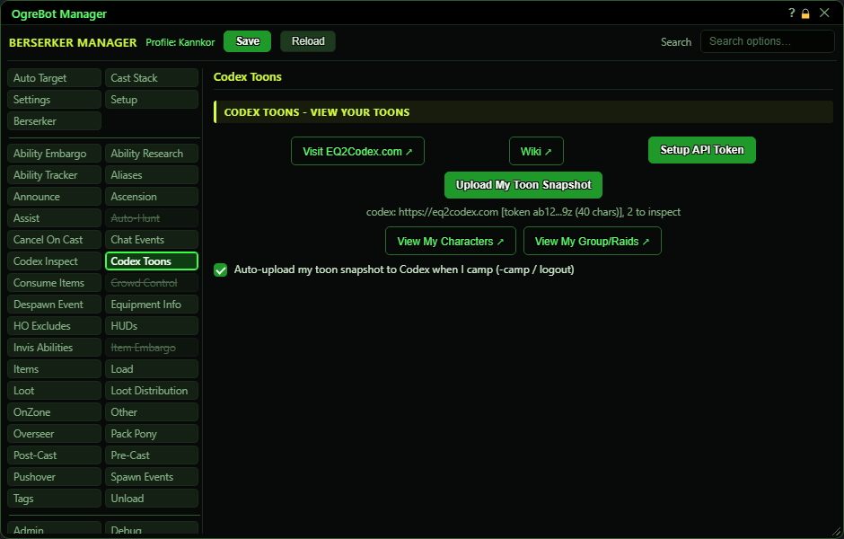

# Codex Toons

**OgreBot is in beta testing.** Looking for OgreBot Classic? [Click here](../../index.md).

Codex Toons uploads a snapshot of your own character (gear and stats) to the EQ2Codex.com website. Press Setup API Token once to paste your token from eq2codex.com, then press Upload My Toon Snapshot whenever you want your page updated. The result, good or bad, is posted in OgreConsole. You can also have it upload by itself every time the bot camps you out. For your group or raid members, use the Codex Inspect tab instead.

| Option | What it does | Default |
|---|---|---|
| **Visit EQ2Codex.com** | Opens eq2codex.com in your web browser. |  |
| **Wiki** | Opens the EQ2Codex help pages in your web browser. |  |
| **Setup API Token** | Opens the EQ2Codex API Token window, where you paste your token from eq2codex.com. The token is kept on this PC, outside your profile, and is never shown back to you. *Same window and same token as on the Codex Inspect tab.* |  |
| **Upload My Toon Snapshot** | Inspects your own character and uploads your gear and stats to eq2codex.com. OgreConsole reports whether it worked. |  |
| **(idle)** | The upload status: whether a token is set, and whether an upload is running. | (idle) |
| **View My Characters** | Opens your characters page on eq2codex.com in your web browser. |  |
| **View My Group/Raids** | Opens your saved groups and raids on eq2codex.com in your web browser. |  |
| **Auto-upload my toon snapshot to Codex when I camp (-camp / logout)** | When the bot camps you out, it first starts an upload of your toon snapshot. The camp does not wait for the upload. *Only camps done by the bot count, not a /camp you type yourself.* | off |

## Good to know

- Nothing uploads until an API token is saved with Setup API Token. The same token is used by Codex Inspect.
- You must be in the world. The inspect window pops open on yourself for a moment while the bot reads your gear.
- If another upload is already running (for example a Codex Inspect run), the snapshot is refused and OgreConsole says so. Try again when it is done.
- The auto-upload on camp only happens when the bot does the camping (for example the camp command, or the Instance Controller's end-of-list camp). Typing /camp yourself does not upload.

