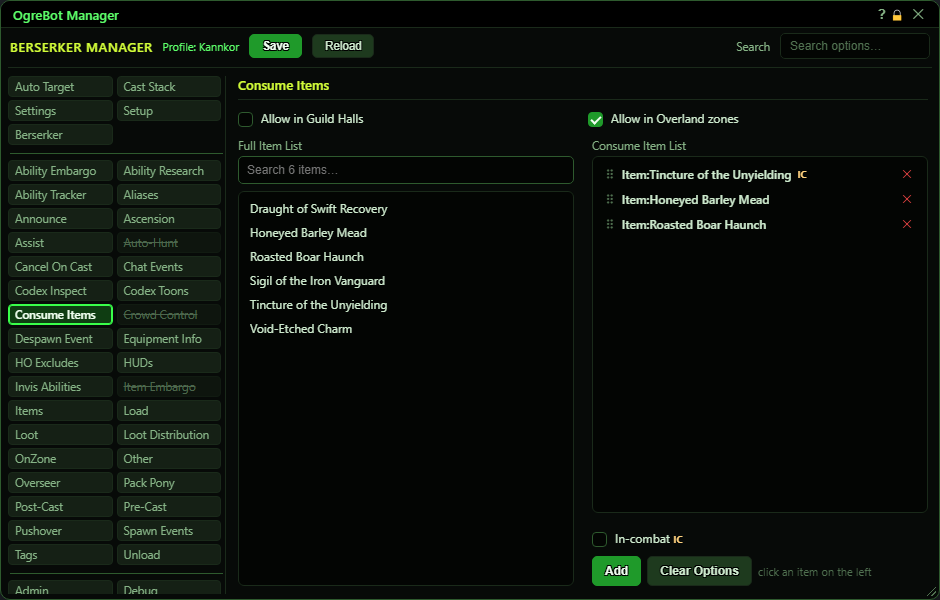

# Consume Items

**OgreBot is in beta testing.** Looking for OgreBot Classic? [Click here](../../index.md).

Consume Items keeps you using items such as potions and temporary buffs. While the bot is running and 'Enable Consume Items' is ticked on the Settings tab, it checks the list about once a second. It uses the first item that is in your bags and ready, then waits before using that item again for as long as its effect lasts (10 minutes if the bot cannot read the duration). The list order is the priority. By default it only works inside instances; the two boxes at the top also allow guild halls and overland zones. To build the list, click an item in the Full Item List (your registered items from the Items tab), tick 'In-combat' if it should only be used in combat, and press Add. On the Consume Item List, drag rows to change the order, click a row to edit it, double-click a row to switch it off or on, and use the x to remove it.

| Option | What it does | Default |
|---|---|---|
| **Full Item List** | Your registered items from the Items tab. Click one to pick it for the Add form, or double-click it to add it straight away with no options. | your registered items |
| **Consume Item List** | The items the bot uses, in priority order: each check it uses the first one that is in your bags, ready, and not waiting out its effect. 'IC' on a row means in combat only. *Drag to reorder, click to edit, double-click to switch off or on, x to remove.* | empty |

## Where it works

| Control | What it does | Default |
|---|---|---|
| **Allow in Guild Halls** | Lets the list be used automatically in a guild hall. Without it, nothing is used there. | off |
| **Allow in Overland zones** | Lets the list be used automatically outside instances, in overland and city zones. Without it, items are only used inside instances. | off |

## Item lists

| Control | What it does | Default |
|---|---|---|
| **In-combat** | The item being added is only used while you are in combat. | off |
| **Add** | Adds the item picked on the left to the end of the list, with the In-combat option as ticked. When you are editing a row, it reads Update and saves your change. |  |
| **Clear Options** | Unticks In-combat. It otherwise stays ticked for the next Add. |  |

## Good to know

- Nothing happens unless 'Enable Consume Items' is ticked on the Settings tab. Pausing the bot also stops it.
- The Full Item List only shows items registered on the Items tab. If it is empty, register your consumables there first.
- Double-clicking an item on the left adds it straight away, without the In-combat option. To set it, click once, tick In-combat, then press Add.
- Nothing is used while you are moving or dead. In combat, the bot waits at least 5 seconds between uses.
- The wait for each item's effect is kept only while the session runs. After a reload the bot may use an item again straight away.
- The OgreConsole command `-ConsumeItems_ProcessList_AP` runs the list on demand (add `-all` to use every eligible item, not just the first). It ignores the zone boxes and the pause, but still needs 'Enable Consume Items'.
- To see what it picks and when, tick ConsumeItemsDebug on the Debug tab.

