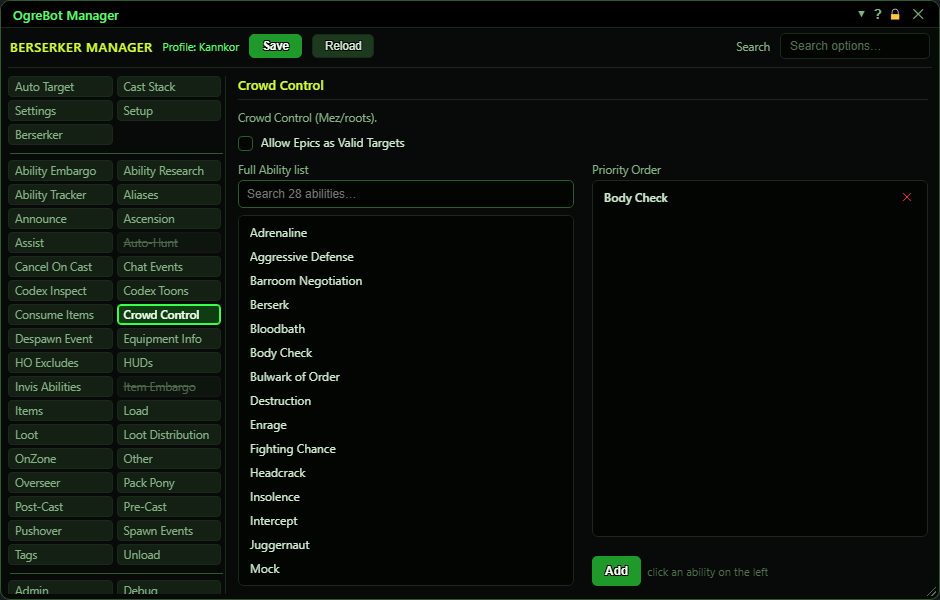

# Crowd Control

**OgreBot is in beta testing.** Looking for OgreBot Classic? [Click here](../../index.md).

With Enable Crowd Control ticked on the Settings tab, the bot mezzes (or roots) the extra mobs that are attacking your group, using the abilities in the Priority Order list, top first. It never mezzes the mob your group is killing, and it renews a mez when it has 10 seconds or less left.

| Option | What it does | Default |
|---|---|---|
| **Full Ability list** | Your abilities, with a search box. Click one and press Add (or double-click it) to put it in the Priority Order list. | filled from your ability export |
| **Priority Order** | The mez abilities to use, top first. The bot uses the first one that is ready and can reach the add. Double-click a row to turn it off without removing it. *Drag to reorder, double-click to switch a row off, x to remove. Clicking a row loads it back into the form.* | empty |

## Crowd Control

| Control | What it does | Default |
|---|---|---|
| **Allow Epics as Valid Targets** | Off: the bot never mezzes an epic mob. On: epic mobs can be mezzed like any other add. | off |
| **Add** | Adds the ability you clicked on the left to the bottom of the Priority Order list. Next to it you see the picked ability, or 'click an ability on the left' until you pick one. |  |

## Good to know

- Only mobs within 30 metres that are attacking someone in your group or raid are mezzed. A mob that is just standing nearby is left alone.
- The mob your group is killing is never mezzed: your own target, and the target of the person you assist.
- To cast a mez the bot briefly targets the add, then gives you your target back. It also turns auto-attack off first, because a swing would break the mez.
- The bot only knows about its own mezzes. It does not see a mez another player put on a mob.
- Nothing is mezzed in a city unless Allow City Casting is ticked, or while an encounter has told the group to stop attacking.

