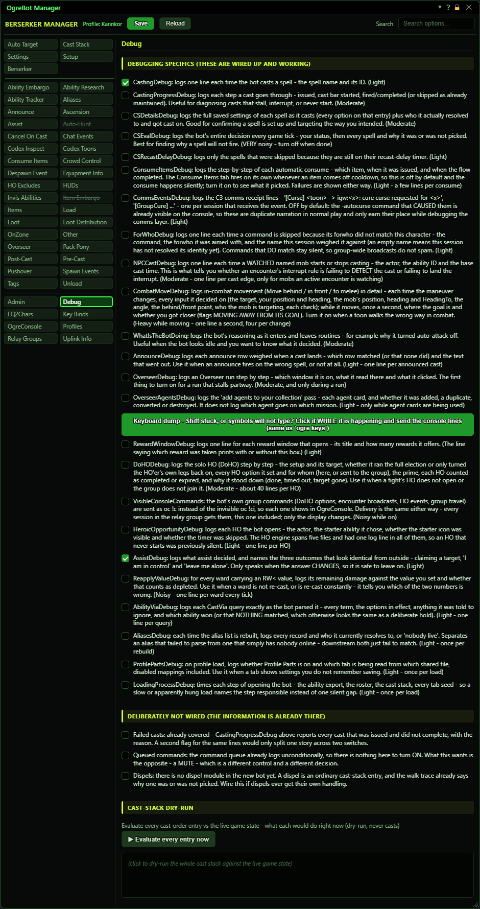
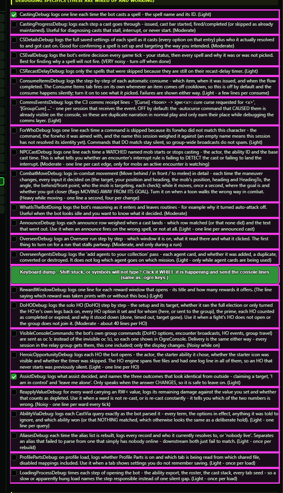
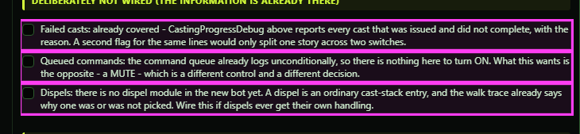
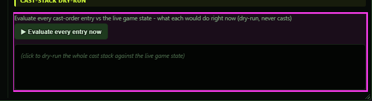

**OgreBot is in beta testing.** Looking for OgreBot Classic? [Click here](../../index.md).

# Debug

Debug holds switches that make the bot explain itself. Each box turns on extra lines about one part of the bot: casting, the Cast Stack, HOs, assist, Overseer, and so on. The lines appear in this character's InnerSpace console and in its log file (ISXOgreEQ2.<session>.log in InnerSpace's extensions folder). None of these boxes changes what the bot does, except Visible Console Commands, which only changes how the bot's group commands show in OgreConsole. At the bottom, the Cast-Stack Dry-Run lists every Cast Stack entry and what it would do right now, without casting anything.

## Debugging specifics (these are wired up and working)

| Option | What it does | Default |
|---|---|---|
| **CastingDebug: logs one line each time the bot casts a spell - the spell name and its ID. (Light)** | Logs one line each time the bot casts something: the ability name and ID, or the item name, the cure target for cures, and what asked for the cast. | off |
| **CastingProgressDebug: logs each step a cast goes through - issued, cast bar started, fired/completed (or skipped as already maintained). Useful for diagnosing casts that stall, interrupt, or never start. (Moderate)** | Logs each step of every cast: sent, cast bar started, finished, already up, or given up. Use it for casts that stall, get interrupted or never start. | off |
| **CSDetailsDebug: logs the full saved settings of each spell as it casts (every option on that entry) plus who it actually resolved to and got cast on. Good for confirming a spell is set up and targeting the way you intended. (Moderate)** | Each time a Cast Stack entry casts, logs every saved option on that entry plus who it was actually cast on. Good for checking an entry is set up the way you meant. | off |
| **CSEvalDebug: logs the bot's entire decision every game tick - your status, then every spell and why it was or was not picked. Best for finding why a spell will not fire. (VERY noisy - turn off when done)** | Logs the Cast Stack's whole decision every time it runs: your health, power and target, then every entry and why it was or was not picked. The best way to find why a spell will not fire. *Very noisy. Turn it off when you are done.* | off |
| **CSRecastDelayDebug: logs only the spells that were skipped because they are still on their recast-delay timer. (Light)** | Logs only the Cast Stack entries skipped because their own recast delay has not run out yet. | off |
| **ConsumeItemsDebug: logs the step-by-step of each automatic consume - which item, when it was issued, and when the flow completed. The Consume Items tab fires on its own whenever an item comes off cooldown, so this is off by default and the consume happens silently; turn it on to see what it picked. Failures are shown either way. (Light - a few lines per consume)** | Logs each automatic use from the Consume Items tab step by step: which item, when it was used and when it finished. | off |
| **CommsEventsDebug: logs the C3 comms receipt lines - '[Curse] <toon> -> igw:<x>: cure curse requested for <x>', '[GroupCure] ...' - one per session that receives the event. OFF by default: the -autocurse command that CAUSED them is already visible on the console, so these are duplicate narration in normal play and only earn their place while debugging the comms layer. (Light)** | Logs a line each time this character receives a cure-curse or group-cure request from another character. *Every character that receives the request logs its own line.* | off |
| **ForWhoDebug: logs one line each time a command is skipped because its forwho did not match this character - the command, the forwho it was aimed with, and the name this session weighed it against (an empty name means this session has not resolved its identity yet). Commands that DO match stay silent, so group-wide broadcasts do not spam. (Light)** | Logs a line each time a command is ignored because it was aimed at someone else: the command, who it was aimed at, and this character's name. Commands that do apply stay silent. | off |
| **NPCCastDebug: logs one line each time a WATCHED named mob starts or stops casting - the actor, the ability ID and the base cast time. This is what tells you whether an encounter's interrupt rule is failing to DETECT the cast or failing to land the interrupt. (Moderate - one line per cast edge, only for mobs an active encounter is watching)** | Logs a line each time a mob that an encounter is watching starts or stops casting: the mob, the ability and its cast time. Tells you whether an interrupt rule failed to see the cast or failed to land the interrupt. | off |
| **CombatMoveDebug: logs in-combat movement (Move behind / in front / to melee) in detail - each time the maneuver changes, every input it decided on (the target, your position and heading, the mob's position, heading and HeadingTo, the angle, the behind/front point, who the mob is targeting, each check); while it moves, once a second, where the goal is and whether you got closer (flags MOVING AWAY FROM ITS GOAL). Turn it on when a toon walks the wrong way in combat. (Heavy while moving - one line a second, four per change)** | Logs Move behind / Move in front / Move to melee in detail: every time the maneuver changes, the target, where you and the mob are, which way the mob faces, the point it is walking to and every check it made; while moving, once a second, whether you are getting closer. Turn it on when a toon walks the wrong way in combat. |  |
| **WhatIsTheBotDoing: logs the bot's reasoning as it enters and leaves routines - for example why it turned auto-attack off. Useful when the bot looks idle and you want to know what it decided. (Moderate)** | Logs why the bot did some things on its own: moving into or out of combat position, turning auto-attack off, dropping invisibility after combat, and follow changes. *Follow and Come2Me lines go to the log file only.* | off |
| **AnnounceDebug: logs each announce row weighed when a cast lands - which row matched (or that none did) and the text that went out. Use it when an announce fires on the wrong spell, or not at all. (Light - one line per announced cast)** | When a cast lands, logs each Announce tab row it checked, which one matched (or that none did), and the text sent. Use it when an announce fires on the wrong spell or not at all. | off |
| **OverseerDebug: logs an Overseer run step by step - which window it is on, what it read there and what it clicked. The first thing to turn on for a run that stalls partway. (Moderate, and only during a run)** | Logs an Overseer run step by step: each stage it moves to, each agent assigned, each quest started or completed, and quests skipped for lack of agents. | off |
| **OverseerAgentsDebug: logs the 'add agents to your collection' pass - each agent card, and whether it was added, a duplicate, converted or destroyed. It does not log which agent goes on which mission. (Light - only while agent cards are being used)** | Logs the 'add agents to your collection' pass step by step: each agent card, and whether it was added, a duplicate, converted or destroyed. | off |
| **Keyboard dump - Shift stuck, symbols will not type, or a box after your text? Click it WHILE it is happening and send the console lines (same as `ogre keys`)** | Prints everything about the keyboard right now: which keys the game thinks are held (Shift, Caps Lock and others), which window has keyboard focus, the last keys pressed, and the last characters sent to a field (a box after your text is one of these - it is now kept out and listed here). Same as typing `ogre keys`. *The last keys cover only this visit to the world. Check the lines before sharing them.* |  |
| **RewardWindowDebug: logs one line for each reward window that opens - its title and how many rewards it offers. (The line saying which reward was taken prints with or without this box.) (Light)** | Logs one line for each reward window that opens: its title and how many rewards it offers. *The line saying which reward was taken prints whether this is on or off.* | off |
| **DoHODebug: logs the solo HO (DoHO) step by step - the setup and its target, whether it ran the full election or only turned the HO'er's own legs back on, every HO option it set and for whom (here, or sent to the group), the prime, each HO counted as completed or expired, and why it stood down (done, timed out, target gone). Use it when a fight's HO does not open or the group does not join it. (Moderate - about 40 lines per HO)** | Logs the solo HO (Do HO) step by step: the setup and its target, every HO option it set and for whom, each HO completed or expired, and why it stopped. Use it when a fight's HO does not open or the group does not join in. | off |
| **VisibleConsoleCommands: the bot's own group commands (DoHO options, encounter broadcasts, HO events, group travel) are sent as oc !c instead of the invisible oc !ci, so each one shows in OgreConsole. Delivery is the same either way - every session in the relay group gets them, this one included; only the display changes. (Noisy while on)** | The bot's own group commands (Do HO options, encounter messages, HO events, group travel) show up in OgreConsole so you can watch them. Normally they are sent hidden. Every character still receives them exactly the same way. *Noisy while on.* | off |
| **HeroicOpportunityDebug: logs each HO the bot opens - the actor, the starter ability it chose, whether the starter icon was visible and whether the timer was skipped. The HO engine spans five files and had one log line in all of them, so an HO that never starts was previously silent. (Light - one line per HO)** | Logs each HO the bot starts: the mob, the starter ability it chose, whether the starter icon was showing, and whether the wait timer was skipped. | off |
| **AssistDebug: logs what assist decided, and names the three outcomes that look identical from outside - claiming a target, 'I am in control' and 'leave me alone'. Only speaks when the answer CHANGES, so it is safe to leave on. (Light)** | Logs who assist wants you to attack and why. It only logs when that answer changes, so it is safe to leave on. | off |
| **ReapplyValueDebug: for every ward carrying an RW< value, logs its remaining damage against the value you set and whether that counts as depleted. Use it when a ward is not re-cast, or is re-cast constantly - it tells you which of the two numbers is wrong. (Noisy - one line per ward every tick)** | For every ward with a 'Reapply-ward <=' value, logs how much damage it has left, your value, and whether that counts as used up. Use it when a ward is not re-cast, or is re-cast all the time. *Noisy: one line per ward each time the Cast Stack runs.* | off |
| **AbilityViaDebug: logs each CastVia query exactly as the bot parsed it - every term, the options in effect, anything it was told to ignore, and which ability won (or that NOTHING matched, which otherwise looks the same as a deliberate hold). (Light - one line per query)** | When a script or command asks the bot to find an ability by description (CastVia), logs how the request was read, what was ruled out, and which ability won, or that nothing matched. | off |
| **AliasesDebug: each time the alias list is rebuilt, logs every record and who it currently resolves to, or 'nobody live'. Separates an alias that failed to parse from one that simply has nobody online - downstream both just fail to match. (Light - once per rebuild)** | Each time the Aliases list is rebuilt, logs every alias and who it points to right now, or 'nobody live'. Tells a mistyped alias apart from one whose characters are simply not online. | off |
| **ProfilePartsDebug: on profile load, logs whether Profile Parts is on and which tab is being read from which shared file, disabled mappings included. Use it when a tab shows settings you do not remember saving. (Light - once per load)** | When a profile loads, logs whether Profile Parts is on and which tab is being read from which shared file, including switched-off ones. Use it when a tab shows settings you do not remember saving. | off |
| **LoadingProcessDebug: times each step of opening the bot - the ability export, the roster, the cast stack, every tab seed - so a slow or apparently hung load names the step responsible instead of one silent gap. (Light - once per load)** | Times each step of opening the bot (abilities, roster, Cast Stack, each tab), so a slow or stuck load shows which step is to blame. | off |

## Deliberately not wired (the information is already there)

| Option | What it does | Default |
|---|---|---|
| **Failed casts: already covered - CastingProgressDebug above reports every cast that was issued and did not complete, with the reason. A second flag for the same lines would only split one story across two switches.** | **Not active yet.** Does nothing. Casts that fail are already reported by CastingProgressDebug. | off |
| **Queued commands: the command queue already logs unconditionally, so there is nothing here to turn ON. What this wants is the opposite - a MUTE - which is a different control and a different decision.** | **Not active yet.** Does nothing. The command queue already logs all the time. | off |
| **Dispels: there is no dispel module in the new bot yet. A dispel is an ordinary cast-stack entry, and the walk trace already says why one was or was not picked. Wire this if dispels ever get their own handling.** | **Not active yet.** Does nothing. Dispels are ordinary Cast Stack entries, and CSEvalDebug already shows why one was or was not picked. | off |

## Cast-Stack Dry-Run

| Option | What it does | Default |
|---|---|---|
| **Evaluate every cast-order entry vs the live game state - what each would do right now (dry-run, never casts)** | One row per Cast Stack entry, in order: its number, its name, then 'WOULD CAST' in green (with the target), or the reason it would be skipped, such as 'recast delay still active' or 'no valid target'. Switched-off entries are greyed. The last column sums up the entry's settings. | empty until you press Evaluate |

## Cast-Stack Dry-Run

| Control | What it does |
|---|---|
| **Evaluate every entry now** | Checks every Cast Stack entry against your current target, group and state, and fills the list below with what each one would do right now. Nothing is cast. *It also prints every entry and its saved settings to the console, so expect a burst of lines.* |

## Good to know

- Debug boxes are saved in your profile like any other setting. A noisy box you forget to untick stays on after a reload.
- The log file starts fresh every time the extension loads. Copy it before you restart if you want to send it to someone.
- A few WhatIsTheBotDoing lines (following, and the Come2Me command) go only to the log file, not the console.
- The three boxes under 'Deliberately not wired' do nothing. They are there so you know why no switch exists for those topics.
- The Keyboard dump includes the last keys you pressed since entering the world. If you just typed something private in game, do not paste the dump anywhere public.
- Cast-Stack Dry-Run: the list only fills after you press 'Evaluate every entry now'. It is a snapshot of that moment; press it again to refresh. It also prints every entry, with all its saved settings, to the console.

