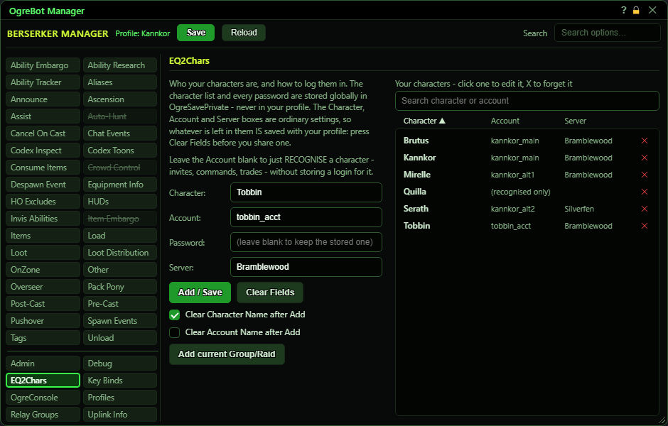

# EQ2Chars

**OgreBot is in beta testing.** Looking for OgreBot Classic? [Click here](../../index.md).

EQ2Chars is your list of characters. It does two jobs. Every character on it is trusted: the bot obeys chat commands from them and, when 'Accept Invites' is ticked, accepts their group and raid invites. A character that also has an account and password can be logged in by the bot, for example with `ogre <name>` (add `-p` to load the bot paused, or `-ph` paused with its main window hidden). The list is one list for the whole PC, not part of any profile. Fill in the form on the left and press Add / Save; the list on the right shows everything stored.

| Option | What it does | Default |
|---|---|---|
| **Character:** | The character's name. Required. | empty |
| **Account:** | The game account the character is on, used to log it in. Leave blank to only recognise the character (trusted for commands and invites, but no login). | empty |
| **Password:** | The account's password. It is hidden as you type and goes straight to the private file on this PC, never into your profile. Blank keeps the stored password; a single - clears it. *One password per account, shared by all its characters.* | empty |
| **Server:** | The server the character plays on. The bot picks this server when logging the character in. Blank keeps the server already stored. | empty |
| **Add / Save** | Saves the character with the account, password and server typed above. If the character is already listed, its entry is replaced (moved to the new account if you changed it). The password box is emptied afterwards. |  |
| **Clear Fields** | Empties the four boxes on the form. The stored list is not touched. |  |
| **Clear Character Name after Add** | After Add / Save, the Character box is emptied, ready for the next one. | off |
| **Clear Account Name after Add** | After Add / Save, the Account box is emptied. Leave it off to add several characters on the same account without retyping it. | off |
| **Add current Group/Raid** | Adds every player in your group or raid who is not already listed, as 'recognised only' (no login details). Mercenaries and pets are skipped. The first click only tells you how many it would add; click again within 15 seconds to confirm. *Everyone added becomes someone whose commands and invites this character accepts.* |  |
| **Your characters - click one to edit it, X to forget it** | Every stored character with its account and server. 'Recognised only' in the Account column means no login details are stored. | empty |

## Your characters

| Control | What it does | Default |
|---|---|---|
| **Search character or account** | Narrows the list to rows whose character or account contains what you type. The small x clears it. | empty |
| **Character / Account / Server (column headers)** | Click a heading to sort by it; click it again to reverse the order. | sorted by Character |
| **Click a row** | Loads that character into the form so you can change it. The password box stays empty; leaving it empty keeps the stored password. |  |
| **x (forget this character)** | Removes the character from the list straight away. The bot stops trusting it and can no longer log it in. *No confirmation.* |  |

## Good to know

- Passwords are kept in a file on this PC, Scripts\OgreSavePrivate\EQ2\Accounts.json. They are stored as plain text (not encrypted), so keep that folder to yourself and never send it to anyone. They are never put in a profile, so sharing a profile does not share them.
- A password belongs to an account, not a character. Every character on the same account uses the one password.
- The password box never shows a stored password. Leave it blank to keep the stored one; type a single - (minus) to clear it.
- A character added with no account is 'recognised only': trusted for commands and invites, but the bot cannot log it in.
- The x on a row forgets that character at once, with no confirmation.
- Only the first 200 matching rows are drawn. Type in the search box to find the rest.
- The Character, Account and Server boxes are ordinary settings: whatever is left in them is saved in your profile, and in a Save Custom Profile copy. Press Clear Fields before sharing a profile.

