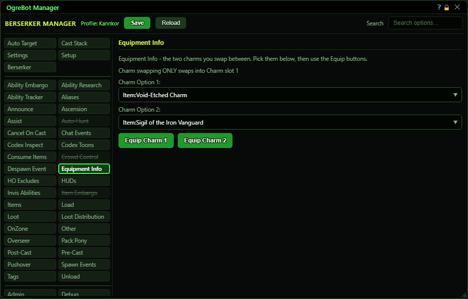

# Equipment Info

**OgreBot is in beta testing.** Looking for OgreBot Classic? [Click here](../../index.md).

Equipment Info stores two charm choices so you can swap between them quickly. Pick an item in each drop-down (the choices are your registered items from the Items tab), then press Equip Charm 1 or Equip Charm 2. The bot looks for that item in your bags and asks the game to equip it. The buttons only affect this character. Scripts and OgreConsole can also run the same swap for other characters.

| Option | What it does | Default |
|---|---|---|
| **Charm Option 1:** | The item that 'Equip Charm 1' puts on. The list shows your registered items from the Items tab. | empty |
| **Charm Option 2:** | The item that 'Equip Charm 2' puts on. The list shows your registered items from the Items tab. | empty |
| **Equip Charm 1** | Finds the Charm Option 1 item in your bags and asks the game to equip it, on this character only. *Does nothing but print a message if Charm Option 1 is empty or the item is not in your bags.* |  |
| **Equip Charm 2** | Finds the Charm Option 2 item in your bags and asks the game to equip it, on this character only. *Does nothing but print a message if Charm Option 2 is empty or the item is not in your bags.* |  |

## Good to know

- The drop-downs are empty until you register items on the Items tab. They list every registered item, not only charms.
- The item must be in your bags (not the bank, and not already equipped). If it is not found, the console says so.
- The game can still refuse the swap, for example because of relic limits. The console line only says the bot asked.

