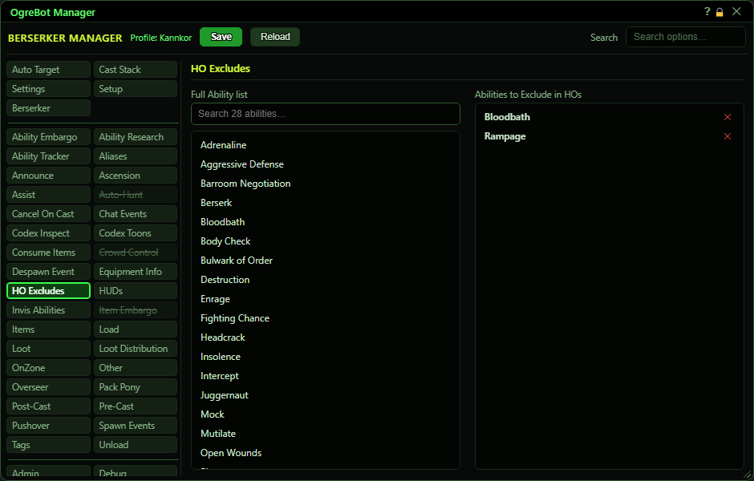

# HO Excludes

**OgreBot is in beta testing.** Looking for OgreBot Classic? [Click here](../../index.md).

HO Excludes lists abilities the bot must never use to work a Heroic Opportunity. When the bot picks an ability to match an HO icon, for the HO Starter or HO Wheel steps on the Settings tab or when a script asks for an HO icon ability, it skips anything on this list and uses another ability with that icon. Your normal Cast Stack rotation is not affected. Double-click an ability in the Full Ability list to add it. On the right, double-click a row to switch it off, or use the X to remove it. Changes apply straight away.

| Option | What it does | Default |
|---|---|---|
| **Full Ability list** | All of this character's abilities. Double-click one to add it to the exclude list. An ability that is already listed is not added twice. | your abilities |
| **Abilities to Exclude in HOs** | The abilities the bot will not pick for HO Starter or HO Wheel icons, shown A to Z. Double-click a row to switch it off (it is then used again), X to remove. | empty |

## Full Ability list (left)

| Control | What it does |
|---|---|
| **Search ... abilities** | Type to filter the ability list. Display only. |

## Good to know

- The rank does not matter: excluding 'Assault' also excludes 'Assault XIII', and the other way round. The match is still the exact ability line, so 'Assault' does not exclude 'Taunting Assault'.
- It does not affect the ability that opens an HO (the HO Start step). It only affects the abilities that match starter and wheel icons.
- To keep an ability out of your normal rotation as well, use the Cast Stack or the 'Disable HO' boxes on the Settings tab.

