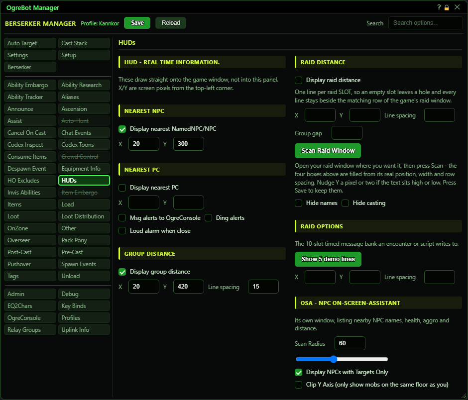
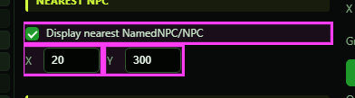
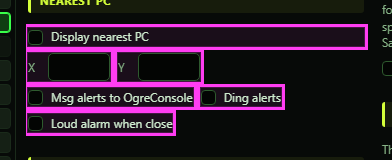
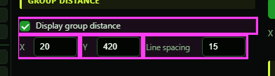
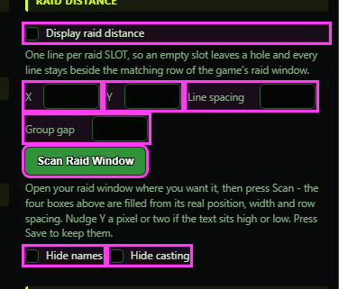
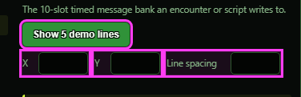
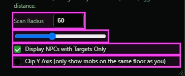

# HUDs

**OgreBot is in beta testing.** Looking for OgreBot Classic? [Click here](../../index.md).

HUDs puts live text straight onto your game screen: the nearest mob, the nearest other player, how far each group or raid member is, and timed messages from encounter scripts. The text sits on a see-through layer over the whole game window. It has no title bar, you cannot click or drag it, and your mouse clicks go through it to the game. Each block is placed by its X and Y boxes, counted in screen pixels from the top-left corner. Changes take effect as soon as you make them. The layer appears when you tick any of the Display boxes (or when an encounter puts up a Raid Options message) and closes when OgreBot closes. The last section sets up the OSA (On-Screen Assistant), which is a separate window of its own.

## Nearest NPC

| Option | What it does | Default |
|---|---|---|
| **Display nearest NamedNPC/NPC** | Shows one line on your screen with the closest mob within 200 metres and its distance. A named mob always wins over a normal one, even if the normal one is closer. | off |
| **X** | How far from the left edge of the screen the Nearest NPC line starts, in pixels. | blank (300) |
| **Y** | How far down from the top of the screen the Nearest NPC line sits, in pixels. | blank (400) |

## Nearest PC

| Option | What it does | Default |
|---|---|---|
| **Display nearest PC** | Shows one line with the closest player within 200 metres who is not in your group or raid. The line is red under 30 metres, yellow under 150 and white further out. | off |
| **X** | How far from the left edge of the screen the Nearest PC line starts, in pixels. | blank (300) |
| **Y** | How far down from the top of the screen the Nearest PC line sits, in pixels. | blank (380) |
| **Msg alerts to OgreConsole** | When a player comes within 150 metres, and again within 30, a line such as 'Kannkor --> Nearest PC: Serath: 24.1 < 30' is posted to OgreConsole. Each player is reported once per distance band, and alerts are at least 5 seconds apart. *Needs 'Display nearest PC' ticked.* | off |
| **Ding alerts** | Plays a short ding when a player comes within 30 metres. If 'Msg alerts' is also ticked, it dings at 150 metres too. A ding under 30 metres also posts the OgreConsole line, even without 'Msg alerts'. *Needs 'Display nearest PC' ticked.* | off |
| **Loud alarm when close** | When a player comes within 30 metres, plays a louder two-tone alarm instead of the short ding. *Does nothing on its own. 'Msg alerts' or 'Ding alerts' must also be ticked.* | off |

## Group Distance

| Option | What it does | Default |
|---|---|---|
| **Display group distance** | Shows a line for each other group member: their slot number, name, distance, their target and what they are casting. The colour shows distance: white close, then yellow, orange and red further out. *In a raid with 'Display raid distance' ticked, the raid lines replace these.* | off |
| **X** | How far from the left edge of the screen the group lines start, in pixels. | blank (300) |
| **Y** | How far down from the top of the screen the first group line sits, in pixels. | blank (420) |
| **Line spacing** | How many pixels apart the group lines are. | blank (12) |

## Raid Distance

| Option | What it does | Default |
|---|---|---|
| **Display raid distance** | In a raid, shows one line per raid slot (01 to 24) with the same details as the group lines. Empty slots stay blank so every line matches the raid window. Outside a raid it shows your group instead. | off |
| **X** | How far from the left edge of the screen the raid lines start, in pixels. Scan Raid Window fills this in. | blank (300) |
| **Y** | How far down the screen raid slot 1's line sits, in pixels. Scan Raid Window fills this in. | blank (420) |
| **Line spacing** | How many pixels apart the lines within one raid group are. Scan Raid Window fills this in from the raid window's own row height. | blank (12) |
| **Group gap** | Extra pixels added after slots 6, 12 and 18, so each raid group lines up with its block in the raid window. | blank (6) |
| **Scan Raid Window** | Reads where your raid window is on screen and fills in the four boxes above. The raid lines are placed right beside it (on the left if there is no room on the right). The HUD moves straight away. *Open the raid window first. If it cannot read the window you get 'Scan failed - see console'. Press Save to keep the numbers.* |  |
| **Hide names** | Leaves the slot number and name off each line, so it shows only the distance, target and cast. Applies to the group lines too. | off |
| **Hide casting** | Leaves off the 'what they are casting' part of each line. Applies to the group lines too. | off |

## Raid Options

| Option | What it does | Default |
|---|---|---|
| **Show 5 demo lines** | Puts 5 test lines with a 10-second countdown on screen so you can see where Raid Options messages appear. They disappear after 15 seconds. |  |
| **X** | How far from the left edge of the screen the Raid Options messages start, in pixels. | blank (300) |
| **Y** | How far down from the top of the screen the first Raid Options message sits, in pixels. | blank (300) |
| **Line spacing** | How many pixels apart the Raid Options messages are. | blank (15) |

## OSA - NPC On-Screen-Assistant

| Option | What it does | Default |
|---|---|---|
| **Scan Radius** | How far out, in metres, the OSA window looks for mobs. Anything over 200 counts as 200. *Only used while the OSA is turned on. The box and the slider always show the same number.* | blank (50) |
| **Scan Radius (slider)** | The same scan radius as the box beside it, as a slider from 0 to 149. Moving one updates the other. | not set (the OSA uses 50) |
| **Display NPCs with Targets Only** | The OSA window only lists mobs that have a target, meaning mobs that are fighting someone. Idle mobs are hidden. | off |
| **Clip Y Axis (only show mobs on the same floor as you)** | The OSA window hides mobs that are 8 or more above or below you, so the floors over and under you drop out of the list. *Only used while the OSA is turned on.* | off |

## What you see

- Nearest NPC - one white line: 'Named NPC: <name>: <distance>' for the closest named mob within 200 metres, or 'NPC: <name>: <distance>' when no named mob is in range.
- Nearest PC - one line: 'Nearest PC: <name>: <distance>' for the closest player within 200 metres who is not in your group or raid. It is red under 30 metres, yellow under 150 and white further out.
- Group distance - one line per group member (you are not listed): '(2) Brutus: 12.3 * <their target> * <what they are casting>'. Names are cut to their first 6 letters so the columns line up.
- Raid distance - one line per raid slot, '(01)' to '(24)', in the same layout as the group lines. An empty slot leaves a blank line and there is an extra gap after every 6 slots, so each line sits beside the matching row of the game's raid window.
- Group and raid line colours show distance: white under 20 metres, yellow under 30, orange under 75, red at 75 or more, grey when the game reports 0.
- The 'what they are casting' part shows the spell name for members running the new bot. For anyone else it just says 'casting'.
- Raid Options - up to 10 lines written by encounter files and scripts, usually a message with a countdown in seconds (for example 'Adds incoming: 12.4'). Each line disappears 5 seconds after its countdown ends.
- All HUD text is white-on-dark-outline monospace text so it stays readable on bright backgrounds. It refreshes about three times a second.

## Good to know

- The HUD layer has no title bar and ignores the mouse, so you cannot move it by dragging. Use the X and Y boxes to move each block.
- With 'Display raid distance' ticked and no raid, you see your group instead. So you do not need both boxes ticked. In a raid, the raid lines replace the group lines.
- The alert boxes only work while 'Display nearest PC' is ticked, and 'Loud alarm when close' does nothing unless 'Msg alerts' or 'Ding alerts' is also ticked.
- Scan Raid Window fills in the four Raid Distance boxes, but you still have to press Save to keep them.
- Emptying a position box does not move the block to 0,0. The block stays where it was, even after the profile is loaded again. It only goes back to its default position after the game client is restarted.

