

**OgreBot is in beta testing.** Looking for OgreBot Classic? [Click here](../../index.md).

# OgreBot Manager

> **:bulb: In game - the ? button on this window says**
>
> The main OgreBot window. Every bot setting for this character lives here, one tab per topic.
>
> **What you can do here**
>
> - **Pick a tab** on the left. Your class has its own tab. Struck-through tabs are not finished yet.
> - **Change a setting** - it takes effect right away.
> - **Save** writes this profile to disk. **Reload** throws away unsaved changes and reads the profile again.
> - **Search** finds a setting on any tab by its name.
> - **Profiles** tab - load, create, delete or set the default profile. A new profile copies the current one as last saved.
> - **Right-click a setting** to copy its name (for commands) or send it to your group.
>
> **Good to know**
>
> - A yellow star (*) in the title bar means there are unsaved changes. Closing OgreBot without saving loses them.
> - The X stops OgreBot, the same as `ogre end bot`. **Hide Main** on the small OgreBot window just hides this one.
> - Hover a setting or button to see what it does.

**Open it:** Type `ogre`. OgreBot loads running, with this window hidden: click **Show Main** on the small OgreBot window to see it (if the character's ability export is missing or out of date, the window is shown instead so you see the export prompt). `ogre -p` loads OgreBot paused with this window shown. `ogre end bot` closes OgreBot.

[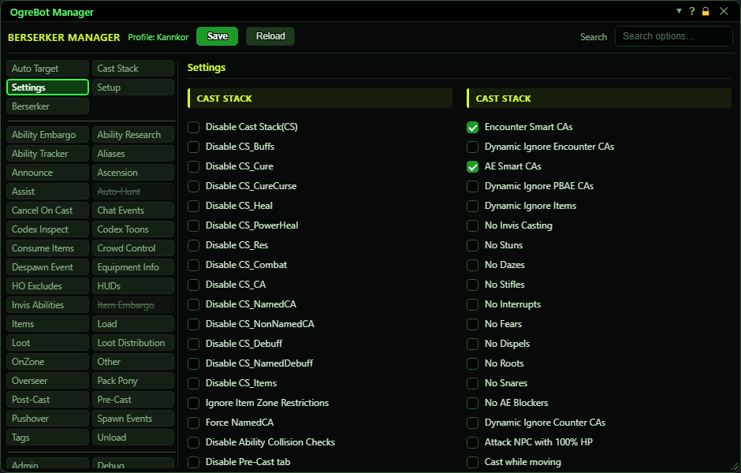](../assets/ogrebot/window.png "Click for full size")

## What it is for

This is the main OgreBot window. Every bot setting for this character lives here, one tab per topic. The window opens on the Settings tab. A change takes effect as soon as you make it, but it is only kept if you press Save. Your settings are grouped into profiles (for example Solo and Raid), and the Profiles tab switches between them. This page covers the frame of the window: the header, the tab list, searching, right-click and the Profiles tab. Each settings tab has its own page.

## Title bar

The title bar has the usual ? (help), lock and X buttons. When the profile has changes that are not saved yet, a yellow star (*) appears next to them.

[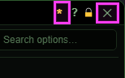](../assets/ogrebot/titlebar.png "Click for full size")

| Control | What it does | Default |
|---|---|---|
| *** (yellow star)** | Shows that this profile has changes that are not saved yet. Only this window shows it, not the small OgreBot window. It goes away after a Save or a Reload. *It counts every change, including ones made by commands or encounter scripts, not only clicks in this window.* | hidden |
| **Title bar close (X)** | Shuts OgreBot down completely, not just this window. Both OgreBot windows close. The Unload tab's list runs. Camp spot, follow and other movement are cleared, HUDs go away, travel routes and codex scans stop, and the profile is unloaded. Unsaved changes are thrown away and a warning is printed in the console. The same as `ogre end bot`. *To get the window out of the way without stopping the bot, use Hide Main on the small OgreBot window instead.* |  |

## Header: class, profile, Save and Reload

[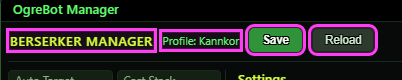](../assets/ogrebot/header.png "Click for full size")

| Control | What it does |
|---|---|
| **<Class> MANAGER** | Your class, for example BERSERKER MANAGER. It is the class of the character whose profile is loaded. |
| **Profile: <name>** | The name of the profile that is loaded right now. |
| **Save** | Asks 'Save current settings to <profile>?', then writes the loaded profile to disk. A message at the bottom says 'Profile saved', or 'No changes to save' if there was nothing to write. *Nothing is saved automatically. Close OgreBot without saving and your changes are gone.* |
| **Reload** | Throws away unsaved changes and reads the profile from disk again. The cast stack and every tab are refreshed. Settings that run when a profile loads run again. *It only asks first if you changed something in this window. Changes made by commands or scripts are dropped without asking.* |

## Search

Type part of a setting's name to find it on any tab. The list shows each match with the tab it lives on, and you can change the setting right there in the list.

[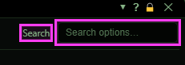](../assets/ogrebot/search.png "Click for full size")

| Control | What it does | Default |
|---|---|---|
| **Search (Search options...)** | Lists every setting, on every tab, whose name contains what you type (upper or lower case does not matter). Each match shows its tab name, for example '↪ Settings'. Click the tab name to jump to that tab, where the setting flashes. *It searches setting names, not tab names. Settings for another archetype are not shown.* | empty |
| **x (clear search)** | Clears the search and shows the tab you were on. Esc in the search box does the same. Clicking any tab also clears the search. |  |

## The tab list

The tabs down the left are in three blocks. At the top: Auto Target, Cast Stack, Settings, Setup, then your class tab. In the middle: every other tab, A to Z. At the bottom: Admin, Debug, EQ2Chars, Key Binds, OgreConsole, Profiles, Relay Groups and Uplink Info. Each block is in A to Z order, except that the class tab is always last in the top block.

[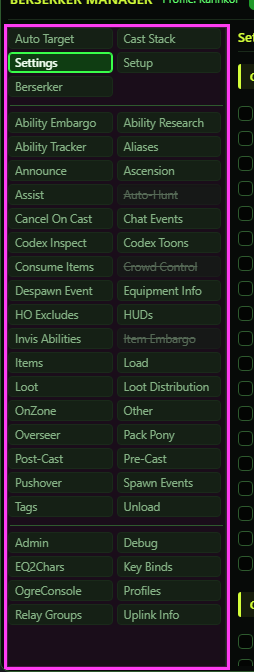](../assets/ogrebot/rail.png "Click for full size")

| Control | What it does | Default |
|---|---|---|
| **A tab (click)** | Shows that tab's settings on the right. The tab you are on is outlined. | Settings |
| **A struck-through tab (for example Auto-Hunt, Item Embargo)** | Not finished yet. Some of its settings do nothing yet, even though you can change and save them. That tab's own page says which ones work. The tab itself also says NOT FINISHED at the top. |  |

## Your class tab

One tab is named after your class (Berserker in the picture). It holds the options that only your class has. If your class has none, the tab says so.

[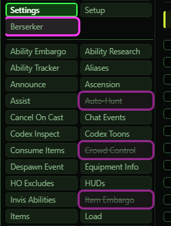](../assets/ogrebot/classtab.png "Click for full size")

| Control | What it does |
|---|---|
| **<Your class> tab** | Options for your class only. Each class's options are described on the class tab pages. *It follows the class of the loaded profile's character.* |

## Hover text

[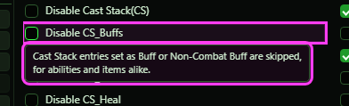](../assets/ogrebot/tooltip-option.png "Click for full size")

| Control | What it does |
|---|---|
| **Hover a setting or a struck-through tab** | After a short pause a box explains what the setting does, or why a tab is struck through. *Buttons and list rows all over the window have hover text too - for example why a greyed Delete cannot be used, and what the yellow star means.* |

## Right-click a setting

Right-click a checkbox, text box, dropdown or slider to get two extra choices. They are not offered for lists or buttons.

[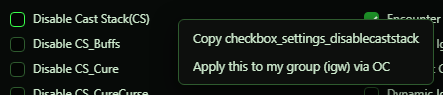](../assets/ogrebot/rightclick.png "Click for full size")

| Control | What it does |
|---|---|
| **Copy <setting name>** | Copies the setting's internal name (for example checkbox_settings_disablecaststack) to the clipboard. That is the name commands and scripts use, such as `-ChangeOgreBotUIOption`. |
| **Apply this to my group (igw) via OC** | Sends this setting, with the value it has here, to everyone in your group, you included. If the For Who window is open, it goes to whoever that window has picked instead, and by IRC if it is set to IRC. If that window has nobody or everyone picked, it still goes to your group. *Other characters get the change in memory only. They still have to Save.* |

## Profiles tab

A profile is a complete set of settings. One character can have several, for example Solo, Raid and Heroic Duo, and switch between them. The line at the top says which profile is loaded and whether you have unsaved changes. Each profile has a row with three buttons, and under the list you can make a new profile.

[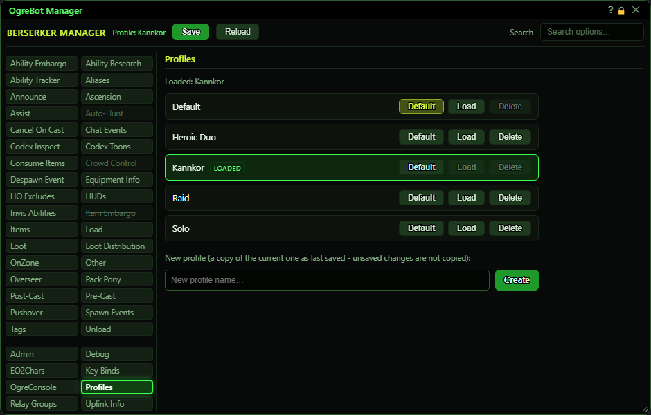](../assets/ogrebot/profiles.png "Click for full size")

| Control | What it does | Default |
|---|---|---|
| **Loaded: <name>** | The profile in use right now. '• unsaved changes' is added whenever the profile has changes that are not saved - the same thing the yellow star shows, including changes made by commands or encounters. |  |
| **A profile row** | One row per profile. The loaded one is outlined and tagged LOADED. |  |
| **Default** | Makes this the profile OgreBot loads when it starts. The current default's button is lit up and does nothing when clicked. | the profile named Default, on a new character |
| **Load** | Switches to this profile. Every tab and the cast stack change to its settings. If the profile has unsaved changes, it asks first, because they are thrown away. *Greyed out on the profile that is already loaded.* |  |
| **Delete** | Asks 'Permanently delete <name>? This cannot be undone.', then removes the profile from disk. *Greyed out on the loaded profile and on the default profile. You also cannot delete a character's last profile.* |  |
| **New profile name... (box)** | Type a name for a new profile. Press Enter or click Create. | empty |
| **Create** | Makes a new profile that is a copy of the loaded one as it was last saved, and saves it to disk at once. You stay on the profile you had. Load the new one to use it. *Unsaved changes are not copied: Save first if the copy should include them. Names are not case-sensitive, so 'raid' is refused if 'Raid' exists.* |  |
| **Confirm box: OK / Cancel** | Save, Reload, Load and Delete ask here first. OK goes ahead (red for Delete). Cancel does nothing. |  |

## What the window shows

- The header shows your class and the loaded profile's name.
- A yellow * in the title bar means there are unsaved changes.
- Struck-through tabs are not finished: some of their settings are saved but do nothing yet.
- A message at the bottom of the window confirms things like 'Profile saved' or 'Loaded profile <name>'.

## Good to know

- Changes take effect at once but are not saved until you press Save. Closing OgreBot (the X on either OgreBot window, or `ogre end bot`) throws unsaved changes away.
- The X does not just hide the window, it stops OgreBot. Use Hide Main on the small OgreBot window to hide it.
- Commands and encounter scripts change settings too. They turn on the star, but Reload and Load only ask before throwing away changes you made in this window.
- All of a character's profiles are kept in one file, normally `Scripts\OgreSave\EQ2\OgreBot\Profiles\Main\<server>_<character>.json`. Back that file up to keep your profiles safe.

## Searching

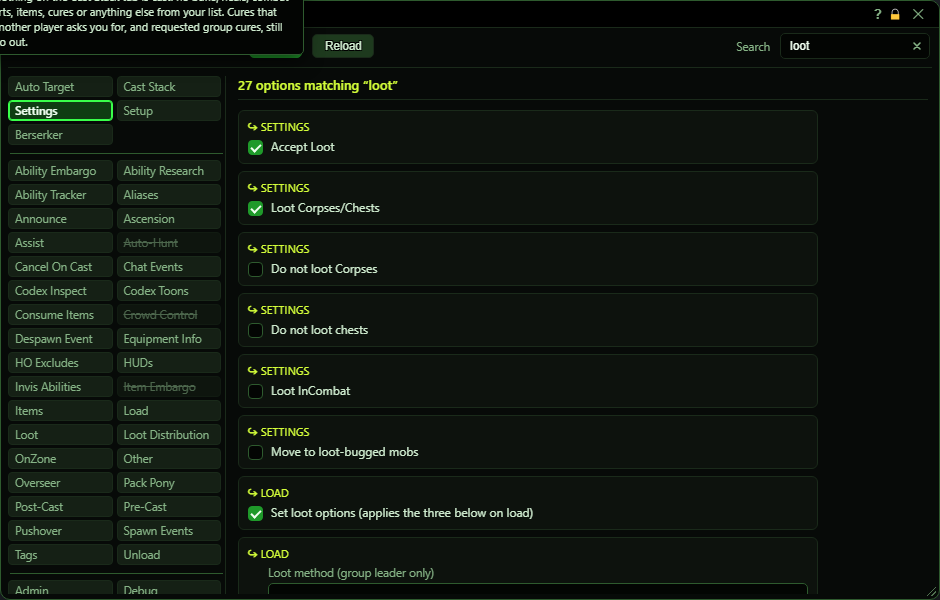

Typing *loot* lists every setting with 'loot' in its name, from every tab. Each match is a working control: tick it right there, or click the tab name above it to go to that tab.

## Profiles tab close-ups

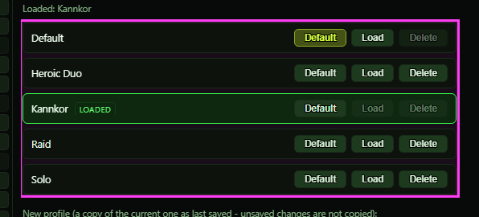

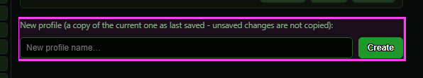

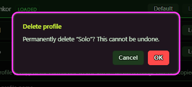

