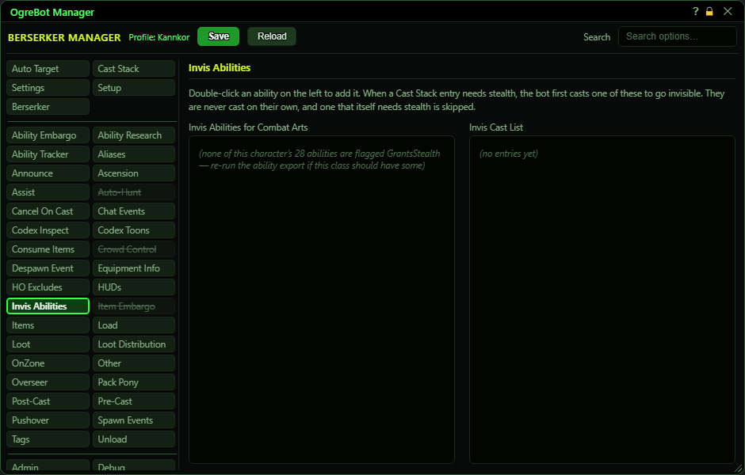

# Invis Abilities

**OgreBot is in beta testing.** Looking for OgreBot Classic? [Click here](../../index.md).

Invis Abilities lists the stealth abilities the bot may use to open a Cast Stack ability that only works while you are hidden (for example a scout attack from stealth). When such an entry comes up in the Cast Stack and you are not hidden, the bot first casts the first ready ability from the Invis Cast List, then fires the stealth ability straight after it, holding the cast bar so nothing else slips in between. The left list shows only this character's abilities that grant stealth, with a search box; double-click one to add it to the right-hand list.

| Option | What it does | Default |
|---|---|---|
| **Invis Abilities for Combat Arts** | Your abilities that grant stealth. Type in the search box to narrow it, and double-click an ability to add it to the Invis Cast List. *An ability already on the right-hand list is not added twice.* | filled from your ability export |
| **Invis Cast List** | The stealth openers to try, in order. Before a Cast Stack ability that needs stealth, the bot casts the first one here that is ready. *Switched-off rows are skipped.* | empty |

## Invis Abilities

| Control | What it does |
|---|---|
| **Drag a row** | Drag a row up or down to change which opener is tried first. |
| **Double-click a row** | Switches that ability off or back on. A switched-off row is struck through and never used. |
| **x (remove)** | Removes that ability from the list. |

## Good to know

- If no ability on the Invis Cast List is ready, a Cast Stack entry that needs stealth is simply skipped until one is.
- Order matters: the first ready ability in the Invis Cast List is used. Drag to reorder.
- An ability here that itself needs stealth can never open anything. The bot skips it and prints a warning in the console once.
- Some class abilities let certain stealth attacks fire without being hidden; in that case no opener is cast.
- If the left list is empty for a class that has stealth, run the ability export again.
- Changes take effect straight away. Press Save at the top to keep them after a reload.

