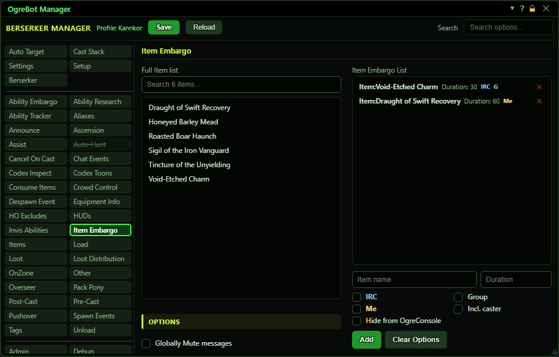
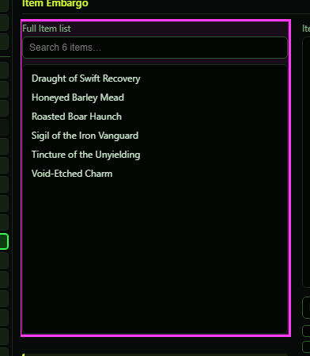
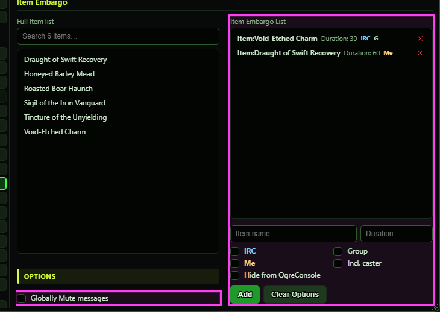

**OgreBot is in beta testing.** Looking for OgreBot Classic? [Click here](../../index.md).

# Item Embargo

Item Embargo stops your characters all using the same item at once: when one of them uses an item on this list, it tells the others to hold off that item for the row's Duration. It works while 'Enable Item Embargo' is ticked on the Settings tab, on the character that uses the item and on the ones that should hold off. How the screen works: the Full Item list on the left shows your registered items (from the Items tab). Click one to pick it, set a Duration and the option flags under the right-hand list, then press Add. Double-clicking an item adds it straight away with no options. On the right-hand list, click a row to edit it (Add becomes Update, with a Cancel), double-click a row to switch it off or on, drag rows to reorder them, and use the x to remove one.

## Item Embargo

| Option | What it does | Default |
|---|---|---|
| **Full Item list** | Your registered items (from the Items tab). Click one to pick it for the form on the right, or double-click it to add it straight away with no options. | your registered items |

## Options

| Option | What it does | Default |
|---|---|---|
| **Globally Mute messages** | Sends every embargo from this tab without showing it in OgreConsole, as if every row had Hide from OgreConsole ticked. Nothing is stopped: the embargo still goes out, over IRC too if the row has IRC ticked. | off |
| **Item Embargo List** | The items that are embargoed when you use them, each with its Duration and options. When you use an item on this list, the other characters hold off that item for its Duration. *Click a row to edit it, double-click to switch it off or on, drag to reorder, x to remove. Rows are checked from the top; a Me row or a row without a Duration ends the check for that item.* | empty |

## Options

| Control | What it does | Default |
|---|---|---|
| **Item name** | The item to add. Type part of a name to get suggestions from your registered items, or click an item in the Full Item list. | empty |
| **Duration** | How many seconds the other characters hold off the item after you use it. A row without one sends nothing. | empty |
| **IRC** | Also sends the embargo over IRC, so characters on other PCs hold off too. | off |
| **Group** | Only the characters in your group hold off the item. | off |
| **Me** | Only this character holds off the item. Nothing is sent to the others. | off |
| **Incl. caster** | Adds who used it and the item's name to the end of the embargo line, so anyone reading OgreConsole or IRC can see which item it was. The line only carries the item's LinkID otherwise. | off |
| **Hide from OgreConsole** | Sends the embargo without showing it in OgreConsole. It still reaches every character. | off |
| **Add** | Adds the picked item with its Duration and ticked options to the list. When you are editing a row, it reads Update and saves your changes. |  |
| **Clear Options** | Unticks all the option boxes. They otherwise carry over to the next Add. |  |

## Good to know

- Nothing is sent unless 'Enable Item Embargo' (Settings tab) is ticked on the character that uses the item. The characters that should hold off need it ticked too, or they ignore the embargo.
- Every row needs a Duration. A row without one sends nothing and the console says so when the item is used.
- A row is matched by the item's name, so it works for an item in your bags or one you have equipped.
- The embargo is sent with the -ItemEmbargo command and the item's LinkID, so you can watch it go out in OgreConsole (unless Hide from OgreConsole or Globally Mute is ticked). The character that used the item gets it too, as in the old bot.
- Loading a profile clears every item embargo still running.
- The Full Item list only shows items you have registered on the Items tab. If it is empty, register some there first.
- The option flags stay ticked after an Add. Use Clear Options to untick them all before the next item.
- On the list each row shows its options as coloured letters: IRC, G (Group), Me, I (Incl. caster) and H (Hide from OgreConsole). The same colour is used on the matching tick box.

