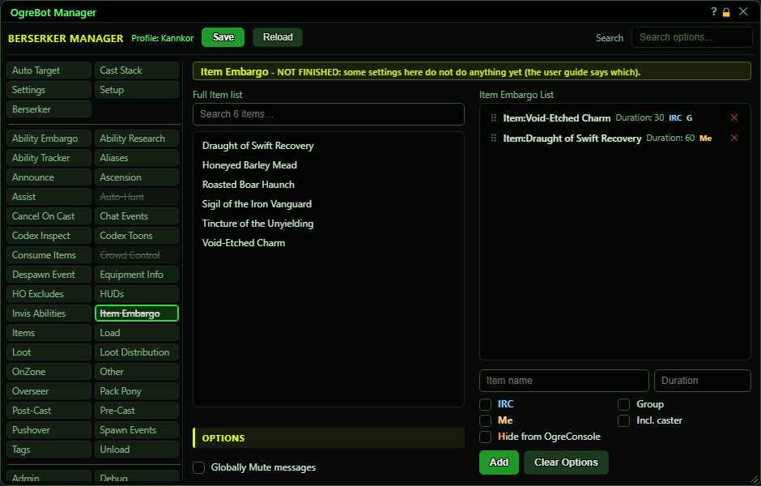
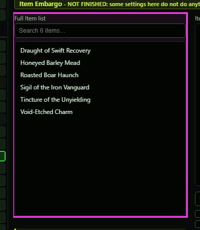
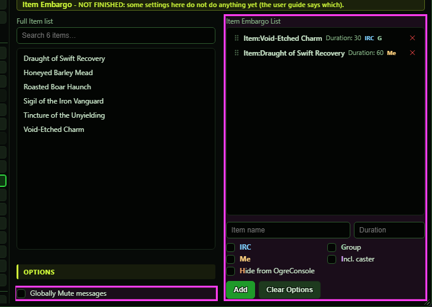

# Item Embargo (not finished)

**OgreBot is in beta testing.** Looking for OgreBot Classic? [Click here](../../index.md).

> **:warning: Not finished**
>
> OgreBot marks this tab as not finished (its name is struck through). Some options below work and some do not yet - each one says which.

Item Embargo is meant to stop your characters all using the same item at once: when one uses a listed item, the others hold off for the set time. In the new bot this tab is not active yet. You can build and save the list, but nothing reads it, so it has no effect. How the screen works: the Full Item list on the left shows your registered items (from the Items tab). Click one to pick it, set a Duration and the option flags under the right-hand list, then press Add. Double-clicking an item adds it straight away with no options. On the right-hand list, click a row to edit it (Add becomes Update, with a Cancel), double-click a row to switch it off or on, drag rows to reorder them, and use the x to remove one.

## Item Embargo

| Option | What it does | Default |
|---|---|---|
| **Full Item list** | **Not active yet.** Your registered items (from the Items tab). Click one to pick it for the form on the right, or double-click it to add it straight away with no options. *This tab is not active yet in the new bot.* | your registered items |

## Options

| Option | What it does | Default |
|---|---|---|
| **Globally Mute messages** | **Not active yet.** It is meant to stop item embargo messages being shown. | off |
| **Item Embargo List** | **Not active yet.** The saved list of items that are meant to be embargoed, each with its duration and options. *Click a row to edit it, double-click to switch it off or on, drag to reorder, x to remove.* | empty |

## Options

| Control | What it does | Default |
|---|---|---|
| **Item name** | The item to add. Type part of a name to get suggestions from your registered items, or click an item in the Full Item list. | empty |
| **Duration** | How many seconds the other characters are meant to hold off after the item is used. | empty |
| **IRC** | Meant to announce the embargo over IRC. | off |
| **Group** | Meant to limit the embargo to group members. | off |
| **Me** | Meant to limit the embargo to this character. | off |
| **Incl. caster** | Meant to include the character who used the item, and the item's name, in the embargo. | off |
| **Hide from OgreConsole** | Meant to send the embargo without showing it in OgreConsole. | off |
| **Add** | Adds the picked item with its Duration and ticked options to the list. When you are editing a row, it reads Update and saves your changes. |  |
| **Clear Options** | Unticks all the option boxes. They otherwise carry over to the next Add. |  |

## Good to know

- Nothing on this tab does anything yet in the new bot, and neither does 'Enable Item Embargo' on the Settings tab.
- The Full Item list only shows items you have registered on the Items tab. If it is empty, register some there first.
- The option flags stay ticked after an Add. Use Clear Options to untick them all before the next item.
- On the list each row shows its options as coloured letters: IRC, G (Group), Me, I (Incl. caster) and H (Hide from OgreConsole). The same colour is used on the matching tick box.

