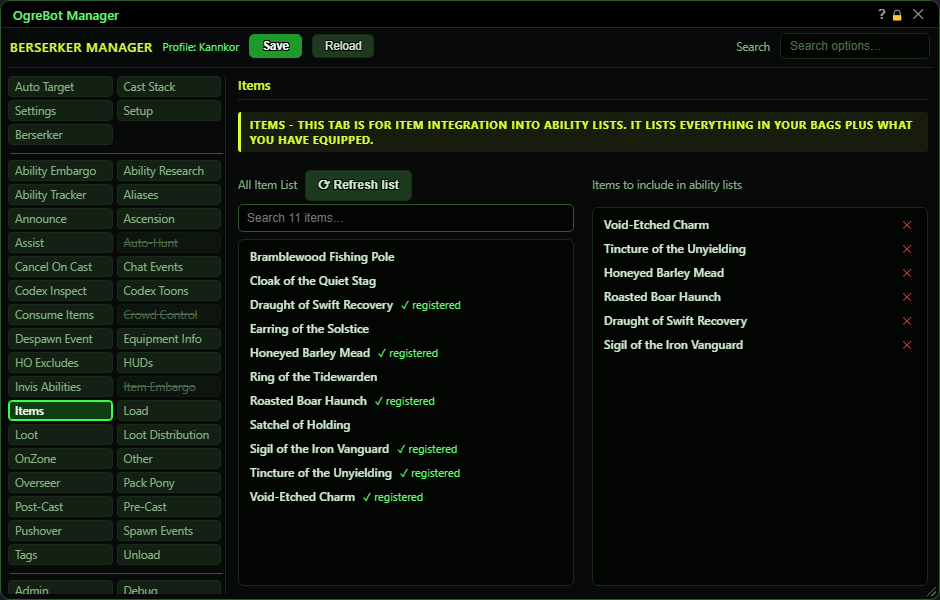

# Items

**OgreBot is in beta testing.** Looking for OgreBot Classic? [Click here](../../index.md).

Items is where you register the items the rest of OgreBot can offer you. The left list, All Item List, shows everything you have equipped and everything in your bags. It is filled when your profile loads; press Refresh list after looting or changing gear. It also has a search box. Double-click an item to register it: it moves into the right list, 'Items to include in ability lists', and gets a green '✓ registered' mark on the left. Only registered items appear in the item pickers on other tabs: the Cast Stack, Consume Items, Item Embargo, Pre-Cast and Post-Cast, the Equipment Info charm choices and the Auto-Hunt pull list. Click the x on a right-hand row to unregister it.

| Option | What it does | Default |
|---|---|---|
| **All Item List** | Everything you have equipped, everything in your bags, 'whatever is in slot X' entries and your equipped adornments. Double-click an item to register it. *Items already registered show a green '✓ registered' mark and cannot be added twice.* | filled when your profile loads |
| **Items to include in ability lists** | Your registered items. These are the items the item pickers on the Cast Stack, Consume Items, Item Embargo, Pre/Post-Cast, Equipment Info and Auto-Hunt tabs offer. | empty |

## Items

| Control | What it does | Default |
|---|---|---|
| **Refresh list** | Reads your equipment and bags again and refreshes the All Item List. Use it after looting or changing gear. |  |
| **Search N items...** | Type part of a name to show only the matching items in the All Item List. It only filters what you see. | empty |
| **Double-click an item (left list)** | Registers that item, adding it to 'Items to include in ability lists'. The change is saved straight away. |  |
| **x (remove row)** | Unregisters that item. It stops appearing in the other tabs' pickers. |  |

## Good to know

- If the Item List on Consume Items or Item Embargo, or a charm drop-down on Equipment Info, is empty, you have not registered any items here yet.
- Registering does not make the bot use an item. It only makes the item appear in the other tabs' pickers.
- The left list has special entries. '_EQUIPPED_<slot>_<number>' means 'whatever is in that slot', so you can use a charm slot without naming a specific charm. '_ADORN_<name>' is an adornment you have equipped.
- Right after a profile loads, the adornment entries can take a few seconds to appear. The bot scans again by itself once they are ready.
- Unregistering an item does not remove it from Cast Stack or Consume Items entries you already made.

