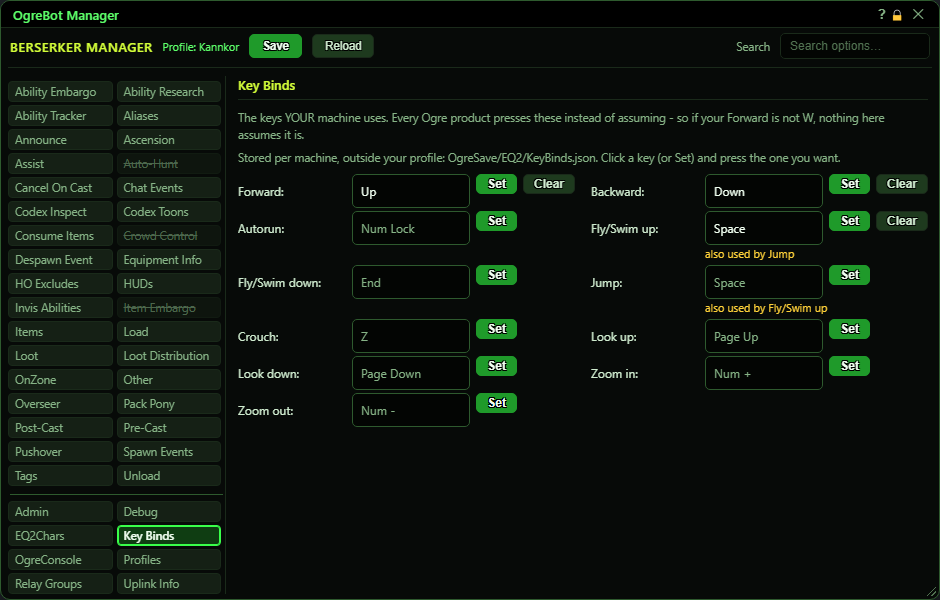

# Key Binds

**OgreBot is in beta testing.** Looking for OgreBot Classic? [Click here](../../index.md).

Key Binds tells the bot which keys your game uses for moving, jumping, flying and so on. Whenever the bot has to press one of these keys for you, it presses the key set here, so if your Forward is not W the bot still walks. The tab shows eleven actions in two columns. Each has a box with its key, a Set button and a Clear button. To change one, click the key box or Set, then press the key you want. The change is saved straight away, for every EverQuest 2 character on this PC. The keys are kept in Scripts\OgreSave\EQ2\KeyBinds.json, not in your profile.

| Option | What it does | Default |
|---|---|---|
| **(the key list)** | One row per action: its name, the key it uses, Set and Clear. Click the key or Set, then press a key to change it. | the standard keys |

## Key Binds

| Control | What it does | Default |
|---|---|---|
| **(key box)** | Shows the key the bot presses for this action. Click it to choose a new key, the same as Set. Grey means it is still the standard key. |  |
| **Set** | Starts waiting for a key. The list is replaced by 'Press the key you want to use.' The next key you press becomes this action's key and is saved at once. *Mouse buttons still work while it waits, so you can click Cancel.* |  |
| **Clear** | Puts this action back to its standard key. *Hidden while the action already uses its standard key.* |  |
| **Cancel** | Only shown while waiting for a key. Stops waiting and keeps the old key. |  |
| **Forward** | The key the bot holds to walk you forward when it moves you somewhere. | w |
| **Backward** | The key the bot holds to back you up when it moves you. | s |
| **Autorun** | The key the bot presses for its Autorun command. | Num Lock |
| **Fly/Swim up** | The key the bot holds to rise while flying or swimming, both when it moves you and for its Fly Up command. | Home |
| **Fly/Swim down** | The key the bot holds to sink while flying or swimming, both when it moves you and for its Fly Down command. It is also used to land a flying mount. | End |
| **Jump** | The key the bot presses for its Jump command and for jumps along a travel path. | Space |
| **Crouch** | The key the bot presses for its Crouch command. | Z |
| **Look up** | **Not active yet.** Stored for later. Nothing in the bot presses this key yet. | Page Up |
| **Look down** | **Not active yet.** Stored for later. Nothing in the bot presses this key yet. | Page Down |
| **Zoom in** | **Not active yet.** Stored for later. Nothing in the bot presses this key yet. | Num + |
| **Zoom out** | **Not active yet.** Stored for later. Nothing in the bot presses this key yet. | Num - |

## Good to know

- While the tab waits for your key press, every key is caught, so the game does not see it. Press the key, click Cancel, or wait 15 seconds.
- If Set shows 'Reading the key list - press Set again in a moment', wait a moment and press Set again.
- A grey key is the standard one. Clear only shows once you have changed a key, and puts it back to the standard one.
- If two actions use the same key, an 'also used by ...' warning appears under it. The bot still allows it.
- Changing a key updates all your EverQuest 2 sessions on this PC right away. No Save is needed.
- Look up, Look down, Zoom in and Zoom out are stored, but nothing in the bot presses them yet.

