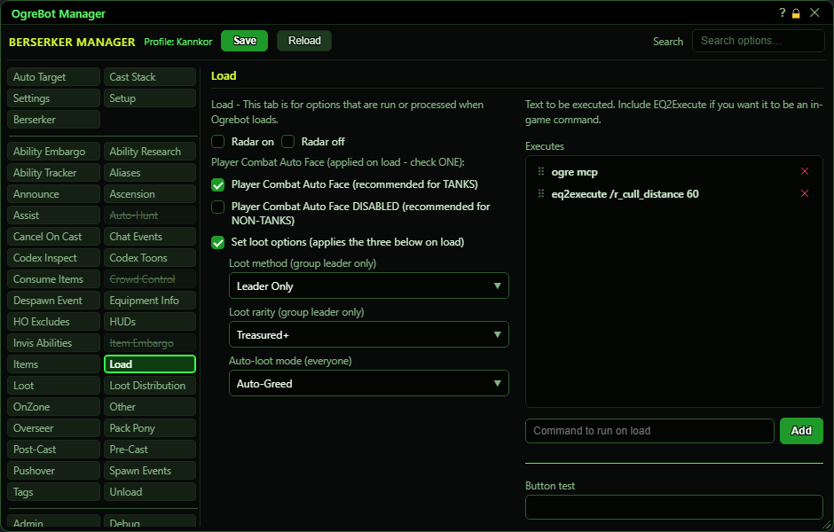

# Load

**OgreBot is in beta testing.** Looking for OgreBot Classic? [Click here](../../index.md).

Load holds things the bot does every time it loads your profile. The left side sets a few game options: the radar, the game's Player Combat Auto Face option, and your group loot rules. Ticking one of those boxes also applies it right away. The right side is a list of commands the bot runs, in order, each time it loads.

| Option | What it does | Default |
|---|---|---|
| **Radar on** | Opens the OgreBot radar window when the profile loads, and right away when you tick it. *You can tick Radar on or Radar off, not both.* | off |
| **Radar off** | Closes the OgreBot radar window when the profile loads, and right away when you tick it. | off |
| **Player Combat Auto Face  (recommended for TANKS)** | Turns ON the game's 'Player Combat Auto Face' option when the profile loads, and right away when you tick it. Your character then turns to face what it is fighting. *Tick this one or the DISABLED one below, not both.* | off |
| **Player Combat Auto Face DISABLED  (recommended for NON-TANKS)** | Turns OFF the game's 'Player Combat Auto Face' option when the profile loads, and right away when you tick it. | off |
| **Set loot options (applies the three below on load)** | Applies the three loot dropdowns below when the profile loads, and right away when you tick it. As group leader the bot opens the game's Group Options window, sets them and clicks Apply. If you are not the leader, only the auto-loot mode is set. *A dropdown left on 'Select...' is not changed.* | off |
| **Loot method (group leader only)** | The group loot method to set: Leader Only, Free For All, Lotto, Need Before Greed or Round Robin. Only used by 'Set loot options', and only when you lead the group. | not set (left alone) |
| **Loot rarity (group leader only)** | The lowest item rarity the group loot rules apply to: All, Treasured+, Legendary+ or Fabled+. Only used by 'Set loot options', and only when you lead the group. | not set (left alone) |
| **Auto-loot mode (everyone)** | Your own auto-loot choice: None, Auto-Greed or Auto-Decline. Used by 'Set loot options', whether or not you lead the group. | not set (left alone) |
| **Executes** | Commands the bot runs, top to bottom, every time it loads your profile. Switched-off lines are skipped. *Double-click a line to switch it off or on. Drag to reorder.* | empty |
| **Button test** | **Not active yet.**  | empty |

## Executes

| Control | What it does | Default |
|---|---|---|
| **Command to run on load** | Type a console command here. Put `eq2execute` in front of an in-game slash command. Press Enter or Add to put it on the list. *Commas and ] are removed when you add the line.* | empty |
| **Add** | Adds the typed command to the end of the list and runs it once straight away, so you can see it works. |  |

## Good to know

- The Executes list takes console commands. To run an in-game slash command, start the line with `eq2execute`, for example `eq2execute /join_channel MyChannel`.
- A command you add is run once straight away, so a typo shows up right then.
- Commas and ] are removed from a command when you add it. A line that needs them will not run as typed.
- Changing one of the three loot dropdowns does nothing by itself. It is used the next time the profile loads, or when you tick 'Set loot options' again.
- Double-click a command to switch it off without deleting it. Drag the grip to change the order. The x removes it.

