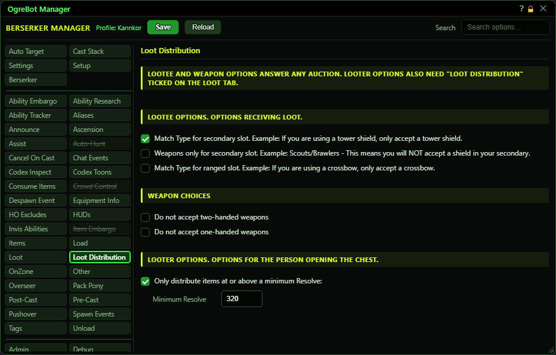
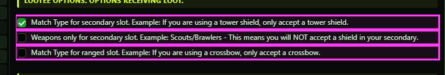
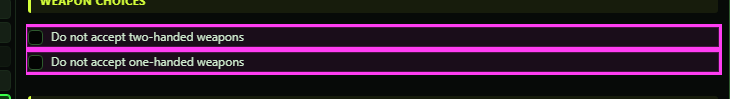
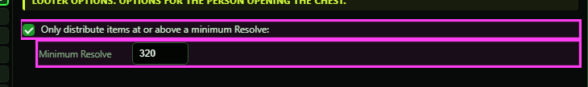

# Loot Distribution

**OgreBot is in beta testing.** Looking for OgreBot Classic? [Click here](../../index.md).

Loot Distribution hands out gear from a Leader Only chest by Resolve. The looter asks the group about each piece of equipment. Every member's bot works out how much Resolve it would gain in the slot the item would replace, and the biggest gain wins. A plain upgrade always beats a 'maybe later' bid. The top half of this tab (Lootee and Weapon Choices) is what THIS character will accept when someone else's chest asks. The bottom half (Looter) only matters on the character opening the chest, and only when 'Loot Distribution' is ticked in the Leader Only block of the Loot tab.

## Lootee Options. Options receiving loot.

| Option | What it does | Default |
|---|---|---|
| **Match Type for secondary slot. Example: If you are using a tower shield, only accept a tower shield.** | For your secondary slot, this character only bids on the same kind of item it already holds there, for example tower shield for tower shield. *If your secondary slot is empty, nothing matches, so you bid on nothing for that slot.* | off |
| **Weapons only for secondary slot. Example: Scouts/Brawlers - This means you will NOT accept a shield in your secondary.** | For your secondary slot, this character only bids on weapons (sword, dagger, mace, axe, rapier, hammer, fist, katana, great sword, great axe, great hammer, staff, spear). Shields and other off-hand items are refused. *A weapon that also fits your primary slot can still be bid on for primary.* | off |
| **Match Type for ranged slot. Example: If you are using a crossbow, only accept a crossbow.** | For your ranged slot, this character only bids on the same kind of item it already holds there, for example crossbow for crossbow. *If your ranged slot is empty, nothing matches.* | off |

## Weapon Choices

| Option | What it does | Default |
|---|---|---|
| **Do not accept two-handed weapons** | This character never bids on two-handed weapons. *Tick both Weapon Choice boxes to take no weapons at all from distribution.* | off |
| **Do not accept one-handed weapons** | This character never bids on one-handed weapons. Shields and other off-hand items that are not weapons are still accepted. *Ranged items are not affected.* | off |

## Looter Options. Options for the person opening the chest.

| Option | What it does | Default |
|---|---|---|
| **Only distribute items at or above a minimum Resolve:** | Only items with at least the Resolve in the box below are auctioned. Lower items go to the normal Leader Only loot boxes instead. | off |
| **Minimum Resolve** | The lowest Resolve an item needs to be auctioned. Only used when the box above is ticked. | empty (0 - no minimum) |

## Good to know

- Group only. In a raid nothing is auctioned; items go straight to the normal Leader Only loot boxes.
- Only the looter needs 'Loot Distribution' ticked on the Loot tab. Everyone else answers with the Lootee and Weapon Choice boxes from their own tab, whatever their own Loot tab says.
- Not auctioned: items with no Resolve, items you cannot equip, mercenary and mount gear, and items no class in the group can use. Those go to the normal loot boxes instead, as do items nobody bids on.
- A character never bids on an item it already has equipped or in its bags.
- 'Match Type' boxes need something in that slot. With an empty secondary or ranged slot and the box ticked, that character bids on nothing for that slot.

