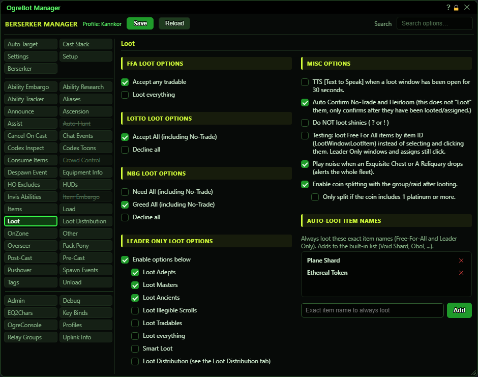
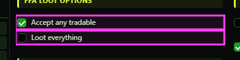
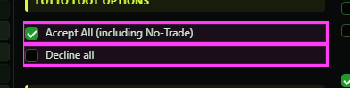
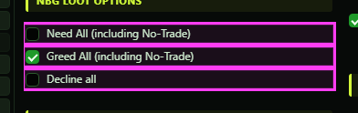
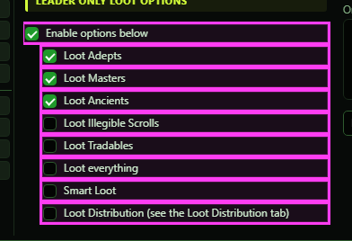
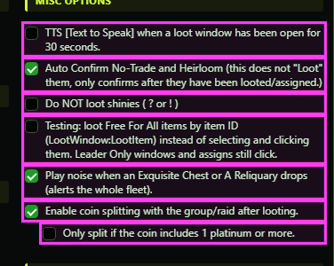
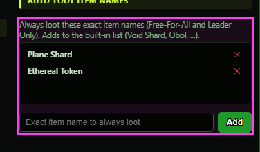

# Loot

**OgreBot is in beta testing.** Looking for OgreBot Classic? [Click here](../../index.md).

Loot decides what the bot does when a loot window opens. Nothing on the left half works unless 'Accept Loot' is ticked on the Settings tab. Each window type has its own block: Free For All (solo boxes and FFA groups), Lottery, Need Before Greed, and Leader Only (you are the loot master). Leader Only is where Smart Loot and Loot Distribution hand items to group members; anything they do not claim goes to the plain 'loot this kind of item' boxes. The right half holds options that apply on their own, plus the Auto-Loot list: type an exact item name in the box under it and press Add (or Enter), and the item is always taken from Free For All and Leader Only windows. Each row has an x to remove it.

## FFA Loot Options

| Option | What it does | Default |
|---|---|---|
| **Accept any tradable** | The bot handles Free For All loot windows. It takes every tradable item, plus anything on the Auto-Loot list. No-Trade and Heirloom items are left behind unless 'Loot everything' is ticked. *With this off, Free For All windows are ignored completely.* | off |
| **Loot everything** | In Free For All windows the bot takes every item, No-Trade and Heirloom included. *Needs 'Accept any tradable' ticked too.* | off |

## Lotto Loot Options

| Option | What it does | Default |
|---|---|---|
| **Accept All (including No-Trade)** | When a Lottery loot window opens, the bot enters the roll for everything in it. *If both Lotto boxes are ticked, this one wins.* | off |
| **Decline all** | When a Lottery loot window opens, the bot declines the roll. | off |

## NBG Loot Options

| Option | What it does | Default |
|---|---|---|
| **Need All (including No-Trade)** | When a Need Before Greed window opens, the bot picks Need. *If several NBG boxes are ticked, Need wins, then Greed, then Decline.* | off |
| **Greed All (including No-Trade)** | When a Need Before Greed window opens, the bot picks Greed. | off |
| **Decline all** | When a Need Before Greed window opens, the bot declines it. | off |

## Leader Only Loot Options

| Option | What it does | Default |
|---|---|---|
| **Enable options below** | The bot handles Leader Only loot windows using the boxes below. With it off, Leader Only windows are left for you. | off |
| **Loot Adepts** | The bot takes items with '(Adept)' in the name. | off |
| **Loot Masters** | The bot takes items with '(Master)' in the name. | off |
| **Loot Ancients** | The bot takes items with '(Ancient)' in the name. | off |
| **Loot Illegible Scrolls** | The bot takes items whose name contains 'Illegible Scroll:'. | off |
| **Loot Tradables** | The bot takes every item that is neither No-Trade nor Heirloom. A few names are always skipped: 'CD Armor:', 'CD Armor Voucher:' and 'Living Embodiment of Shadow'. | off |
| **Loot everything** | The bot takes every item in the window. Once it has finished with the window, it closes it, even if something was left behind. *Smart Loot and Loot Distribution still get first pick of each item.* | off |
| **Smart Loot** | Before anything else, the bot gives each item to the first member of your group or raid (in slot order) whose Smart Loot quota still wants it, or wants an adornment on it. Quotas are set in the Smart Loot window (`ogre smartloot`). | off |
| **Loot Distribution (see the Loot Distribution tab)** | Items Smart Loot did not hand out go to a Resolve auction first: the group is asked who gains the most Resolve from the item, and the winner gets it. Items nobody wants, or that do not qualify, fall through to the boxes above. *Group only. In a raid nothing is auctioned. Each auction waits up to about 3 seconds for answers.* | off |

## Misc Options

| Option | What it does | Default |
|---|---|---|
| **TTS [Text to Speak] when a loot window has been open for 30 seconds.** | If a loot window is still open 30 seconds after it appeared, every one of your sessions says '<your name> Loot Window' out loud. *Only works while 'Accept Loot' (Settings tab) is ticked.* | off |
| **Auto Confirm No-Trade and Heirloom (this does not "Loot" them, only confirms after they have been looted/assigned.)** | When the game asks you to confirm taking a No-Trade or Heirloom item, the bot clicks yes for you. *It never loots anything by itself. An Instance Controller run ticks this box.* | off |
| **Do NOT loot shinies ( ? or ! )** | The bot stops picking up shinies ('?' and '!' collectibles) near you. Corpses and chests are still looted as usual. *Applies to the automatic looter ('Loot Corpses/Chests' on the Settings tab) and to Instance Controller shiny steps.* | off |
| **Testing: loot Free For All items by item ID (LootWindow:LootItem) instead of selecting and clicking them. Leader Only windows and assigns still click.** | A test option. In Free For All windows the bot takes each item directly instead of selecting it and clicking Loot, which is faster. Leader Only windows and handing items to others are not affected. *Still being tried out. Untick it if Free For All items start being left behind.* | off |
| **Play noise when an Exquisite Chest or A Reliquary drops (alerts the whole fleet).** | When an Exquisite Chest or A Reliquary appears, all your sessions get a message with a sound. *Every session with this ticked sends its own alert, so tick it on one character only.* | off |
| **Enable coin splitting with the group/raid after looting.** | Each time you loot coin, the bot splits that amount with your group or raid. | off |
| **Only split if the coin includes 1 platinum or more.** | Coin is only split when the looted amount has at least 1 platinum in it. Gold, silver and copper alone are kept. *Does nothing unless the box above is ticked. 99 gold does not count as 1 platinum.* | off |

## Auto-Loot item names

| Option | What it does | Default |
|---|---|---|
| **Always loot these exact item names (Free-For-All and Leader Only). Adds to the built-in list (Void Shard, Obol, ...).** | Items named here are always taken from Free For All and Leader Only windows, even No-Trade ones. Your names are added to the shipped list. *The name must match exactly (case does not matter). The FFA or Leader Only master box must be ticked for its window type.* | empty |

## Auto-Loot item names

| Control | What it does | Default |
|---|---|---|
| **Exact item name to always loot** | Type an item name here, then press Add or Enter to put it on the list. | empty |
| **Add** | Adds the typed name to the Auto-Loot list. It takes effect on the next loot window. |  |
| **x (remove row)** | Removes that name from your list. |  |

## Good to know

- 'Accept Loot' on the Settings tab is the master switch. With it off, the bot ignores every loot window, whatever is ticked here.
- 'Loot everything' under FFA only works when 'Accept any tradable' is also ticked. That box is what makes the bot handle Free For All windows at all.
- The Leader Only boxes only work when 'Enable options below' is ticked. With it off, Leader Only windows (including Smart Loot and Loot Distribution) are left alone.
- A paused bot does not loot Free For All or Leader Only windows. A window that opened while paused is not handled when you resume. Close it and open it again.
- Starting an Instance Controller run ticks some of these for you: Leader Only 'Enable options below', 'Loot everything' and 'Smart Loot' on all your characters, and 'Auto Confirm No-Trade'. Solo, it also ticks both FFA boxes.
- Auto-Loot names must match the item name exactly (upper or lower case does not matter). Your list is added to a shipped list (Void Shard, Obol and others). To remove a shipped name, list it as false in your own list file, Scripts\OgreSave\EQ2\Loot\custom\autoloot-names.json (the shipped file explains how). Just leaving a name out of that file does not remove it.

