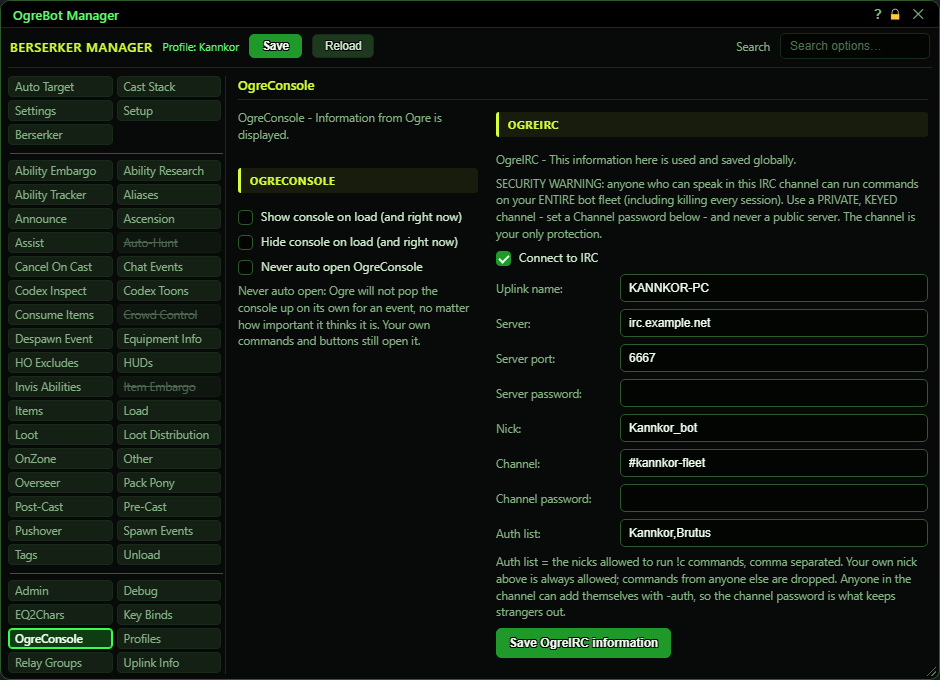
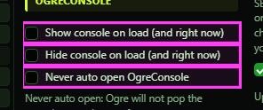
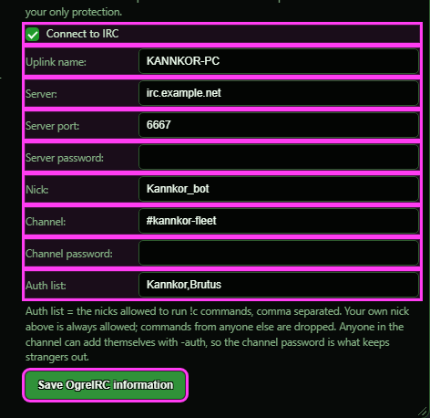

# OgreConsole

**OgreBot is in beta testing.** Looking for OgreBot Classic? [Click here](../../index.md).

OgreConsole is the window where Ogre shows messages from all your characters. The left column decides whether that window opens or closes when this character's profile loads, and whether Ogre may pop it open by itself. The right column sets up OgreIRC, which links your bot fleet to an IRC channel so you can send commands to it from IRC. The IRC settings are one set for the whole PC, not per character.

## OgreConsole

| Option | What it does | Default |
|---|---|---|
| **Show console on load (and right now)** | Opens OgreConsole each time this profile loads. Ticking it also opens it right now and unticks 'Hide console on load'. *Unticking it does not close the console; it only stops the open on the next load.* | off |
| **Hide console on load (and right now)** | Closes OgreConsole each time this profile loads. Ticking it also closes it right now and unticks 'Show console on load'. *If both boxes end up ticked, hide wins.* | off |
| **Never auto open OgreConsole** | Ogre never pops OgreConsole open by itself for an event, such as a tell passed on from another of your sessions. Your own commands and buttons still open it. | off |

## OgreIRC

| Option | What it does | Default |
|---|---|---|
| **Connect to IRC** | Connects to IRC each time this profile loads, and when you press 'Save OgreIRC information'. This box is saved per character profile, unlike the IRC details below. *Unticking it never disconnects. By hand: `ogre irc` connects, `ogre end irc` disconnects.* | off |
| **Uplink name:** | **Not active yet.** It is saved, but the IRC link always runs on this PC's own uplink. | empty |
| **Server:** | The IRC server address to connect to. Required. | empty |
| **Server port:** | The server's port. 6667 unless your server says otherwise. | 6667 (used when blank or invalid) |
| **Server password:** | The server's password, if it has one. Leave blank if not. *Shown as plain text on screen.* | empty |
| **Nick:** | The name the bot uses in the IRC channel. This nick is always allowed to send commands. Required. | empty |
| **Channel:** | The IRC channel the bot joins. Required. | empty |
| **Channel password:** | The channel's key (password). Strongly recommended, because anyone in the channel who is on the Auth list can command your fleet. *Shown as plain text on screen.* | empty |
| **Auth list:** | IRC nicks allowed to send commands to your fleet, separated by commas. Your own nick above is always allowed. Commands from anyone else are ignored. *Anyone in the channel can add a nick from IRC with -auth, so this list is not real protection - the channel password is. Nicks added that way are not written back here.* | empty |
| **Save OgreIRC information** | Saves the IRC details above for this whole PC. If 'Connect to IRC' is ticked, it also applies them and connects. |  |

## Good to know

- The IRC settings are only stored when you press 'Save OgreIRC information'. They go to Scripts\OgreSavePrivate\Common\OgreConsoleIRC.json, shared by every character on this PC.
- Ticking 'Connect to IRC' does not connect right away. It connects the next time this profile loads, or when you press 'Save OgreIRC information'. Unticking it never disconnects.
- Anyone who can talk in the channel can give themselves command rights with -auth, and a command can do anything, including closing every session. Use a private channel with a password; that is the only real protection.
- Currently the only thing that pops the console open by itself is an incoming tell passed on from another of your sessions. 'Never auto open' stops that too.
- Whatever is in the IRC boxes, the two passwords included, is also saved in this character's profile on Save, and so in a Save Custom Profile copy. The log never shows the passwords.
- In a raid, the -RaidAuth command (Auth raid - put it on an MCP button) authorizes everyone in your raid to each other on their IRC links, and nobody outside it; -RaidUnauth (Unauth raid) takes back only the names added that way. Clicking it on every character of a PC still asks once.

