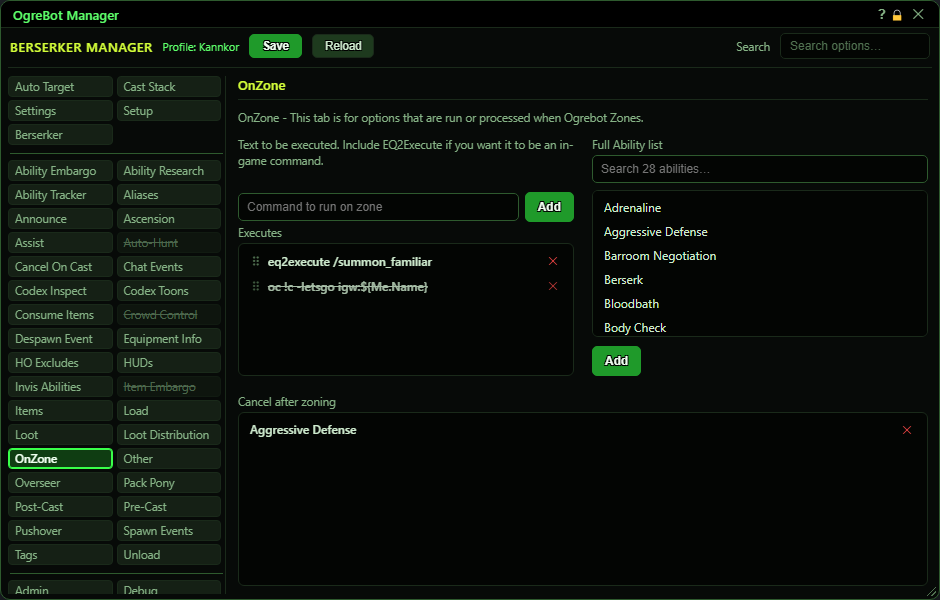

# OnZone

**OgreBot is in beta testing.** Looking for OgreBot Classic? [Click here](../../index.md).

OnZone does two things each time you finish zoning. It runs the commands in the Executes list, top to bottom. Then it cancels any of your maintained spells that are on the 'Cancel after zoning' list. Both wait until the new zone has fully loaded (about three and a half seconds after it appears), so they act on a zone that is really there.

| Option | What it does | Default |
|---|---|---|
| **Executes** | Commands the bot runs, top to bottom, each time you finish zoning and the new zone has loaded. Switched-off lines are skipped. *Runs even while OgreBot is paused. Double-click a line to switch it off; drag to reorder.* | empty |
| **Full Ability list** | All of this character's abilities. Click one and press Add below, or double-click it, to put it on the 'Cancel after zoning' list. |  |
| **Cancel after zoning** | After each zone has loaded, the bot cancels any of your maintained spells that match a name here, whatever its rank. *Runs even while paused. Double-click a row to switch it off.* | empty |

## Executes

| Control | What it does | Default |
|---|---|---|
| **Command to run on zone** | Type a console command here. Put `eq2execute` in front of an in-game slash command. Press Enter or Add to put it on the list. *Commas and ] are removed when you add the line.* | empty |
| **Add** | Adds the typed command to the end of the Executes list. It is not run now, only after your next zone. |  |

## Cancel after zoning

| Control | What it does |
|---|---|
| **Add** | Adds the ability you clicked in the Full Ability list to the cancel list. Greyed out until you click one. |

## Good to know

- Both lists work even while OgreBot is paused. They only need OgreBot to be loaded.
- The Executes list takes console commands. To run an in-game slash command, start the line with `eq2execute`. A command you add here is not run straight away.
- Commas and ] are removed from a command when you add it.
- The cancel list matches any rank: 'Assault' also cancels 'Assault XIII'. It only cancels spells you are maintaining (your own buffs and effects in the maintained window).
- To add a spell to the cancel list, click it in the Full Ability list and press Add, or double-click it. In the cancel list, double-click a spell to switch it off, and the x removes it. The cancel list is shown A to Z because order does not matter there.

