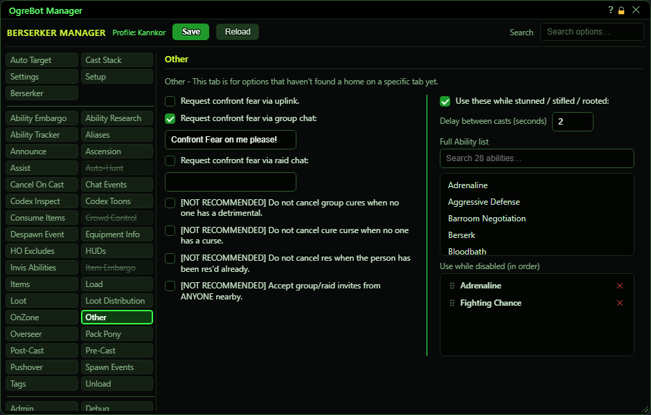

# Other

**OgreBot is in beta testing.** Looking for OgreBot Classic? [Click here](../../index.md).

Other holds options that do not have a tab of their own yet. The left column asks a dirge for Confront Fear when you have revive sickness, stops a few automatic cast cancels, and lets you accept group invites from any player nearby. The right column is a list of abilities the bot uses when you are stunned, stifled or rooted and have a detrimental on you, because the normal Cast Stack cannot act then.

| Option | What it does | Default |
|---|---|---|
| **Request confront fear via uplink.** | When you get revive sickness, send a request to your other characters over the uplink. A dirge among them, with OgreBot running (not paused) and in your group or raid in the same zone, casts Confront Fear on you. Used only if the raid and group chat requests below did not go out. *Needs no message and no dirge in view; the other sessions decide if they can help. Fighters are cured first, then priests, then everyone else.* | off |
| **Request confront fear via group chat:** | When you get revive sickness and another dirge is in your group, say the text in the box beside this in group chat. *Nothing is said if the box is empty. If you are a dirge yourself, nothing is asked.* | off |
| **(group chat message)** | What to say in group chat to ask for Confront Fear. *A message containing the word NULL is not sent.* | empty |
| **Request confront fear via raid chat:** | When you get revive sickness and another dirge is in your raid, say the text in the box beside this in raid chat. This is tried before group chat. *Nothing is said if the box is empty.* | off |
| **(raid chat message)** | What to say in raid chat to ask for Confront Fear. *A message containing the word NULL is not sent.* | empty |
| **[NOT RECOMMENDED] Do not cancel group cures when no one has a detrimental.** | Normally the bot stops a group cure mid-cast when nobody needs it any more. Tick this to let it finish anyway. *Some raid scripts tick this during a fight.* | off |
| **[NOT RECOMMENDED] Do not cancel cure curse when no one has a curse.** | Normally the bot stops a Cure Curse mid-cast when the target no longer has a curse. Tick this to let it finish anyway. | off |
| **[NOT RECOMMENDED] Do not cancel res when the person has been res'd already.** | Normally the bot stops a res mid-cast when the target is no longer a corpse, for example because someone else res'd them first. Tick this to let it finish anyway. | off |
| **[NOT RECOMMENDED] Accept group/raid invites from ANYONE nearby.** | Accepts a group or raid invite from any player your client can see, not only from your own characters. It only works when 'Accept Invites' on the Settings tab is ticked too. *Invites from your own characters are accepted by 'Accept Invites' alone.* | off |
| **Use these while stunned / stifled / rooted:** | While the bot is running and you are stunned, stifled or rooted with a detrimental on you, it casts the first ready ability from the list below. Useful because the normal Cast Stack cannot cast in that state. *Does nothing while 'Disable CS_Cure' on the Settings tab is ticked. The Enable/Disable Cures commands flip this box.* | off |
| **Delay between casts (seconds)** | How long to wait after one of these abilities fires before the next one may. Decimals work. Blank or not a number means 3 seconds; 0 means no wait. | empty (3 seconds) |
| **Full Ability list** | All of this character's abilities. Double-click one to add it to the end of the 'Use while disabled' list. |  |
| **Use while disabled (in order)** | The abilities to use while stunned, stifled or rooted, best first. The bot casts the first one that is ready; one on cooldown just lets the next one try. *Group or raid cures are skipped while 'Disable Group/Raid Cures in CS' is ticked on Settings, and single-target ones while 'Disable Single Target Cures in CS' is ticked.* | empty |

## Good to know

- Confront Fear requests go out only once per revive sickness, and only while the bot is running. If you are paused when the sickness lands, the request waits until you resume. A revive at a scout camp is ignored.
- Only one channel is ever used for a request. Raid chat is tried first, then group chat, then the uplink.
- The stunned list only fires when you have an Arcane, Noxious, Elemental or Trauma detrimental. It does not check that the ability cures that type, so abilities that give immunity work too.
- 'Disable CS_Cure' on the Settings tab switches the stunned list off. The Enable Cures and Disable Cures commands also tick and untick 'Use these while stunned / stifled / rooted'.
- To add to the stunned list, double-click an ability in the Full Ability list. In the saved list, drag rows to set priority, double-click to switch one off, and the x removes it.

