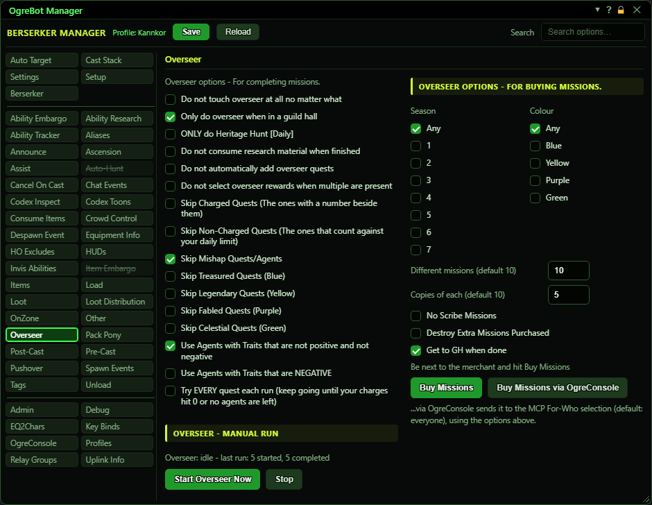
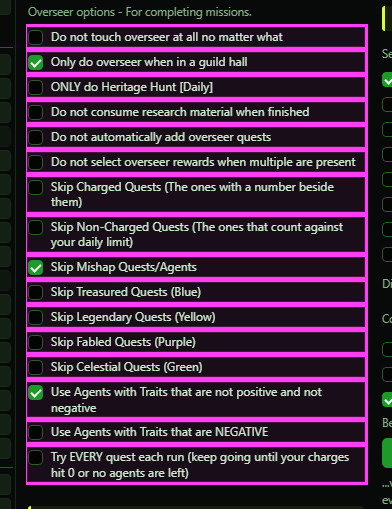
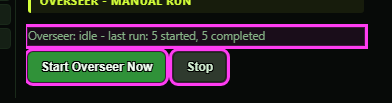
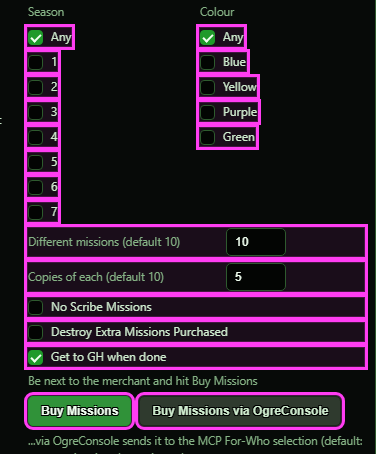

**OgreBot is in beta testing.** Looking for OgreBot Classic? [Click here](../../index.md).

# Overseer

The left column controls the bot's daily Overseer run. The bot opens the Overseer window, turns in finished missions, adds any mission scrolls in your bags, starts new missions with the best agents it has, and afterwards uses any Research Material in your bags. The run starts on its own soon after OgreBot loads your profile, then at most once an hour. It will not start while the bot is paused, you are in combat or dead, or you are zoning. Start Overseer Now runs it straight away. The right column is a separate tool: stand at an Administrator Agent and it buys mission scrolls for you.

## Overseer

| Option | What it does | Default |
|---|---|---|
| **Do not touch overseer at all no matter what** | The bot does not run Overseer: no daily run, and Start Overseer Now does nothing (it says why in the console). Overseer reward windows are still answered. *Buying missions (the right column) is a separate tool and still works.* | off |
| **Only do overseer when in a guild hall** | The bot only starts the daily Overseer run on its own while you are in a guild hall. *Start Overseer Now works anywhere.* | off |
| **ONLY do Heritage Hunt [Daily]** | The only new mission the bot starts is 'Heritage Hunt [Daily]', and it skips Mishap missions. It still turns in finished missions and adds scrolls from your bags. | off |
| **Do not consume research material when finished** | Normally, after a run in which it turned in at least one of your own missions, the bot uses any Research Material in your bags (Advancement, Companion, Mount, Tradeskill, Upgrade and General). Tick this to keep them. | off |
| **Do not automatically add overseer quests** | Normally the bot uses every Overseer mission scroll in your bags and Overseer bag to add it to your missions, then looks at the list again. Tick this to leave the scrolls alone. *'Overseer Boost to Season 5' is never used.* | off |
| **Do not select overseer rewards when multiple are present** | When an Overseer reward window offers a choice, the bot normally takes the first reward. Tick this to leave the window for you. | off |
| **Skip Charged Quests (The ones with a number beside them)** | The bot never starts charged missions. Normally it starts them once there are no daily or plain missions left to start. | off |
| **Skip Non-Charged Quests (The ones that count against your daily limit)** | The bot never starts plain missions or 'Heritage Hunt [Daily]', so of the regular missions only charged ones are started. Mishap missions are not affected. *When your daily limit is used up, the bot only tries charged missions anyway.* | off |
| **Skip Mishap Quests/Agents** | The bot skips Mishap missions entirely and goes straight to the normal missions. | off |
| **Skip Treasured Quests (Blue)** | The bot does not start plain Treasured (blue) missions. *Charged missions of this colour are still started.* | off |
| **Skip Legendary Quests (Yellow)** | The bot does not start plain Legendary (yellow) missions. *Charged missions of this colour are still started.* | off |
| **Skip Fabled Quests (Purple)** | The bot does not start plain Fabled (purple) missions. *Charged missions of this colour are still started.* | off |
| **Skip Celestial Quests (Green)** | The bot does not start plain Celestial (green) missions. *Charged missions of this colour are still started.* | off |
| **Use Agents with Traits that are not positive and not negative** | Normally the bot only sends agents whose traits help the mission, plus agents with no traits. Tick this to also send agents whose traits neither help nor hurt, when it needs more agents to start a mission. *Never used for Mishap missions.* | off |
| **Use Agents with Traits that are NEGATIVE** | Also send agents that carry a trait the mission dislikes, when it needs more agents to start the mission. They are used last. *Never used for Mishap missions.* | off |
| **Try EVERY quest each run (keep going until your charges hit 0 or no agents are left)** | Normally the bot tries at most 50 missions per run. Tick this to try every mission in the list once, stopping early only when no agent is free. | off |

## Overseer - Manual run

| Option | What it does |
|---|---|
| **Overseer: idle** | Shows what the Overseer run is doing: 'running' with the current step and how many missions it has started and turned in, or 'idle' with the totals from the last run. |
| **Start Overseer Now** | Starts the daily Overseer run now. It ignores the guild hall box, combat, and the one-hour wait between runs. It does nothing if a run is already going, or if 'Do not touch overseer at all no matter what' is ticked. *OgreBot must have a profile loaded.* |
| **Stop** | Stops the daily Overseer run that is in progress, and a Buy Missions run too. |

## Overseer options - For BUYING missions.

| Option | What it does | Default |
|---|---|---|
| **Any** | Buy missions from any season. Ticking it unticks the season numbers; leaving every season box unticked means the same. | off |
| **1** | Only buy missions from Overseer season 1. *Only one season can be ticked: ticking one unticks the others.* | off |
| **2** | Only buy missions from Overseer season 2. | off |
| **3** | Only buy missions from Overseer season 3. | off |
| **4** | Only buy missions from Overseer season 4. | off |
| **5** | Only buy missions from Overseer season 5. | off |
| **6** | Only buy missions from Overseer season 6. | off |
| **7** | Only buy missions from Overseer season 7. | off |
| **Any** | Buy missions of any colour. Ticking it unticks the colours; leaving every colour box unticked means the same. | off |
| **Blue** | Only buy blue missions. *Only one colour can be ticked: ticking one unticks the others.* | off |
| **Yellow** | Only buy yellow missions. | off |
| **Purple** | Only buy purple missions. | off |
| **Green** | Only buy green missions. | off |
| **Different missions (default 10)** | How many different missions to buy. From the missions this merchant sells that match your season and colour, the bot picks this many at random. | empty (10 is used) |
| **Copies of each (default 10)** | How many copies of each chosen mission you want. The bot buys until you have this many in your bags, counting copies you already had. The most is 20. | empty (10 is used) |
| **No Scribe Missions** | Normally the bot uses each copy of a mission right after buying it, to add it to your Overseer missions. Tick this to leave the scrolls in your bags. | off |
| **Destroy Extra Missions Purchased** | After using the scrolls, the bot destroys any copies of that mission still in your bags. *This includes copies you had before the run.* | off |
| **Get to GH when done** | When a buy run finishes, each character travels to its own guild hall, the same as the Get To GH button. It does not happen if the run is stopped or fails. | off |
| **Buy Missions** | Starts a buy run for this character with the options above. It uses the merchant window if it is open; otherwise it opens the nearest Administrator Agent, which must be within 10. Then it buys, uses and (if ticked) destroys the scrolls, one mission at a time. *OgreBot must have a profile loaded. To stop it, type `ogre buyoverseermissions stop`.* |  |
| **Buy Missions via OgreConsole** | Sends a buy run, with this screen's season, colour and amounts, to every character picked in the MCP For-Who window (everyone if it was never set). Each of them must be standing at its own Administrator Agent. *No Scribe, Destroy and Get to GH are sent as they are set here, ticked or not, so every character uses this screen's choices, not its own tab.* |  |

## Good to know

- The Settings tab has its own 'Do not auto Overseer' box. Either that box or 'Do not touch overseer at all' stops the automatic run.
- Start Overseer Now runs even when 'Only do overseer when in a guild hall' is ticked, and ignores the one-hour wait. It does not run while 'Do not touch overseer at all no matter what' is ticked - it says so in the console instead.
- Ticking a 'do not' box during a run does not stop it. Press Stop. The mission and agent choices do change mid-run, from the next mission the bot picks.
- The Skip Treasured/Legendary/Fabled/Celestial boxes only skip plain missions. A charged mission of that colour is still started.
- The agent boxes never apply to Mishap missions. Those use a Mishap agent first if one is free, then only agents with helpful traits or no traits.
- Stop stops a Buy Missions run too. `ogre buyoverseermissions stop` also works.
- Season and Colour are one choice each: ticking a box unticks the others in its column. 'Any', or nothing ticked, means no filter.
- 'Destroy Extra Missions Purchased' destroys every copy of that mission left in your bags, including copies you had before. With 'No Scribe Missions' also ticked, it buys the scrolls and then destroys them all.

