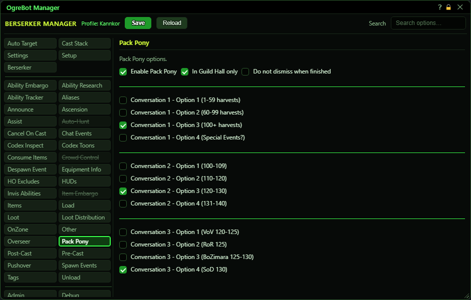

# Pack Pony

**OgreBot is in beta testing.** Looking for OgreBot Classic? [Click here](../../index.md).

Pack Pony sends your Artisan's Pack Pony out to gather harvests by itself. With 'Enable Pack Pony' ticked and the bot running, the bot summons the pony, hails it and answers its questions using your choices below. If the pony offers to empty its packs, the bot accepts that first and then hails it again. The bot is paused while it does this and resumed afterwards. After a successful send-out it waits 2 hours 5 minutes before trying again, 10 minutes if the pony is still out or something failed, and 1 minute if you were busy. The three groups of boxes are the answers to the pony's three questions. Tick one box per group; ticking a box unticks the others in that group.

| Option | What it does | Default |
|---|---|---|
| **Enable Pack Pony** | While the bot is running, it sends your pack pony out whenever the wait from the last run is over. | off |
| **In Guild Hall only** | The pony is only sent out while you are in a guild hall. | off |
| **Do not dismiss when finished** | The pony stays summoned after the run. Normally the bot dismisses it when it is done. *Runs started by TaskRunner still dismiss it.* | off (the pony is dismissed) |
| **Conversation 1 - Option 1 (1-59 harvests)** | When the pony asks its first question ('I need some level ... harvests'), the bot picks reply 1. | off |
| **Conversation 1 - Option 2 (60-99 harvests)** | When the pony asks its first question, the bot picks reply 2. | off |
| **Conversation 1 - Option 3 (100+ harvests)** | When the pony asks its first question, the bot picks reply 3. This is also used when no box in this group is ticked. | off (used anyway when none is ticked) |
| **Conversation 1 - Option 4 (Special Events?)** | When the pony asks its first question, the bot picks reply 4. | off |
| **Conversation 2 - Option 1 (1-9 / 60-69 / 100-109 harvests)** | When the pony asks its second question ('Gather level ... harvests'), the bot picks reply 1. | off |
| **Conversation 2 - Option 2 (10-19 / 70-79 / 110-120 harvests)** | When the pony asks its second question, the bot picks reply 2. | off |
| **Conversation 2 - Option 3 (20-29 / 80-89 / 120-130 harvests)** | When the pony asks its second question, the bot picks reply 3. This is also used when no box in this group is ticked. | off (used anyway when none is ticked) |
| **Conversation 2 - Option 4 (30-39 / 90-95 / 131-140 harvests)** | When the pony asks its second question, the bot picks reply 4. | off |
| **Conversation 3 - Option 1 (VoV 120-125 / PoM 110 / Thalumbra harvests / RoC 135)** | When the pony asks its third question ('Gather harvests from ...'), the bot picks reply 1. | off |
| **Conversation 3 - Option 2 (RoR 125 / EP 110 harvests)** | When the pony asks its third question, the bot picks reply 2. This is also used when no box in this group is ticked. | off (used anyway when none is ticked) |
| **Conversation 3 - Option 3 (BoZimara 125-130 / Luclin 110-120 harvests)** | When the pony asks its third question, the bot picks reply 3. | off |
| **Conversation 3 - Option 4 (SoD 130 harvests)** | When the pony asks its third question, the bot picks reply 4. | off |

## Good to know

- The character needs the 'Summon Artisan's Pack Pony' ability, or the run does not start.
- It never starts while you are in combat, while the bot is paused, or while another conversation window is open.
- If no box in a group is ticked, the bot uses option 3 for Conversations 1 and 2, and option 2 for Conversation 3.
- The boxes follow your earlier picks, the way the pony's questions do: Conversation 2 shows the replies the pony offers after your Conversation 1 pick (six under 1-59 harvests, five under 60-99, four under 100+), and Conversation 3 is only asked under 100+ harvests. Where a reply is not known (Special Events, Conversation 3 below 100) the boxes read 'placeholder' and can still be picked, in case the game adds one. A ticked box your path does not offer says 'not offered ..., pick another'. The options listed on this page are the ones shown for 100+ harvests, 120-130.
- The wait timers are kept only while the session runs. After a reload the bot tries again straight away.
- The harvest ranges in the box names describe what each reply meant in the old bot. The bot clicks the reply by its number (Option 1 = the first reply), so check them in game if the pony's replies change.

