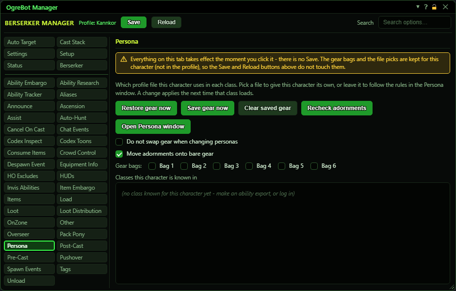

**OgreBot is in beta testing.** Looking for OgreBot Classic? [Click here](../../index.md).

# Persona

A persona is one character in one class. This tab lists every class this character is known in and which profile file it uses for each. By default it follows the rules in the Persona window (`ogre persona`). Pick a file here to give this character its own setting for a class.

| Option | What it does | Default |
|---|---|---|
| **Restore gear now** | Puts this class's saved gear back on from your bags. This happens by itself after a class change; use it if something got left off. A slot whose saved piece will not go on gets the piece it replaced, or another class's piece for that slot (same archetype first); a slot still empty is an OgreConsole error with a ding. New gear you put on also replaces the old piece for every other class that wore it. |  |
| **Save gear now** | Saves what this class is wearing now. This also happens by itself each time you zone and before a camp. A slot you emptied keeps its saved piece, so the next restore puts it back, wears a fallback, or warns you; Clear saved gear forgets it. |  |
| **Clear saved gear** | Forgets this class's saved gear and keeps only what it is wearing now, after you confirm. Use it when you left a slot empty on purpose: a slot that is empty now is forgotten, so a restore will not fill it or warn about it. |  |
| **Recheck adornments** | Looks at every gear slot now and moves adornments onto any bare piece, from this character's other gear for that slot. A worn piece comes off, gets its adornments, and goes back on. Also finishes a move that was stopped. Runs even when the box below is unticked. |  |
| **Open Persona window** | Opens the Persona window, where you set which profile file each class uses on this PC. |  |
| **Do not swap gear when changing personas** | Ticked: a class change leaves your gear as the game left it - nothing is put back on and nothing moves to the gear bags. Restore gear now still works. For this character; saved at once. | unticked (the swap happens) |
| **Move adornments onto bare gear** | After a class change, before your gear goes on, each bare piece of gear in your bags gets the adornments of this character's other piece for that slot (another class's, same archetype first). They come off that piece and go on this one; one that will not fit goes back. Then the gear is put on. A small window shows the progress and has Stop. For this character; on unless you untick it. | ticked |
| **Gear bags:** | Which of your six bags hold persona gear, for this character. After a class change, gear the game dumped moves into them. Tick none to leave the gear where it lands. |  |
| **Classes this character is known in** | One row per class: the file it uses, why, a picker to give this character its own file for that class, and an X to forget that setting and follow the rules again. |  |

## What you see

- Each row is a class this character has an ability export for, the class it is logged in as now, or a class it already has its own setting for. The class it is logged in as comes first.
- Beside the class is the file it uses and why: this character (its own setting), name route (an old route for this name alone), rule: all ranger (a rule in the Persona window), rule: all (the rule for every class), or class sample (nothing set, it starts from the sample for that class).

## Good to know

- A change applies the next time that class loads on this character, not to the class it is on right now.
- A character's own setting beats every rule. Clear puts it back on the rules.
- The file list is every profile in the Main profiles folder.

