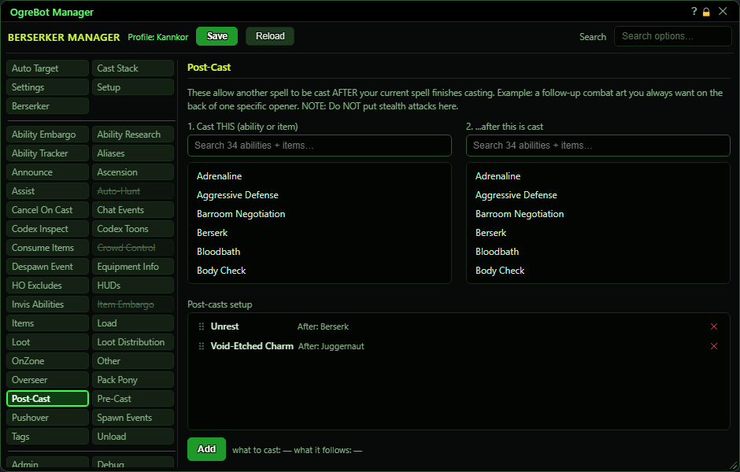

# Post-Cast

**OgreBot is in beta testing.** Looking for OgreBot Classic? [Click here](../../index.md).

Post-Cast casts one thing right AFTER another has finished. Each row says 'after the bot casts B, cast A'. A can be an ability or an item; B is the ability that sets it off. For a spell with a cast time, A goes out once the cast bar is done; for an instant, straight after. Several rows can share the same B; they go one at a time, top to bottom.

| Option | What it does | Default |
|---|---|---|
| **1. Cast THIS  (ability or item)** | Pick what the bot should cast afterwards. Click an ability or item to select it for the next row. |  |
| **2. ...after this is cast** | Pick the ability that sets it off. After the bot casts this ability, the pick from list 1 follows. |  |
| **Post-casts setup** | Your post-cast rows, shown as 'what to cast   After: what it follows'. Rows for the same ability fire top to bottom, one at a time, once that ability's cast is over. *Double-click a row to switch it off. Drag to reorder.* | empty |

## Post-Cast

| Control | What it does |
|---|---|
| **Add** | Saves your two picks as a new row at the end of 'Post-casts setup'. It stays greyed out until you have picked one entry in each list. |

## Good to know

- To add a row, click the thing to cast in list 1, click the ability it follows in list 2, then press Add under 'Post-casts setup'. The text next to Add shows your two picks.
- Any cast the bot makes can set off a post-cast: the Cast Stack, scripts and commands. Abilities you click yourself do not.
- If your cast bar stays busy with something else for more than about 2 seconds after B, the post-cast is dropped, because it would no longer be 'after B'.
- Names match any rank: 'Assault' also matches 'Assault XIII'. An ability must be ready; items are just tried.
- A row that points at itself is ignored, and a post-cast never sets off another post-cast or a pre-cast.
- 'Disable Post-Cast tab' on the Settings tab switches this whole tab off. While a script has 'Dynamic Ignore Encounter CAs' or 'Dynamic Ignore PBAE CAs' ticked, post-casts of that kind are skipped too.
- In 'Post-casts setup', drag a row to change the order, double-click a row to switch it off, and the x removes it.

