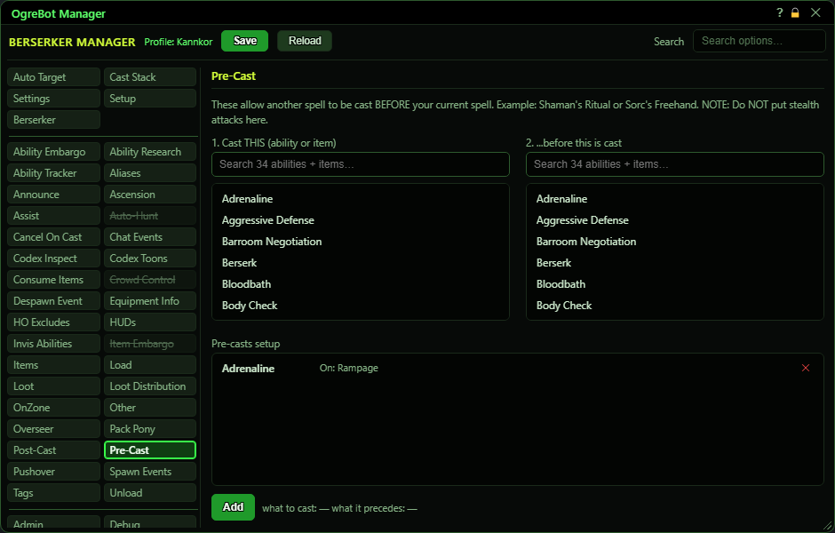

# Pre-Cast

**OgreBot is in beta testing.** Looking for OgreBot Classic? [Click here](../../index.md).

Pre-Cast casts one thing right BEFORE another. Each row says 'when the Cast Stack is about to cast B, cast A first'. A can be an ability or an item; B is the ability that sets it off. A pre-cast is optional: if A is not ready, B is cast anyway. Several rows can share the same B; they go one at a time, top to bottom, and then B goes out.

| Option | What it does | Default |
|---|---|---|
| **1. Cast THIS  (ability or item)** | Pick what the bot should cast first. Click an ability or item to select it for the next row. |  |
| **2. ...before this is cast** | Pick the ability that sets it off. When the Cast Stack is about to cast this ability, the pick from list 1 goes first. |  |
| **Pre-casts setup** | Your pre-cast rows, shown as 'what to cast   On: what it goes before'. Rows for the same ability fire top to bottom, one at a time, then that ability is cast. *Double-click a row to switch it off. Drag to reorder.* | empty |

## Pre-Cast

| Control | What it does |
|---|---|
| **Add** | Saves your two picks as a new row at the end of 'Pre-casts setup'. It stays greyed out until you have picked one entry in each list. |

## Good to know

- To add a row, click the thing to cast in list 1, click the ability it goes before in list 2, then press Add under 'Pre-casts setup'. The text next to Add shows your two picks.
- Only casts the Cast Stack chooses get pre-casts. Casts from scripts, commands or other bot features do not.
- Names match any rank: 'Assault' also matches 'Assault XIII'.
- An ability must be ready to be pre-cast. Items are not checked for readiness; the bot just tries them.
- A row that points at itself (the same ability in both lists) is ignored.
- 'Disable Pre-Cast tab' on the Settings tab switches this whole tab off. While a script has 'Dynamic Ignore Encounter CAs' or 'Dynamic Ignore PBAE CAs' ticked, pre-casts of that kind are skipped too.
- In 'Pre-casts setup', drag a row to change the order, double-click a row to switch it off, and the x removes it.

