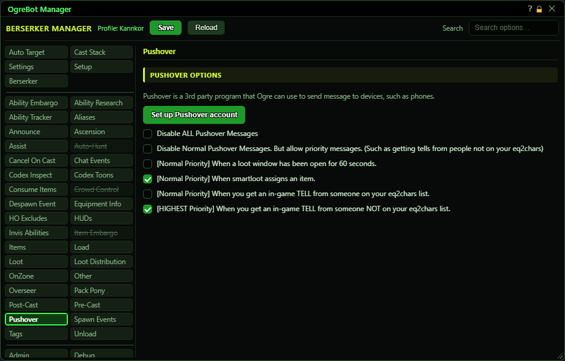

# Pushover

**OgreBot is in beta testing.** Looking for OgreBot Classic? [Click here](../../index.md).

Pushover is a separate phone and desktop notification service (pushover.net). With a Pushover account, the bot can send you a notification when certain things happen: a loot window left open, SmartLoot handing out an item, or a tell. Press 'Set up Pushover account' once to enter your Pushover details, then tick the notifications you want. The two Disable boxes at the top switch notifications off without losing your choices below.

| Option | What it does | Default |
|---|---|---|
| **Set up Pushover account** | Opens the Pushover Account window. Enter your application API token and your user key from pushover.net, then Save. Its 'Send test' button sends a test notification. *The test obeys the Disable boxes below, so untick them to test.* |  |
| **Disable ALL Pushover Messages** | No Pushover notification is sent at all, whatever is ticked below. | off |
| **Disable Normal Pushover Messages. But allow priority messages. (Such as getting tells from people not on your eq2chars)** | Only high-priority notifications are sent. Of the options below, that is just the tell from someone not on your EQ2Chars list; the rest are normal priority and are blocked. | off |
| **[Normal Priority] When a loot window has been open for 60 seconds.** | If a loot window is still open 60 seconds after it appeared, you get a notification listing the items in it. | off |
| **[Normal Priority] When smartloot assigns an item.** | Each time SmartLoot gives an item to someone, you get a notification with the time, who got it and the item. | off |
| **[Normal Priority] When you get an in-game TELL from someone on your eq2chars list.** | When one of your own characters (anyone on the EQ2Chars tab) sends you a tell, you get a notification with who sent it and what they said. | off |
| **[HIGHEST Priority] When you get an in-game TELL from someone NOT on your eq2chars list.** | When anyone not on your EQ2Chars list sends you a tell, you get a high-priority notification with who sent it and what they said. *This is the one notification that still gets through 'Disable Normal Pushover Messages'.* | off |

## Good to know

- Nothing is sent until your Pushover application token and user key are saved with 'Set up Pushover account'. They are kept on this PC, outside your profile.
- No tell notification is sent if you sent that person a tell in the last 60 seconds. You are clearly at the keyboard already.
- Notifications go out at most about one every 10 seconds. If many pile up, the oldest waiting ones are dropped.
- Scripts and commands can also send Pushover messages. The two Disable boxes block those too.

