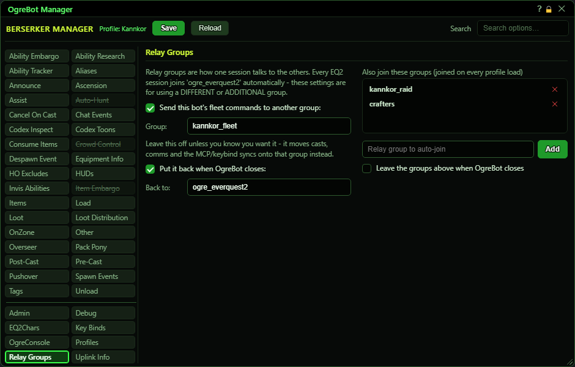

# Relay Groups

**OgreBot is in beta testing.** Looking for OgreBot Classic? [Click here](../../index.md).

A relay group is a named channel that InnerSpace sessions use to talk to each other. Every EQ2 session joins 'ogre_everquest2' by itself, and the bot sends its fleet messages there: cast requests, cure requests, event messages, and the MCP and key-bind syncs. You only need this tab to use a different or extra group, for example to keep two separate fleets apart on one PC. The left side moves this character's fleet messages to another group; the right side joins extra groups each time the profile loads.

| Option | What it does | Default |
|---|---|---|
| **Send this bot's fleet commands to another group:** | Sends this character's fleet messages (casts, cures, events, MCP and key-bind syncs) to the group named below instead of 'ogre_everquest2'. Takes effect as soon as you tick or untick it, and again at every profile load. *Unticked always means 'ogre_everquest2', whatever the box below says.* | off |
| **Group:** | The group to send to while the box above is ticked. This character joins it straight away. Blank means 'ogre_everquest2'. *Letters, numbers and _ only.* | empty |
| **Put it back when OgreBot closes:** | When OgreBot closes, this character goes back to sending to the group in 'Back to' (or 'ogre_everquest2' if that is blank). Unticked, it keeps sending to whatever group was in use. *Matters because parts of Ogre, such as MCP, still send messages after OgreBot closes.* | off |
| **Back to:** | The group to go back to when OgreBot closes. Blank means 'ogre_everquest2'. | empty |
| **Also join these groups (joined on every profile load)** | Extra relay groups this character joins, in addition to the one it sends to. Each is joined when you add it and again every time the profile loads. | empty |
| **Leave the groups above when OgreBot closes** | When OgreBot closes, this character leaves every group on the list above. It never leaves 'ogre_everquest2', even if that is on the list. | off |

## Extra groups

| Control | What it does | Default |
|---|---|---|
| **Relay group to auto-join** | Type a group name here, then press Add. | empty |
| **Add** | Adds the typed group to the list and joins it straight away. *Press Save to keep the list for next time.* |  |
| **x (remove a row)** | Takes the group off the list. This character stays in it until OgreBot closes (and leaves only if the box below is ticked). |  |

## Good to know

- Changing the group only changes where THIS character sends. The others only hear it if they are in that group too, so set the same group on every character of that fleet.
- This character never leaves 'ogre_everquest2', so it still hears everything sent there.
- Group names can only use letters, numbers and _. Anything else is removed when you add a row, so the name you see is the one that is joined now and on every profile load.
- Removing a row from the 'Also join' list does not leave that group now. It is left only when OgreBot closes, and only if 'Leave the groups above' is ticked.

