# Settings

**OgreBot is in beta testing.** Looking for OgreBot Classic? [Click here](../../index.md).

Settings holds the master controls for what the bot is allowed to cast. Column 1 switches whole groups of the Cast Stack off (buffs, heals, cures, combat arts, items, and so on), and holds a few overrides: treating every target as named, the line-of-sight check, and item zone limits. Column 2 sets the area-attack rules (the Smart CAs minimum target counts, plus the "Dynamic Ignore" boxes, which are not saved and which scripts tick and untick during fights) and the per-category bans, such as no stuns or no roots. Column 3 controls Heroic Opportunities (HOs): which HO steps this character does, how it aims them, Heroic Surge, and which HO-icon abilities the normal rotation must leave alone. Column 4 limits threat abilities, but only when the bot picks an ability for a script, a command or an HO. The normal Cast Stack ignores column 4.

Settings covers cures and combat behaviour. Column 1 controls cures: switching group or single-target cures off, limiting cures to chosen types (arcane, elemental, noxious, trauma), and drinking cure potions automatically. Columns 2 and 3 cover how the bot fights: camp spot, assisting, facing the mob, melee and ranged auto-attack, moving behind, in front or into melee range, turning attack off, sending the pet and mercenary, Bulwark of Order, NPC cast monitoring, raid and heroic encounter setups, the stun checks and the Destiny of Velious (DoV) raid debuff. Column 4 holds the on/off switches for other OgreBot tabs: Chat Events, Spawn and Despawn Events, Announce, Consume Items, Aliases and Ability Tracker. Several boxes here are saved but have no effect yet; each is marked 'Not active yet'.

Settings covers the bot's everyday conveniences outside combat. 'Pop up windows' decides which game pop-ups it answers for you: loot windows, looting corpses and chests, group invites, rezzes, zone-in lockout prompts, raid ready checks, dungeon finder prompts and quest offers. 'On Load' covers what happens when a profile loads: opening the On Screen Assistant and OgreMCP, and checking ability research. 'On Zone' covers zone-in behaviour, such as the list of available encounter setups and auto-sharing missions. 'Unorganized' holds the rest: native auto-follow, flying with the leader, Quest Compare and the automatic Overseer. About a third of the boxes on this tab are saved but have no effect yet; each is marked 'Not active yet'.

[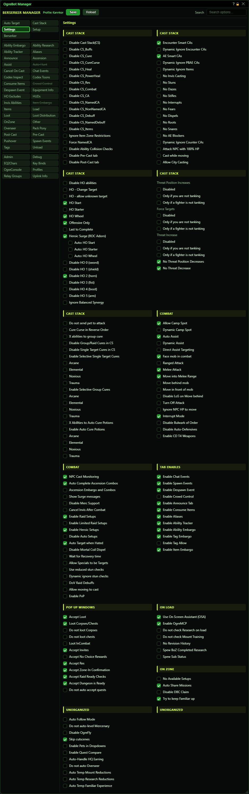](../assets/ogrebot/tab-settings.png "Click for full size")

## Cast Stack (1 of 5)

[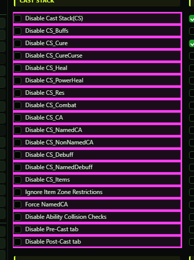](../assets/ogrebot/tab-settings-s1.png "Click for full size")

| Option | What it does | Default |
|---|---|---|
| **Disable Cast Stack(CS)** | Nothing on the Cast Stack tab is cast: no buffs, heals, combat arts, items, cures or anything else from your list. Cures that another player asks you for, and requested group cures, still go out. *The Do HO feature can tick this for the character it picks to run HOs, then put it back afterwards.* | off |
| **Disable CS_Buffs** | Cast Stack entries set as Buff or Non-Combat Buff are skipped, for abilities and items alike. | off |
| **Disable CS_Cure** | Cast Stack entries set as Cure are skipped, and so is any Cast Stack ability the game marks as a player cure, whatever type it was entered as. The bot also stops choosing cures when a script or command asks for an ability or when it picks an HO ability, and the Other tab's 'cure while stunned' feature is switched off. Cures that someone calls for still go out. *The Enable/Disable Cures commands tick and untick this box.* | off |
| **Disable CS_CureCurse** | Cast Stack entries set as Cure Curse are skipped. *Curse cures that someone calls for are handled separately and still go out.* | off |
| **Disable CS_Heal** | Cast Stack entries set as Heal are skipped. | off |
| **Disable CS_PowerHeal** | Cast Stack entries set as Power Heal are skipped. | off |
| **Disable CS_Res** | Cast Stack entries set as Res (resurrect another player) are skipped. | off |
| **Disable CS_Combat** | Cast Stack entries set as Combat are skipped. These are the in-combat-only entries, such as combat buffs and wards. | off |
| **Disable CS_CA** | Cast Stack entries set as plain CA (combat art) are skipped. Entries set as Named CA or Non-Named CA are not affected. | off |
| **Disable CS_NamedCA** | Cast Stack entries set as Named CA (named combat art) are skipped. | off |
| **Disable CS_NonNamedCA** | Cast Stack entries set as Non-Named CA (non-named combat art) are skipped. | off |
| **Disable CS_Debuff** | Cast Stack entries set as plain Debuff are skipped. Named Debuff entries are not affected. | off |
| **Disable CS_NamedDebuff** | Cast Stack entries set as Named Debuff are skipped. | off |
| **Disable CS_Items** | Every item entry on the Cast Stack is skipped (clickies, adornments and so on), whatever its type. Abilities still cast. | off |
| **Ignore Item Zone Restrictions** | Normally the bot skips an item whose effect only works in certain zones (for example 'only in a Rage of Cthurath raid or Untold zone') when you are somewhere else. Tick this to use such items everywhere. *The zone list comes from ZoneExpansions.json: the shipped copy plus your own custom copy.* | off |
| **Force NamedCA** | Every target counts as a named mob. Entries that need a named target fire on everything, and entries that need a non-named target stop firing. *It does not change which Disable CS_ box applies to an entry.* | off |
| **Disable Ability Collision Checks** | The Cast Stack stops checking line of sight to the target, and to your pet, before casting. Abilities go out even through walls, as long as the range is fine. *Mostly for scripted fights where the game allows casts the line-of-sight check would block.* | off |
| **Disable Pre-Cast tab** | Nothing on the Pre-Cast tab fires (the rules that cast one ability before another). *Do HO ticks this for the group while it runs and restores it afterwards.* | off |
| **Disable Post-Cast tab** | Nothing on the Post-Cast tab fires (the rules that cast one ability after another). *Do HO ticks this for the group while it runs and restores it afterwards.* | off |

## Cast Stack (2 of 5)

[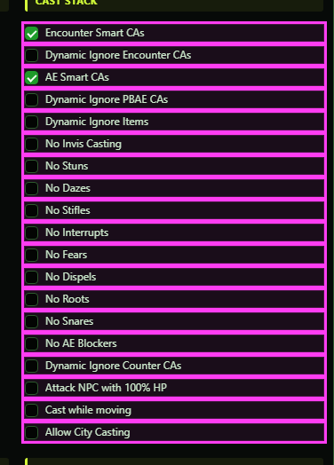](../assets/ogrebot/tab-settings-s2.png "Click for full size")

| Option | What it does | Default |
|---|---|---|
| **Encounter Smart CAs** | An encounter-wide attack is only used when the linked encounter has at least the number of mobs set in 'Targets for Smart Encounters' on the Setup tab (2 if blank). A single mob never qualifies. Untick it to use encounter attacks on anything. *A Cast Stack entry can override this with its own ignore-encounter setting or a count of 1.* | off |
| **Dynamic Ignore Encounter CAs** | While ticked, the bot casts no encounter-wide attacks: not from the Cast Stack, not from the Pre/Post-Cast tabs, not when it picks an interrupt, and not when a script asks for an ability. Neither Smart CAs nor an entry's own setting can override it. *Meant for scripts. The Disable AEs (area effects) command and encounter files tick and untick it during a fight.* | off (not saved; clears on reload) |
| **AE Smart CAs** | A point-blank or targeted area attack is only used when at least the number of mobs set in 'Targets for Smart AEs' on the Setup tab are in range (2 if blank). Untick it to use them at any count. *A Cast Stack entry can override this with its own ignore-area-effect setting or its own count.* | off |
| **Dynamic Ignore PBAE CAs** | While ticked, the bot casts no point-blank or targeted area attacks: not from the Cast Stack, not from the Pre/Post-Cast tabs, not when it picks an interrupt, and not when a script asks for an ability. *Meant for scripts. The Disable AEs (area effects) command and encounter files tick and untick it during a fight.* | off (not saved; clears on reload) |
| **Dynamic Ignore Items** | While ticked, every item entry on the Cast Stack is skipped. It works like Disable CS_Items, but it does not touch your saved setting. *Meant for encounter scripts.* | off (not saved; clears on reload) |
| **No Invis Casting** | **Not active yet.**  | off |
| **No Stuns** | The bot does not cast abilities the game marks as stuns: not from the Cast Stack, not when a script or command asks for an ability, and not when it picks an HO ability. *The Enable/Disable Stuns commands tick and untick it. Items are never blocked by this.* | off |
| **No Dazes** | The bot does not cast abilities marked as dazes, from the Cast Stack, script/command requests or HO picks. | off |
| **No Stifles** | The bot does not cast abilities marked as stifles, from the Cast Stack, script/command requests or HO picks. | off |
| **No Interrupts** | The bot does not cast abilities marked as interrupts, from the Cast Stack, script/command requests or HO picks. *The Enable/Disable Interrupts commands tick and untick it.* | off |
| **No Fears** | The bot does not cast abilities marked as fears, from the Cast Stack, script/command requests or HO picks. | off |
| **No Dispels** | The bot does not cast abilities that dispel a mob's buffs, from the Cast Stack, script/command requests or HO picks. For mages it also stops the automatic Mortal Coil dispel. *The Enable/Disable Dispells commands tick and untick it.* | off |
| **No Roots** | The bot does not cast abilities marked as roots, from the Cast Stack, script/command requests or HO picks. | off |
| **No Snares** | The bot does not cast abilities marked as snares, from the Cast Stack, script/command requests or HO picks. | off |
| **No AE Blockers** | The Cast Stack skips abilities the game marks as AE (area effect) blockers. It only affects the Cast Stack. | off |
| **Dynamic Ignore Counter CAs** | While ticked, the Cast Stack skips 'counter' abilities, mostly reactive stances that deal damage when you are hit. *The Disable AEs (area effects) command ticks it unless told to allow counters.* | off (not saved; clears on reload) |
| **Attack NPC with 100% HP** | The bot ignores the '% NPC HP to attack' and '% NPC HP for pet to attack' settings on the Setup tab and treats a mob at any health as fair game. That covers hostile Cast Stack attacks, sending the pet or mercenary, moving into combat range, Turn Off Attack and Cancel Invis After Combat. | off |
| **Cast while moving** | Normally the bot will not start a spell while you are moving; melee arts and a few class, buff or zone exceptions are allowed. Tick this to let it cast anything while moving. It applies to the Cast Stack and to the bot's other casts, such as HOs. | off |
| **Allow City Casting** | **Not active yet.**  | off |

## Cast Stack (3 of 5)

[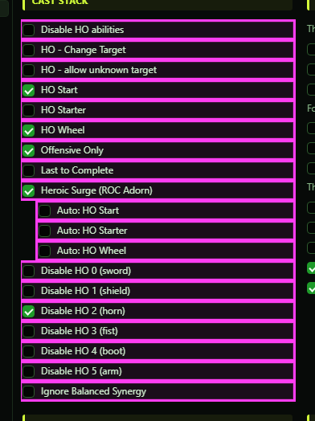](../assets/ogrebot/tab-settings-s3.png "Click for full size")

| Option | What it does | Default |
|---|---|---|
| **Disable HO abilities** | Your normal rotation stops casting any ability tied to an HO icon, so it cannot change an HO by accident. The bot's own HO steps (HO Start, HO Starter, HO Wheel) still use those abilities. *It also blocks those abilities when a script asks for an ability, unless the script is running the HO itself. Do HO sets it per archetype while running.* | off |
| **HO - Change Target** | When the bot casts a starter or wheel ability, it aims it at the mob the HO was started on rather than at your current target. *Do HO ticks this for the whole group.* | off |
| **HO - allow unknown target** | Normally the bot only works the HO starter or wheel when it knows which mob the HO belongs to. Tick this to let it continue when that mob is unknown. | off |
| **HO Start** | While the bot is running and no HO is up, it casts your archetype's HO-opening ability on your target (or on the Do HO target) to start a Heroic Opportunity. *Do HO and encounter setups turn this on and off. Heroic Surge can run this step even when the box is off.* | off |
| **HO Starter** | While an HO starter window is open and offers your archetype an icon, the bot casts the ability that matches it. *Heroic Surge can run this step even when the box is off.* | off |
| **HO Wheel** | While the HO wheel is up and shows an icon for your archetype, the bot casts the ability that completes that icon. *Heroic Surge can run this step even when the box is off.* | off |
| **Offensive Only** | When working the HO wheel, the bot only chooses attack abilities, never beneficial ones. | off |
| **Last to Complete** | The bot only works the HO wheel when your archetype is the only one still left on it, so it finishes the HO last. | off |
| **Heroic Surge (ROC Adorn)** | If the Lazirah's Star adornment is equipped, the bot also works each HO step whose 'Auto:' box below is ticked, even when that step's own HO box is off. Without the adornment this does nothing. *An encounter's HO setup can switch this off for a fight and restore it afterwards.* | off |
| **Auto: HO Start** | The Heroic Surge part of the HO Start step. The bot ticks and unticks this box itself. *When a Heroic Surge chat message appears, the bot unticks the box if your archetype is already listed and ticks it if not. When the 36-second surge buff runs out, it ticks it again.* | off (not saved; the bot sets it) |
| **Auto: HO Starter** | The Heroic Surge part of the HO Starter step. The bot manages it exactly like 'Auto: HO Start'. | off (not saved; the bot sets it) |
| **Auto: HO Wheel** | The Heroic Surge part of the HO Wheel step. Unlike the other two, the bot never changes this box. It only takes effect if you tick it. | off (not saved) |
| **Disable HO 0 (sword)** <small>(fighters only)</small> | Fighters only: your rotation will not cast your abilities that carry this HO icon, so it cannot change an HO by accident. The bot's own HO steps can still use them. *Only shown to fighters. Do HO resets these boxes and ticks some of them while running.* | off |
| **Disable HO 1 (shield)** <small>(fighters only)</small> | Fighters only: your rotation will not cast your abilities that carry the shield HO icon. The bot's own HO steps can still use them. | off |
| **Disable HO 2 (horn)** <small>(fighters only)</small> | Fighters only: your rotation will not cast your abilities that carry the horn HO icon. The bot's own HO steps can still use them. *Do HO ticks it for the group when a scout is running HOs.* | off |
| **Disable HO 3 (fist)** <small>(fighters only)</small> | Fighters only: your rotation will not cast your abilities that carry the fist HO icon. The bot's own HO steps can still use them. | off |
| **Disable HO 4 (boot)** <small>(fighters only)</small> | Fighters only: your rotation will not cast your abilities that carry the boot HO icon. The bot's own HO steps can still use them. *Do HO ticks it for the group when a scout is running HOs.* | off |
| **Disable HO 5 (arm)** <small>(fighters only)</small> | Fighters only: your rotation will not cast your abilities that carry the arm HO icon. The bot's own HO steps can still use them. | off |
| **Disable HO 12 (chalice)** <small>(priests only)</small> | Priests only: your rotation will not cast your abilities that carry the chalice HO icon. The bot's own HO steps can still use them. *Do HO ticks it when a fighter or scout is running HOs.* | off |
| **Disable HO 13 (symbol)** <small>(priests only)</small> | Priests only: your rotation will not cast your abilities that carry the symbol HO icon. The bot's own HO steps can still use them. | off |
| **Disable HO 14 (hammer)** <small>(priests only)</small> | Priests only: your rotation will not cast your abilities that carry the hammer HO icon. The bot's own HO steps can still use them. *Do HO ticks it when a fighter or mage is running HOs.* | off |
| **Disable HO 15 (eye)** <small>(priests only)</small> | Priests only: your rotation will not cast your abilities that carry the eye HO icon. The bot's own HO steps can still use them. | off |
| **Disable HO 16 (moon)** <small>(priests only)</small> | Priests only: your rotation will not cast your abilities that carry the moon HO icon. The bot's own HO steps can still use them. | off |
| **Disable HO 17 (arch)** <small>(priests only)</small> | Priests only: your rotation will not cast your abilities that carry the arch HO icon. The bot's own HO steps can still use them. | off |
| **Disable HO 24 (wand)** <small>(mages only)</small> | Mages only: your rotation will not cast your abilities that carry the wand HO icon. The bot's own HO steps can still use them. | off |
| **Disable HO 25 (lightning)** <small>(mages only)</small> | Mages only: your rotation will not cast your abilities that carry the lightning HO icon. The bot's own HO steps can still use them. | off |
| **Disable HO 26 (icecube)** <small>(mages only)</small> | Mages only: your rotation will not cast your abilities that carry the ice cube HO icon. The bot's own HO steps can still use them. | off |
| **Disable HO 27 (staff)** <small>(mages only)</small> | Mages only: your rotation will not cast your abilities that carry the staff HO icon. The bot's own HO steps can still use them. | off |
| **Disable HO 28 (fire)** <small>(mages only)</small> | Mages only: your rotation will not cast your abilities that carry the fire HO icon. The bot's own HO steps can still use them. | off |
| **Disable HO 29 (star)** <small>(mages only)</small> | Mages only: your rotation will not cast your abilities that carry the star HO icon. The bot's own HO steps can still use them. | off |
| **Disable HO 36 (dagger)** <small>(scouts only)</small> | Scouts only: your rotation will not cast your abilities that carry the dagger HO icon. The bot's own HO steps can still use them. | off |
| **Disable HO 37 (bow)** <small>(scouts only)</small> | Scouts only: your rotation will not cast your abilities that carry the bow HO icon. The bot's own HO steps can still use them. | off |
| **Disable HO 38 (mask)** <small>(scouts only)</small> | Scouts only: your rotation will not cast your abilities that carry the mask HO icon. The bot's own HO steps can still use them. | off |
| **Disable HO 39 (padlock)** <small>(scouts only)</small> | Scouts only: your rotation will not cast your abilities that carry the padlock HO icon. The bot's own HO steps can still use them. | off |
| **Disable HO 40 (cloak)** <small>(scouts only)</small> | Scouts only: your rotation will not cast your abilities that carry the cloak HO icon. The bot's own HO steps can still use them. | off |
| **Disable HO 41 (coin)** <small>(scouts only)</small> | Scouts only: your rotation will not cast your abilities that carry the coin HO icon. The bot's own HO steps can still use them. *Do HO always ticks this, because the coin icon changes the HO window.* | off |
| **Ignore Balanced Synergy** | **Not active yet.**  *One encounter setup (Sypheria the Shackled) ticks it, but it has no effect yet.* | off |

## Cast Stack (4 of 5)

[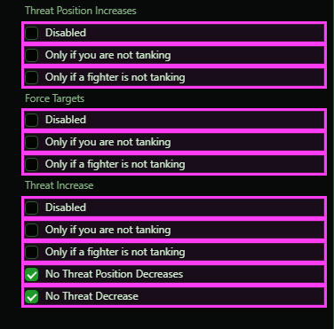](../assets/ogrebot/tab-settings-s4.png "Click for full size")

| Option | What it does | Default |
|---|---|---|
| **Disabled** | The bot never chooses abilities that move you up the hate list when a script or command asks for an ability, or when it picks an HO ability. *Your normal Cast Stack still casts them if they are on it.* | off |
| **Only if you are not tanking** | When picking an HO ability, the bot skips abilities that move you up the hate list unless the mob is attacking you. *Only affects HO picks. If the bot cannot tell who is tanking, the ability is skipped.* | off |
| **Only if a fighter is not tanking** | When picking an HO ability, the bot skips abilities that move you up the hate list unless a fighter player is tanking the mob. Fighters on the threat-fighter ignore list do not count. *Only affects HO picks. If the bot cannot tell who is tanking, the ability is skipped.* | off |
| **Disabled** | The bot never chooses force-target (taunt) abilities when a script or command asks for an ability, or when it picks an HO ability. *Your normal Cast Stack still casts them if they are on it.* | off |
| **Only if you are not tanking** | When picking an HO ability, the bot skips force-target abilities unless you are top of the mob's hate list. *Only affects HO picks. If the bot cannot tell who is tanking, the ability is skipped.* | off |
| **Only if a fighter is not tanking** | When picking an HO ability, the bot skips force-target abilities unless a fighter player is tanking the mob. Fighters on the threat-fighter ignore list do not count. *Only affects HO picks. If the bot cannot tell who is tanking, the ability is skipped.* | off |
| **Disabled** | The bot never chooses hate-increasing abilities when a script or command asks for an ability, or when it picks an HO ability. *Your normal Cast Stack still casts them if they are on it.* | off |
| **Only if you are not tanking** | When picking an HO ability, the bot skips hate-increasing abilities unless the mob is attacking you. *Only affects HO picks. If the bot cannot tell who is tanking, the ability is skipped.* | off |
| **Only if a fighter is not tanking** | When picking an HO ability, the bot skips hate-increasing abilities unless a fighter player is tanking the mob. Unlike the other two groups, the ignore list is not used here. *Only affects HO picks.* | off |
| **No Threat Position Decreases** | The bot never chooses abilities that move you down the hate list when a script or command asks for an ability, or when it picks an HO ability. *Your normal Cast Stack still casts them if they are on it.* | off |
| **No Threat Decrease** | The bot never chooses hate-reducing abilities when a script or command asks for an ability, or when it picks an HO ability. *Your normal Cast Stack still casts them if they are on it.* | off |

## Cast Stack (5 of 5)

[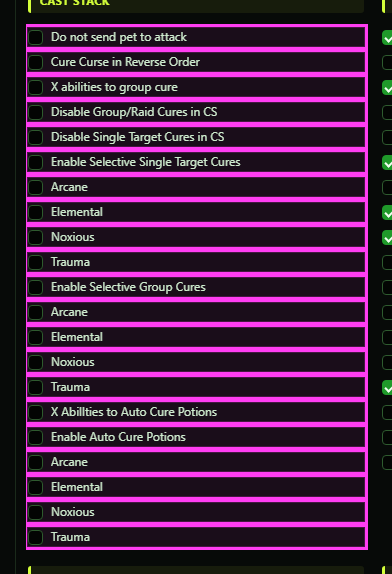](../assets/ogrebot/tab-settings-s5.png "Click for full size")

| Option | What it does | Default |
|---|---|---|
| **Do not send pet to attack** | The bot stops sending your pet at the mob it is fighting, and stops re-aiming the pet when it drifts onto another mob. Your mercenary is handled separately (see Disable Merc Support). *Encounter files can tick this during a fight.* | off |
| **Cure Curse in Reverse Order** | **Not active yet.**  | off |
| **X abilities to group cure** | **Not active yet.**  | off |
| **Disable Group/Raid Cures in CS** | The bot will not choose a group or raid cure when a script or command asks it for an ability, or when it picks an HO ability. The 'cure while stunned' feature on the Other tab also skips group cures. The normal Cast Stack rotation is NOT affected by this box. *Despite 'in CS' (in Cast Stack) in the label, Cure entries on your Cast Stack still cast.* | off |
| **Disable Single Target Cures in CS** | The bot will not choose a player cure when a script or command asks it for an ability, or when it picks an HO ability. The 'cure while stunned' feature on the Other tab also skips single-target cures. The normal Cast Stack rotation is NOT affected by this box. *Some encounter setups tick this expecting it to stop Cast Stack cures; it does not.* | off |
| **Enable Selective Single Target Cures** | Single-target Cure entries on your Cast Stack only cure the types ticked below (Arcane, Elemental, Noxious, Trauma). If none of the ticked types is one that cure removes, or nothing is ticked, that cure is not cast at all. Curse cures are not affected. *While on, the bot also stops choosing player cures for script/command ability requests and HO picks.* | off |
| **Arcane** | With 'Enable Selective Single Target Cures' on, single-target cures may remove Arcane. | off |
| **Elemental** | With 'Enable Selective Single Target Cures' on, single-target cures may remove Elemental. | off |
| **Noxious** | With 'Enable Selective Single Target Cures' on, single-target cures may remove Noxious. | off |
| **Trauma** | With 'Enable Selective Single Target Cures' on, single-target cures may remove Trauma. | off |
| **Enable Selective Group Cures** | Group and raid Cure entries on your Cast Stack only count and cure the types ticked below. A group cure fires only when members have one of those types. *While on, the bot also stops choosing group cures for script/command ability requests and HO picks.* | off |
| **Arcane** | With 'Enable Selective Group Cures' on, group cures count and cure Arcane. | off |
| **Elemental** | With 'Enable Selective Group Cures' on, group cures count and cure Elemental. | off |
| **Noxious** | With 'Enable Selective Group Cures' on, group cures count and cure Noxious. | off |
| **Trauma** | With 'Enable Selective Group Cures' on, group cures count and cure Trauma. | off |
| **X Abillties to Auto Cure Potions** | If you are casting when you need a cure potion (one of the types ticked below is on you and you have a ready potion for it), the bot cancels the cast so the potion can be used. *It only cancels. The drinking is done by 'Enable Auto Cure Potions', so tick both.* | off |
| **Enable Auto Cure Potions** | When you are not casting and carry a ready 'Cure <type>' potion for a detrimental on you, the bot drinks it, checking about twice a second. Only the types ticked below are used. Potions only ever cure yourself. | off |
| **Arcane** | Allows automatic cure potions to be used for Arcane. | off |
| **Elemental** | Allows automatic cure potions to be used for Elemental. | off |
| **Noxious** | Allows automatic cure potions to be used for Noxious. | off |
| **Trauma** | Allows automatic cure potions to be used for Trauma. | off |

## Combat (1 of 2)

[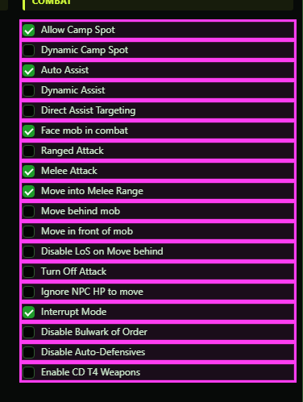](../assets/ogrebot/tab-settings-s6.png "Click for full size")

| Option | What it does | Default |
|---|---|---|
| **Allow Camp Spot** | Allows this character to use a camp spot. When on, the bot returns you to your camp spot when you stray from it. When off, a camp spot cannot even be set on this character, and it never walks back to one. *Scripts and encounters can tick and untick this during a fight; it takes effect at once.* | off |
| **Dynamic Camp Spot** | Shows whether a camp spot is set: the bot ticks it when a spot is set and unticks it when the spot is cleared. Untick it yourself to stop the bot returning to the camp spot without deleting the spot. *Setting a new spot ticks it again.* | off (not saved; the bot sets it) |
| **Auto Assist** | Switches assisting on. While it is ticked, the bot targets for the first available player on the Assist tab, or the player set by an assist command. Unticked, it does not assist at all. *Auto Target, when it is on, takes over from assisting whatever this box says. 'ogre assist' still shows who you would assist while the box is off.* | off |
| **Dynamic Assist** | **Not active yet.** The assist command remembers who to assist on its own; this box is not used or updated. | off (not saved) |
| **Direct Assist Targeting** | Instead of targeting the player you assist (and fighting whatever they have targeted), the bot targets that player's target directly. If that player has no live target, your target is left alone. | off |
| **Face mob in combat** | While the bot is running and you are standing still, it turns you to face the mob you are fighting when you are more than 45 degrees off. It only does this within the 'Melee move when less' distance on the Setup tab (40 if blank). If you are on /follow it drops follow for a moment to turn. | off |
| **Ranged Attack** | When the mob is outside melee reach (or melee is off) and beyond your ranged minimum, the bot switches on ranged auto-attack. *It never turns auto-attack on while you are invisible, stealthed or casting a stealth opener.* | off |
| **Melee Attack** | When the mob is within melee reach, the bot switches on melee auto-attack, and switches back from ranged to melee when the mob closes in. *It never turns auto-attack on while you are invisible, stealthed or casting a stealth opener.* | off |
| **Move into Melee Range** | When the mob is farther away than your melee reach, the bot walks you into melee range. It does this even if you are tanking. It only acts within the 'Melee move when less' distance on the Setup tab (40 if blank), only when no camp spot is active, and only once the mob is at or below '% NPC HP to move into attack range'. | off |
| **Move behind mob** | When the mob is attacking someone else, the bot walks you round to its back, and backs you off if you are standing too close. The same distance, camp spot and health limits as 'Move into Melee Range' apply. *If both this and 'Move in front of mob' are ticked, behind wins.* | off |
| **Move in front of mob** | When the mob is attacking someone else, the bot walks you round to its front, and backs you off if you are standing too close. The same distance, camp spot and health limits as 'Move into Melee Range' apply. *Ignored when 'Move behind mob' is also ticked.* | off |
| **Disable LoS on Move behind** | Normally the bot will not move you behind, in front of, or up to the mob if a wall or obstacle is in the way. Tick this to skip that line-of-sight check for all three moves. | off |
| **Turn Off Attack** | While auto-attack is on but you no longer have a valid mob to attack (it died, is gone, or is above the '% NPC HP to attack' threshold), the bot switches auto-attack off. It checks twice a second. | off |
| **Ignore NPC HP to move** | The combat moves (behind, in front, into melee range) ignore the '% NPC HP to move into attack range' setting on the Setup tab and start as soon as you have a mob you can attack. | off |
| **Interrupt Mode** | **Not active yet.**  | off |
| **Disable Bulwark of Order** | Fighters: the bot normally watches chat for a mob announcing a big hit and casts Bulwark of Order timed to meet it. Tick this to stop it answering new warnings. A Bulwark already counting down still goes out. | off |
| **Disable Auto-Defensives** | **Not active yet.**  | off |
| **Enable CD T4 Weapons** | **Not active yet.**  | off |

## Combat (2 of 2)

[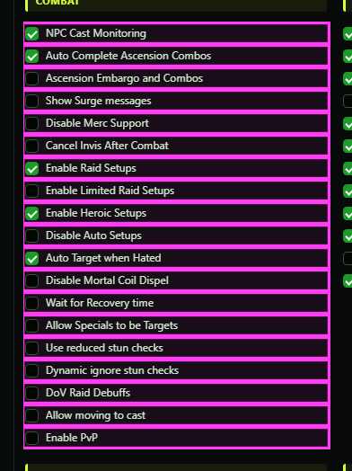](../assets/ogrebot/tab-settings-s7.png "Click for full size")

| Option | What it does | Default |
|---|---|---|
| **NPC Cast Monitoring** | The bot watches nearby mobs for the spells they start casting. Zone data and encounter files use this to react, for example with an interrupt. Off means no scanning and no reactions. *When a zone or encounter asks for a watch, the bot ticks this for you. It never unticks it, so your own untick sticks.* | off |
| **Auto Complete Ascension Combos** | **Not active yet.**  | off |
| **Ascension Embargo and Combos** | **Not active yet.**  | off |
| **Show Surge messages** | **Not active yet.**  | off |
| **Disable Merc Support** | The bot stops sending your mercenary to attack the mob you are fighting (and stops pulling it back off other mobs). | off |
| **Cancel Invis After Combat** | When you are invisible, out of combat and have no mob left to attack, the bot cancels your invisibility. | off |
| **Enable Raid Setups** | In raid zones, the bot runs the encounter setups written for that zone's fights (setup, triggers and mechanics). When off, no raid encounter setup runs automatically and you cannot start one by hand. *If a setup already ran for a mob, its clean-up still runs when that mob dies, even after you untick this.* | off |
| **Enable Limited Raid Setups** | **Not active yet.**  | off |
| **Enable Heroic Setups** | The same as 'Enable Raid Setups', but for every zone that is not a raid zone (heroic, solo and so on). | off |
| **Disable Auto Setups** | **Not active yet.**  | off |
| **Auto Target when Hated** | When you have no target at all, the bot looks about once a second for a mob within 30 meters (and roughly your height) that is attacking someone in your group, and targets it. | off |
| **Disable Mortal Coil Dispel** | Mages: the bot normally dispels the 'Mortal Coil' buff from named mobs in range with your dispel ability. Tick this to stop it. *'No Dispels' on the Settings tab also stops it.* | off |
| **Wait for Recovery time** | Normally the bot picks the next ability the moment a cast lands, queuing it during the recovery time. Tick this to make it wait out each ability's recovery time (minus 0.2 seconds) first. Items are not affected. | off |
| **Allow Specials to be Targets** | **Not active yet.**  | off |
| **Use reduced stun checks** | The Cast Stack decides you are stunned when you cannot turn, or when your Mining ability is not ready. Tick this to drop the 'cannot turn' test, so being unable to turn alone no longer stops casting. | off |
| **Dynamic ignore stun checks** | While ticked, the Cast Stack skips its stun tests entirely and tries to cast even if you look stunned. *Meant for encounter scripts, for fights where the game falsely reports a stun.* | off (not saved; clears on reload) |
| **DoV Raid Debuffs** | When chat says the Destiny of Velious (DoV) raid debuff is about to expire on a mob, the bot re-casts your archetype's DoV raid debuff on it. | off |
| **Allow moving to cast** | Lets the bot move you into range to cast the Destiny of Velious (DoV) raid debuff, when the request to cast it does not say otherwise. | off |
| **Enable PvP** | **Not active yet.**  | off |

## Tab Enables

[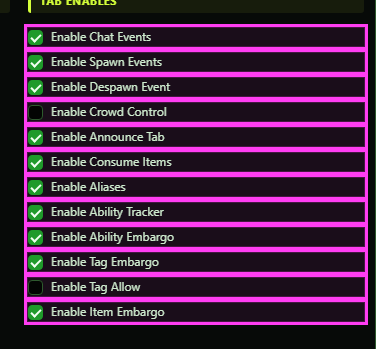](../assets/ogrebot/tab-settings-s8.png "Click for full size")

| Option | What it does | Default |
|---|---|---|
| **Enable Chat Events** | Turns on the Chat Events tab. When a chat line matches one of its rows, the bot does that row's actions: send a line to OgreConsole, play a sound, and/or run a command. When off, chat lines are not watched at all. | off |
| **Enable Spawn Events** | Turns on the Spawn Events tab. When something matching one of its rows appears nearby, the bot does that row's actions (OgreConsole line, sound, command). | off |
| **Enable Despawn Event** | Turns on the Despawn Events tab. When something matching one of its rows disappears, the bot does that row's actions (OgreConsole line, sound, command). | off |
| **Enable Crowd Control** | **Not active yet.** Crowd control (mezzing) has not been built yet. | off |
| **Enable Announce Tab** | Turns on the Announce tab, so the bot announces the abilities listed there when you use them. | off |
| **Enable Consume Items** | Turns on the Consume Items tab, so the bot automatically uses the items listed there (following that tab's zone and combat rules). When off, the consume-items command also does nothing. | off |
| **Enable Aliases** | Turns on your custom aliases from the Aliases tab (names starting with *), so commands and Cast Stack targets can use them. When off, custom aliases resolve to nobody. The built-in @ slots such as @Tank are not affected. | off (the Cast Stack target dropdown treats a never-saved box as on) |
| **Enable Ability Tracker** | Turns on the Ability Tracker tab. About twice a second the bot reads the cooldowns of the abilities listed there and shares them, for example with the OgreMCP cooldown buttons. | off |
| **Enable Ability Embargo** | **Not active yet.**  *Embargoes sent by commands or other characters are still honoured whether or not this is ticked.* | off |
| **Enable Tag Embargo** | **Not active yet.**  *Tag embargoes are still honoured by the Cast Stack whether or not this is ticked.* | off |
| **Enable Tag Allow** | **Not active yet.**  *Tag allows are still honoured by the Cast Stack whether or not this is ticked.* | off |
| **Enable Item Embargo** | **Not active yet.**  | off |

## Pop up windows

[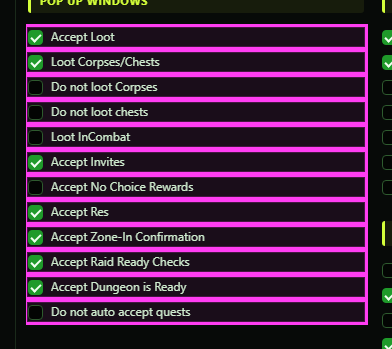](../assets/ogrebot/tab-settings-s9.png "Click for full size")

| Option | What it does | Default |
|---|---|---|
| **Accept Loot** | Lets the bot answer loot windows, using the choices on the Loot tab (for example lotto accept or decline, and free-for-all accept). When off, loot windows are left for you. | off |
| **Loot Corpses/Chests** | While out of combat, the bot loots corpses and chests, and picks up shinies, that are already within reach. It does not walk to them. It also turns on a fix for mobs that get stuck in a 'dead but not lootable' state, by using the Loot action on them. *Shinies can be switched off on the Loot tab.* | off |
| **Do not loot Corpses** | When looting is on, corpses are skipped. Chests and shinies are still looted. | off |
| **Do not loot chests** | When looting is on, chests are skipped. This also applies to the Instance Controller's chest-looting step. | off |
| **Loot InCombat** | Lets the bot loot corpses, chests and shinies within reach while you are in combat. It is separate from 'Loot Corpses/Chests', which only covers out of combat, so tick both to loot at all times. | off |
| **Accept Invites** | Accepts group and raid invites from characters on your EQ2Chars list. With the Other tab's option for anyone in range also on, it accepts invites from any nearby player. | off |
| **Accept No Choice Rewards** | When a reward window appears that offers only one reward and nothing to choose, the bot accepts it. New quest offers and reward windows with choices are left alone. | off |
| **Accept Res** | When someone offers you a resurrect, the bot waits the time set in 'Wait __ 10ths/second to accept RES' on the Setup tab, then accepts, but only if you are still dead and the window is still open. | off |
| **Accept Zone-In Confirmation** | Accepts the 'Do you wish to enter and apply the associated lockout?' prompt when you zone into an instance. | off |
| **Accept Raid Ready Checks** | Accepts raid ready checks automatically. | off |
| **Accept Dungeon is Ready** | Accepts dungeon finder 'Dungeon: ... is ready' pop-ups and Battle for Felwithe match prompts. It also accepts group-option votes started by characters on your EQ2Chars list. | off |
| **Do not auto accept quests** | By default the bot accepts every quest offered to you. Tick this to stop that. The accept-quest command also respects it. *The Get Quest tool ticks this for itself while it runs and puts it back afterwards.* | off (so quests ARE auto-accepted) |

## On Load

[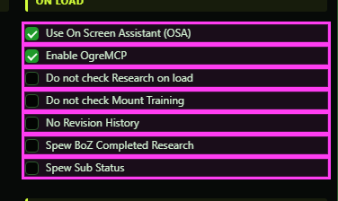](../assets/ogrebot/tab-settings-s10.png "Click for full size")

| Option | What it does | Default |
|---|---|---|
| **Use On Screen Assistant (OSA)** | Opens the On Screen Assistant window when the profile loads, and whenever you tick the box. Unticking it closes the window. | off |
| **Enable OgreMCP** | Opens the OgreMCP panel each time the profile loads. | off |
| **Do not check Research on load** | By default the bot checks ability research when the profile loads and when a 'Research of ...' finished message appears, claiming finished research and starting the next ability from your Ability Research list. Tick this to stop those automatic checks. | off (so research IS checked) |
| **Do not check Mount Training** | **Not active yet.** The bot does not check mount training on load; the manual mount-training command still works. | off |
| **No Revision History** | **Not active yet.**  | off |
| **Spew BoZ Completed Research** | **Not active yet.** The Ballads of Zimara (BoZ) research readout exists as a manual command only. | off |
| **Spew Sub Status** | **Not active yet.**  | off |

## On Zone

[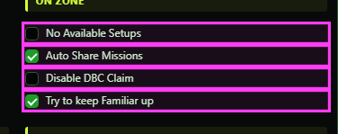](../assets/ogrebot/tab-settings-s11.png "Click for full size")

| Option | What it does | Default |
|---|---|---|
| **No Available Setups** | On zone-in the bot normally lists the fights in this zone that have encounter setups. Tick this to hide that automatic message. Asking for the list yourself still shows it. | off |
| **Auto Share Missions** | Shortly after zoning in, if you are the group leader, the bot shares your quests and missions for this zone with the group. This works even while the bot is paused. | off |
| **Disable DBC Claim** | **Not active yet.**  | off |
| **Try to keep Familiar up** | **Not active yet.** After every zone-in to an instance (not overland, not a guild hall) the bot summons your familiar. If it was already up that dismisses it, and the 'Your Familiar has been dismissed' message makes the bot summon it again - so it is up either way. Any other time that message appears, it is summoned again too, with a message on the console and in OgreConsole. Adventure level 100 and up (read once when OgreBot loads). | off |

## Unorganized

[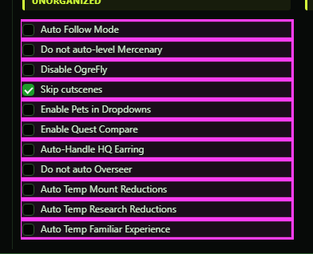](../assets/ogrebot/tab-settings-s12.png "Click for full size")

| Option | What it does | Default |
|---|---|---|
| **Auto Follow Mode** | Allows the force-follow command to start the game's own /follow on the character named in 'Auto Follow:' on the Setup tab; when off, that command does nothing. The box does not start following on its own. *It will not follow a character who is dead or nearly dead.* | off |
| **Do not auto-level Mercenary** | **Not active yet.**  | off |
| **Disable OgreFly** | When following, the bot normally takes off, flies at the leader's height and lands with them. Tick this to keep following on the ground only. Swimming to the leader's depth still works. | off |
| **Skip cutscenes** | **Not active yet.**  | off |
| **Enable Pets in Dropdowns** | **Not active yet.**  | off |
| **Enable Quest Compare** | Makes this character the group's quest reference. When one of its quests updates, the bot asks the rest of the group whether they are on the same step and reports anyone who differs. Ticking it opens the Quest Compare window and unticks it on the rest of the group, so there is only one reference. | off |
| **Auto-Handle HQ Earring** | **Not active yet.**  | off |
| **Do not auto Overseer** | Stops the automatic Overseer run from starting on this character. A run already in progress is not interrupted. | off |
| **Auto Temp Mount Reductions** | **Not active yet.**  | off |
| **Auto Temp Research Reductions** | **Not active yet.**  | off |
| **Auto Temp Familiar Experience** | **Not active yet.**  | off |

