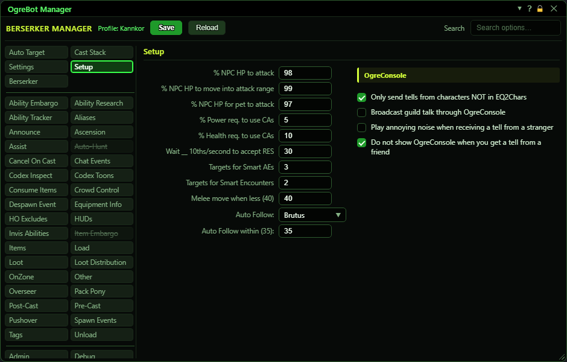
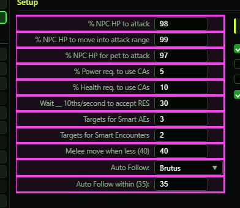
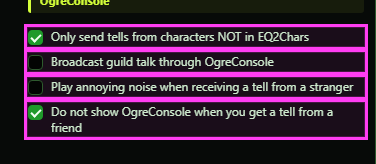

**OgreBot is in beta testing.** Looking for OgreBot Classic? [Click here](../../index.md).

# Setup

Setup holds the numbers that tune when the bot fights: how hurt a mob must be before you attack it, move to it or send your pet, how much health and power you keep before using attacks, and how many mobs an area attack needs. It also names who the Force Follow command follows. The right-hand column controls how tells and guild chat reach OgreConsole. Blank boxes use the default shown in each description.

## Setup

| Option | What it does | Default |
|---|---|---|
| **% NPC HP to attack** | The bot only attacks a mob once its health is at or below this percent. It covers Cast Stack attacks (CA and Debuff types), moving into combat position, Turn Off Attack and Cancel Invis After Combat. *A Cast Stack entry with its own 'NPC HP' condition ignores this box.* | blank (counts as 100 - any health) |
| **% NPC HP to move into attack range** | The move options on Settings (move behind, in front, or into melee range) only start once the mob's health is at or below this percent. Once movement has started for a fight, it carries on until there is nothing left to attack. *'Ignore NPC HP to move' on Settings skips this check.* | blank (counts as 100 - any health) |
| **% NPC HP for pet to attack** | Your pet and your mercenary are only sent in once the mob's health is at or below this percent. *'Do not send pet to attack' on Settings stops the pet entirely.* | blank (counts as 100 - any health) |
| **% Power req. to use CAs** | The Cast Stack uses no attack abilities (CA and Debuff types) while your power is below this percent. *A Cast Stack entry with its own 'My MP' condition ignores this box.* | blank (0 - no limit) |
| **% Health req. to use CAs** | The Cast Stack uses no attack abilities (CA and Debuff types) while your health is below this percent. *A Cast Stack entry with its own 'My HP' condition ignores this box.* | blank (0 - no limit) |
| **Wait __ 10ths/second to accept RES** | When someone offers you a resurrection and 'Accept Res' on Settings is ticked, the bot waits this long before accepting, in tenths of a second (10 = 1 second). It then accepts only if you are still dead and the offer is still open. | blank (accepts straight away) |
| **Targets for Smart AEs** | How many mobs must be in range before the bot uses a point-blank or targeted area attack, while 'AE Smart CAs' on the Settings tab is ticked. *A Cast Stack entry's own '# of mobs' overrides this.* | blank (counts as 2) |
| **Targets for Smart Encounters** | How many mobs the linked encounter must have before the bot uses an encounter-wide attack, while 'Encounter Smart CAs' on the Settings tab is ticked. A single mob never qualifies. *A Cast Stack entry's own '# of mobs' overrides this; a '# of mobs' of 1 always allows it.* | blank (counts as 2) |
| **Melee move when less (40)** | The move options on Settings only move you when the mob is closer than this distance. 'Face mob in combat' only turns you toward mobs within this distance too. | blank (counts as 40) |
| **Auto Follow:** | The group member the `-forcefollow` command follows, using the game's own follow. It only works while 'Auto Follow Mode' on Settings is ticked, and only if that person is in your group and alive. *The list shows your group and raid members. Nothing follows automatically; the command has to be sent.* | empty |
| **Auto Follow within (35):** | **Not active yet.** It is meant to be the distance for auto follow. | blank |

## OgreConsole

| Option | What it does | Default |
|---|---|---|
| **Only send tells from characters NOT in EQ2Chars** | Every tell this character receives is shown in OgreConsole on all your sessions. Tick this to send only tells from strangers, meaning characters not in your EQ2Chars list. | off (every tell is sent) |
| **Broadcast guild talk through OgreConsole** | Guild and officer chat that this character sees is sent to OgreConsole on all your sessions, as 'name -> <Guild>: text'. *Tick it on one character per guild, or each line arrives once for every character that has it on.* | off |
| **Play annoying noise when receiving a tell from a stranger** | When a broadcast tell from a stranger (someone not in the receiving character's EQ2Chars list) reaches this session, a loud alarm sound plays. *It is read on the session that plays the sound, not on the character that got the tell.* | off |
| **Do not show OgreConsole when you get a tell from a friend** | Normally OgreConsole opens when a broadcast tell arrives. Tick this so it only opens for tells from strangers, not from characters in EQ2Chars. *The 'never auto open OgreConsole' option still wins over this.* | off (opens for every tell) |

## Good to know

- All the percentage boxes compare the MOB's health (or yours) to the number: 'at or below' for the mob boxes, 'at or above' for your own health and power.
- 'Attack NPC with 100% HP' on the Settings tab switches off the attack and pet mob-health boxes in one go. 'Ignore NPC HP to move' on Settings does the same for the move box.
- Auto Follow does nothing on its own. It only sets who the `-forcefollow` command follows, and only when 'Auto Follow Mode' on Settings is ticked.
- The OgreConsole boxes about sound and opening the console are read on the session that RECEIVES the broadcast tell, not on the character that got the tell.

