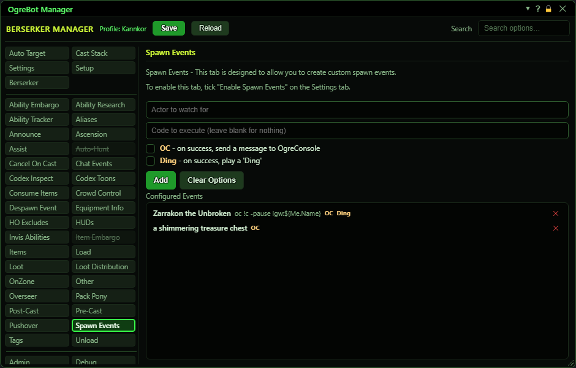

# Spawn Events

**OgreBot is in beta testing.** Looking for OgreBot Classic? [Click here](../../index.md).

Spawn Events works like Chat Events, but it watches for things appearing around you instead of chat. When something appears whose name contains your text, the bot can run a console command, post a line to OgreConsole, play a 'Ding' sound, or any mix of the three. Nothing happens until you tick "Enable Spawn Events" on the Settings tab. Build events with the boxes at the top; they appear in the Configured Events list below.

| Option | What it does | Default |
|---|---|---|
| **Configured Events** | Your spawn events. Click a row to edit it, double-click to switch it off or on, drag a row to reorder, and click X to delete it. *A switched-off row is kept but never fires. Every active row is checked, so the order does not matter.* | empty |

## Add an event

| Control | What it does | Default |
|---|---|---|
| **Actor to watch for** | Part or all of the name to watch for. The event fires when something with a matching name appears. Upper and lower case must match exactly. *Required. An event with no name cannot be added.* | empty |
| **Code to execute (leave blank for nothing)** | A console command to run when a match appears. It runs exactly as if you typed it into the InnerSpace console. Leave it blank if you only want the OC line or the Ding. | empty |
| **OC - on success, send a message to OgreConsole** | When a match appears, a line goes to OgreConsole saying which character saw it, the text it matched and the full name of what appeared. | off |
| **Ding - on success, play a 'Ding'** | When a match appears, a 'Ding' sound plays on this PC. | off |
| **Add** | Adds the event to the list below. Pressing Enter in either text box does the same. While you are editing a row this button reads Update and saves your changes to that row. |  |
| **Clear Options** | Unticks OC and Ding. Ticks otherwise carry over to the next event you add. |  |
| **Cancel** | Only shown while editing a row. Stops editing without changing the row. |  |

## Good to know

- Nothing here works until "Enable Spawn Events" is ticked on the Settings tab.
- The name match is case-sensitive: "vindicator" does not match "a Vindicator". Copy the name exactly as the game shows it. Part of the name is enough.
- It fires when something comes into your view, not only for a fresh spawn. Things that were already around when OgreBot was loaded do not fire.
- An event with no command, no OC and no Ding is ignored, and the console prints a warning about it.
- The OC and Ding ticks stay ticked for the next event you add. Use Clear Options to untick them.
- Spawn Events keep working while OgreBot is paused.

