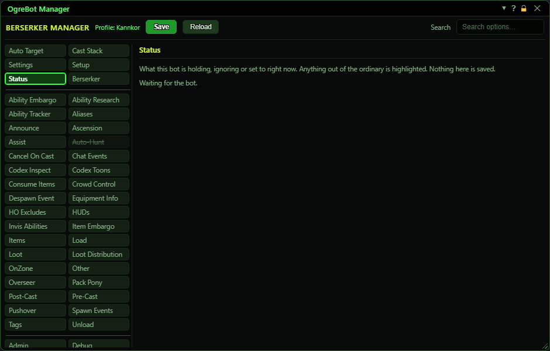

# Status

**OgreBot is in beta testing.** Looking for OgreBot Classic? [Click here](../../index.md).

Status shows what this bot is holding, ignoring or set to right now, grouped by topic: whether it is paused, why it is or is not assisting, whether Auto Target is suppressed, No Move and the camp spot, who it is following, which fighters are not being counted, and what is disabled in the Cast Stack. Anything out of the ordinary is highlighted. Nothing on this tab is saved. When something is holding up another tab, that tab gets an amber dot in the tab list, which you can see from any tab, and a Held line beside its title. Hover the dot to see why. If a player or a script set the hold, the Held line has a Release button. Holds the bot sets itself end on their own.

## Good to know

- The tab updates about twice a second while the OgreBot window is open.

